# NocTORnal: the analyst and operator manual

> Beta 1.5 (v0.9.5-beta). Beta software. See [README.md](README.md) for the legal status: five decisions, L1 to L5, gate any use against real material, and until they are made this manual is for use on synthetic or published, non-personal data only.

### About this manual

This is the long answer. The console keeps its own text short: a pane opens on its work, a field carries a label and, where the format or the consequence is not obvious, one hint. What a method does, why a number is what it is, why the tool refuses you, and who can undo what, are written down here.

**If you are new,** read Part I and Part II once, then read a pane's chapter in Part III when you first use that pane. **If you are looking something up,** use the Contents, the Glossary (Appendix A), the table of refusals (Appendix K) or Troubleshooting (Appendix L). **If you run the deployment,** Part IV is yours, and the checklists in Appendix G and J are the ones you will use most.

First time on a machine? [START-HERE.md](START-HERE.md) installs it in about fifteen minutes and is the page to follow before this one. [INSTALL.md](INSTALL.md) has the longer version, with every failure it knows of.

#### How the manual writes

- **Bold** is a label you will see on screen: a button, a tab, a field. `Code` is a value you type or read, a setting, or a file. <kbd>Keys</kbd> are keys.
- A role is written the way the console shows it, Lead investigator or Security officer, with its key in code (`CASE_OWNER`, `SECURITY_OFFICER`) the first time it matters. Appendix B lists every role and what it holds.
- Four words are used for one thing each, in every pane: an **entity** (a person, persona, group, wallet, host), a **relationship** between two entities (the Add link pane calls it a **link**), an **assertion** (a claim, with its source, grading and confidence), and an **exhibit** (one item of evidence). The **view** is the projection, said in the words of its controls.
- All times are UTC unless a line says otherwise, and the console says so wherever a time is shown.
- Every example comes from the showcase case, **OP-SHOWCASE-26**, a TLP:CLEAR case in which every actor, handle, domain and phone number is invented, and the pictures are taken from it. The README's first-run recipe seeds it. The installer offers a smaller case, Operation Latticework (`OP-LATTICEWORK-26`), which shows the same things on fewer people.

#### What this edition changed

Beta 1.5 closes the findings of a code review and leaves every screen as it was; its changes are in the changelog. The screens went quiet in Beta 1.4. Every explanatory paragraph that used to open a pane was cut to a line, or removed, and its content moved here. If a screen no longer explains itself, that is deliberate and the explanation is in the chapter for that pane. Nothing that protects somebody was removed: a legal warning, a destruction warning, and the notices that keep you from misreading a number are still on screen, in one sentence each.

---

## Part I. Getting started

>> Who this is for, how to sign in, how the console is laid out, and one case worked from the first entity to the finished report.

### 1. What NocTORnal is for

Analysts who work organised cybercrime spend most of their time on a question that is social, not technical: **who trusts whom, and why?** Which broker vouched for which affiliate. Which escrow both sides accept. Which handle on this forum is the same human as that handle on that channel, and how sure is anyone.

NocTORnal is the case system for that work. It holds a graph of **entities** (handles, groups, people, wallets, infrastructure) and the **relationships** between them, and it refuses to hold anything it cannot trace. Every line on the graph comes from a claim; every claim names its source, carries a grade you gave it, and should point at an exhibit, the captured page, file or message that backs it. Ask any element on the chart "why do you say that?" and you get a chain back to a locked exhibit with an unbroken custody log.

That one rule changes what the tool is for. A link chart is a picture of what somebody believed. This is a case file that survives disclosure.

#### What it is not

- **It does not decide.** It scores, ranks and proposes. Every statement in the case has an analyst's name on it.
- **It is not a collection platform that acts on its own.** Collection runs only where a person has recorded written authority and a second person has confirmed it, and the production stack polls due sources on a schedule, and **Poll now** polls one source at once.
- **It is not multi-tenant.** One deployment is one organisation. Isolation inside it is by case, classification and compartment (Chapter 7).
- **It is not audited, and it is not legal advice.** See the box below.

> **Warning.** This is a beta. It has not had an independent security audit, and some features refuse to work until a legal decision is recorded: uploading malware samples is the first of them. Holding real case material is dangerous in itself, because possession can be an offence and stealer and breach data makes you the custodian of thousands of uninvolved people. Until counsel has worked through docs/18, use synthetic data or published reporting that contains no personal data.

#### The five ideas everything else follows from

If a behaviour seems obstructive, it is usually one of these being enforced.

**1. Nothing is a fact.** Every attribute and every relationship traces to an *assertion*: a claim, with a source, an Admiralty grading and a time. There is no way to add anything to the graph without one. When you are asked for a source and a grade, that is not paperwork. It is the record that makes the element defensible later.

**2. A handle is not a person.** An `IDENTITY` (a persona, what you observed) and a `PERSON` (an assessed human, what you concluded) are different kinds of entity. They are joined by an `ATTRIBUTED_TO` relationship that carries a confidence, and the join is reversible. You cannot merge a persona into a person: that is attribution, which is an assessment, and collapsing the two destroys the gap the model exists to preserve.

**3. Machines propose, analysts dispose.** Extractors, importers and inference jobs write to the triage queue, never to the graph. Accepting a proposal is you making the claim.

**4. Inferred is visually and structurally distinct.** Inferred relationships draw **dashed** and are counted in metrics only while the view includes them (the console opens with **Include inferred** ticked). Hold <kbd>space</kbd> on the graph to hide them: the fastest way to see how much of a picture is assessment rather than evidence.

**5. Classification gates every way out.** Email, webhook, export, report: all pass through one check. `AMBER_STRICT` and `RED` never leave the boundary, whatever anybody clicks.

The twelve invariants that the code enforces, of which these are the visible half, are listed in the README.

#### The five legal items

| | What is built | What has to be true before real material goes in |
|---|---|---|
| **L1** | A sample store that ingests attacker-supplied binaries | A prohibited-content policy, written with counsel, covering preservation against destruction. |
| **L2** | Stealer-log ingest holding data on thousands of uninvolved people | A lawful basis, an understanding of victim-notification duties, and a retention period that is real. |
| **L3** | A persona vault that can drive a covert account into a forum | That operating each persona is authorised in each jurisdiction. |
| **L4** | Message-level capture, including group channels and call recordings | That interception law, consent and retention of third parties' content are settled. |
| **L5** | Web capture of phishing infrastructure | That fetching attacker infrastructure is authorised, and separately that entering any input into a phishing page, canary credentials included, is covered. |

Several screens refuse to act until the matching declaration is recorded. The refusal is the feature. The console cannot tell whether a declaration is true; it can only record that somebody made it, and it says so on the Readiness page (Chapter 28).

### 2. Signing in

Signing in takes two things: **your password** and **a six-digit code from an authenticator app** (any TOTP app: Aegis, 1Password, Google Authenticator, Microsoft Authenticator). The code changes every 30 seconds and works once.

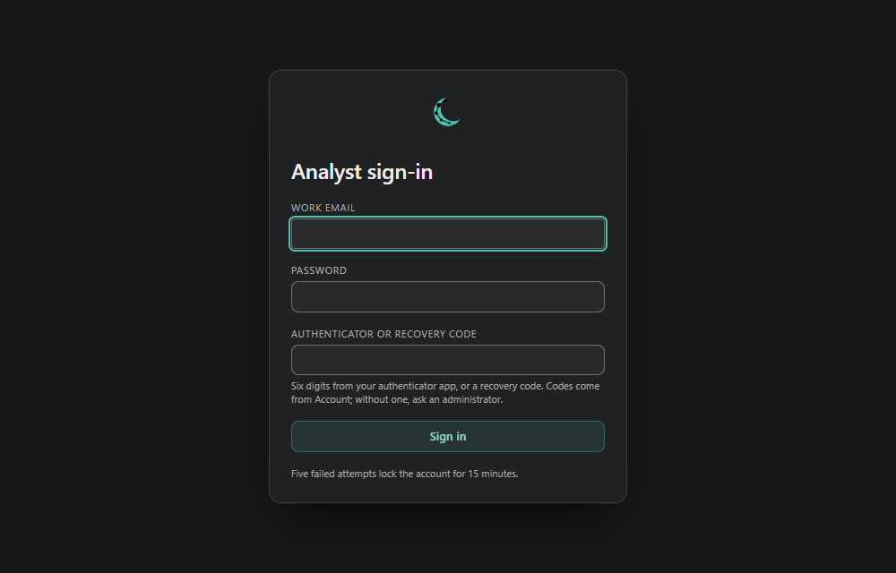

#### The first administrator

A new deployment has no accounts. Its first page offers to **create the first administrator**, and it asks for the value of `NOCTORNAL_SETUP_TOKEN`, which the person running the server set. This door closes permanently once the first account exists.

1. Enter your email and a display name, and the setup token.
2. The page then shows a generated **password** and an **authenticator secret**, once, as text and as a QR code. They are not recoverable. Have an authenticator app ready, scan the code, and save the password somewhere safe.
3. Sign in on the same page with them. They stay on screen until that works, so a mistyped secret is caught while it can still be fixed.
4. The page then shows your **recovery codes**, once. Save them.

If you leave before saving the password and the secret, the console asks first: without them this administrator cannot sign in and first-run setup does not come back. The only way in then is a shell on the server with `python scripts/bootstrap.py`.

#### A normal sign-in

Enter your email, your password and the code from your app. A recovery code can stand in for the app code.

- **A code works once.** Two sign-ins inside the same 30-second step fail on the replay guard, not on the code. Wait for the next code.
- **The time on your phone matters.** A code is a function of the clock. The server allows 30 seconds either way. If your code keeps failing and the secret is right, set the phone to take its time automatically. An operator can check which side is wrong with `python scripts/bootstrap.py totp-diagnose --email you@example.org --code 123456`.
- **Five failed attempts lock the account for 15 minutes.** A locked account answers "invalid credentials" even with the right password, on purpose, so the lock cannot be used to find out which accounts exist. An administrator can unlock it sooner: Administration, Accounts, the account's card, **Unlock**.

#### Recovery codes

A recovery code signs you in once, in place of an authenticator code: for a lost phone, or a clock that has drifted. They look like `xxxxx-xxxxx-xxxxx`.

- You issue your own from **Account** (your name, top right) while signed in. A new set replaces any earlier one, and it needs a sign-in from the last 15 minutes.
- A recovery code is used up only when you finish choosing a new password, so one you just used to reset a password still works if the reset did not complete.
- With neither your app nor a recovery code, an administrator can re-enrol your authenticator: Administration, Accounts, **Re-enrol TOTP**. Their old secret stops working at once.

#### A password an administrator issued

An administrator can reset your password. What they issue is a one-time password: it opens no session. At your next sign-in the console asks you to choose your own before it lets you in, and the one-time password is not used again. Passwords need at least 12 characters, and length is the only rule: a long phrase is better than a short mix of symbols. Choosing a new password signs out your other sessions and keeps this one.

#### How long a session lasts

A session ends after **30 minutes without activity**, or **12 hours** after you signed in, whichever comes first. When it does, anything you had typed but not saved stays on screen, but saving it needs a fresh sign-in, and the console says plainly when a change you just made was **not** saved. Some actions need more than a valid session: merging, exporting, purging, downloading a sample, and most administration ask for a **sign-in from the last 15 minutes** ("step-up"). When the last one is older, the pane asks again in place and nothing else on screen changes.

> **Warning.** If the console is reached over plain HTTP at an address that is not this computer, your password and code are accepted but the browser refuses to keep the sign-in, because the session cookies are marked Secure. Nothing is opened, and no error says so beyond a line on the sign-in form. Use the HTTPS address, or reach the console at `localhost`.

### 3. The console at a glance

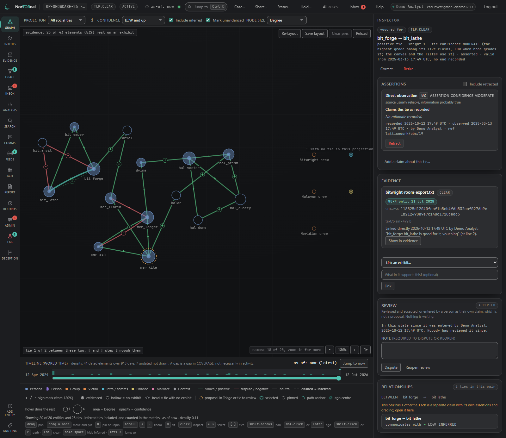

#### The rail

The column down the left is the rail. Each tile opens a pane. A badge on a tile is a count of work waiting: **Triage** counts suggestions awaiting review, **Inbox** counts unread notifications and stays up while an urgent one is not acknowledged, **Admin** counts blocking checks that fail, and **Lab** counts samples in the queue. The rail caption is the name the palette answers to.

| Tile | What it opens | Chapter |
|---|---|---|
| Graph | The sociogram | 11 |
| Entities | Every entity in the case, and the inspector | 12 |
| Evidence | Exhibits, custody and holds | 13 |
| Triage | Machine suggestions waiting for you, and second-signature requests | 14 |
| Inbox | Notifications | 15 |
| Analysis | Centralities, brokers, communities, key players, roles | 16 |
| Search | One box over entities, exhibits, claims and documents | 17 |
| Comms | Channels, identifiers, signatures | 18 |
| Feeds | Ingest, dead letters, sources, watches, keys | 19 |
| ACH | Competing hypotheses | 20 |
| Report | Build a document and ask whether it may leave | 21 |
| Records | Retention, destruction, break-glass, audit, lookups | 22 |
| Admin | Administration (or **Oversight** for a reviewer) | 28 to 34 |
| Lab | Malware samples | 23 |
| Deception | Web captures, email, calls | 24 |
| Add entity, Add link | The two forms that write the graph | 25 |

#### The case strip

Along the top, left to right: the case you have open with its **TLP** label and **status**; the **as-of** control (Chapter 8); the live-channel dot; **Jump to** (<kbd>Ctrl</kbd> <kbd>K</kbd>); then **Case...** (the case record), **Share...** (who is on it), **Status...** (move it between draft, active, dormant, closed, archived), **Hold...** (legal hold on the whole case), **All cases**, **Inbox**, **Help**, your account, and **Log out**.

The **live dot** is the channel that brings other analysts' changes to you without a refresh. Green means it is connected. Grey means it is not, and you should refresh by hand. It is a convenience, never a correctness feature: the data is the same either way, and the console says "Paused while nobody is using this console" when it has stopped on purpose so that your session can still time out.

When the case is not in an ordinary working state a line under the strip says so. A **draft** case has not been opened for work: move it to active before working it. A **dormant** case was put to sleep: reactivate it before adding material, so the record shows when work resumed. A **closed** case is read-only: its graph, evidence, captures, proposals, comms, analysis, tags and samples cannot be changed and the controls that would change them are off, while status, legal holds, retention, sharing and break-glass still work. An **archived** case is a record, not a workspace: read-only, and it cannot be reopened.

#### The palette and the keyboard

<kbd>Ctrl</kbd> <kbd>K</kbd> opens **Jump to**: type to reach a pane, a case or an entity. <kbd>?</kbd> opens the keyboard map (Appendix C), including the sociogram's keys and the single-letter triage keys, which can be turned off there.

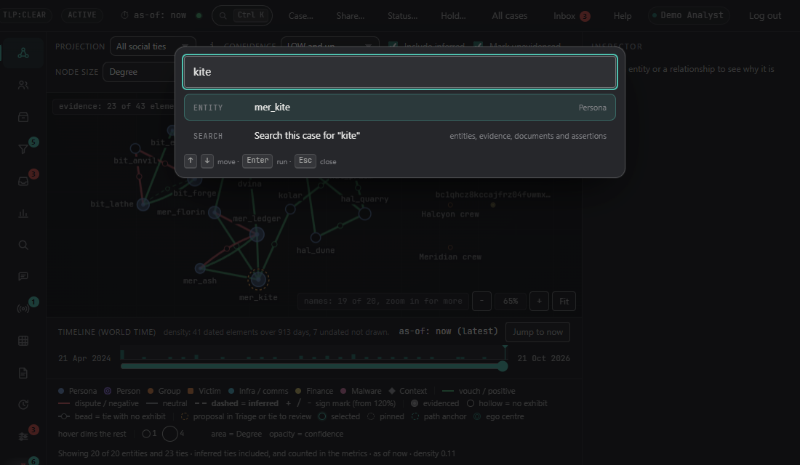

#### The inspector

The panel on the right is the **inspector**. Select an entity or a relationship anywhere and it shows **why it is believed**: its claims, each with its basis, grade and exhibit, its history, and what you may do next. The inspector is the same everywhere; Chapter 12 describes it in full.

#### The case list

**All cases** is the list of cases you may open, with **New case**. Everything in the console is scoped to one open case, except Administration, Oversight and the notification inbox, which cover the deployment.

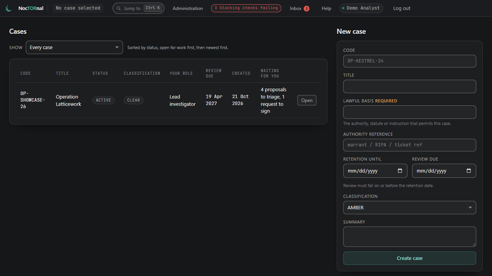

### 4. Your first case, start to finish

This chapter walks one small case through every step that matters, so the other chapters have something to hang on. It assumes an account that can create cases (a Lead investigator, `CASE_OWNER`). If you loaded a demonstration case (Operation Latticework from the installer, or the showcase case from the README's first-run recipe), open it beside this chapter and follow along; everything here is visible in either.

#### Step 1: open the case

**All cases** shows the list with the **New case** form beside it (the figure in Chapter 3). A case needs:

- a **code** and a **title**. The code is intelligence: it is in notification subject lines unless the notification is above what email may carry, when the subject is a stub with no code, and a report prepared below the case's level leaves it out with the rest of the header;
- a **lawful basis**: the authority, statute or instruction that permits this case. It is recorded on the case and shown on a report whenever the case header is within the level prepared at;
- a **classification** (TLP: `CLEAR`, `GREEN`, `AMBER`, `AMBER_STRICT`, `RED`), which can later be raised but not lowered;
- a **retention** date and a **review** date. Retention can only be extended, and extending it lengthens the storage lock on every exhibit permanently, so check the year. Review must fall on or before retention.

A case starts as a **draft**. Move it to **active** from **Status...** before working it.

#### Step 2: add an entity, with a claim

Open **Add entity**. Choose the type (a persona is an `IDENTITY`, a human you have assessed is a `PERSON`; never record one as the other), give it a label and a classification, and then make the claim that justifies its existence:

- **Basis**: direct observation, third-party report, analyst inference, automated inference, self claim, or legal process. An inference must state its reasoning, in the rationale; the server rejects one that does not.
- **Confidence** in ICD 203 words: low, moderate or high.
- **Source reliability** from A to F and **information credibility** from 1 to 6 (Chapter 5). Nothing is preselected: you grade the claim yourself, so an ungraded claim cannot pass for a graded one.
- An **exhibit**, optional but the difference between a defensible claim and an opinion. Upload on **Evidence** first to see it listed here.
- **Observed at** (UTC) and a **source reference**, for example `Received hop 2`.
- A **valid interval**: calendar days in UTC, blank if there is no known start or end. This drives the timeline scrubber and trust decay; it is not when you recorded the claim.

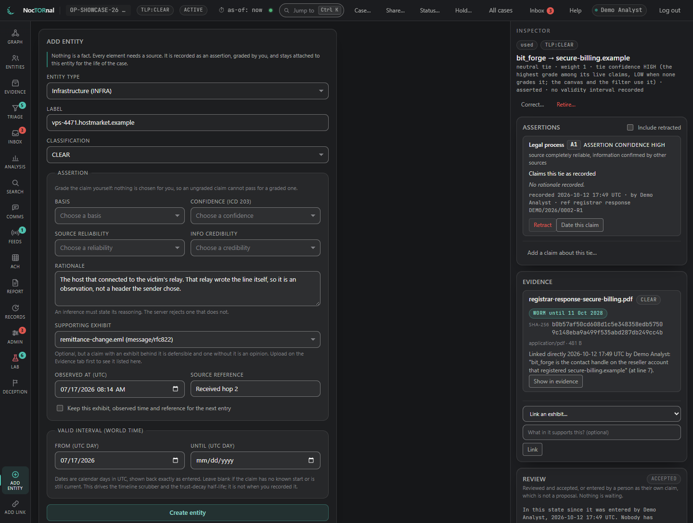

#### Step 3: add the exhibit first, if you have one

**Evidence**, then choose the file, give it a title, say how it was acquired and when, and **Upload exhibit**. The server computes its SHA-256 and BLAKE3 on receipt and locks the object. Chapter 13 explains custody, verification and legal holds. Upload before you make the claim and the claim can cite it.

#### Step 4: link two entities

**Add link**. Pick the two ends, then a relationship type; only types the ontology permits for that pair are offered. Make a claim for the relationship exactly as for an entity. The confidence you give the claim is the confidence the line is drawn and filtered at.

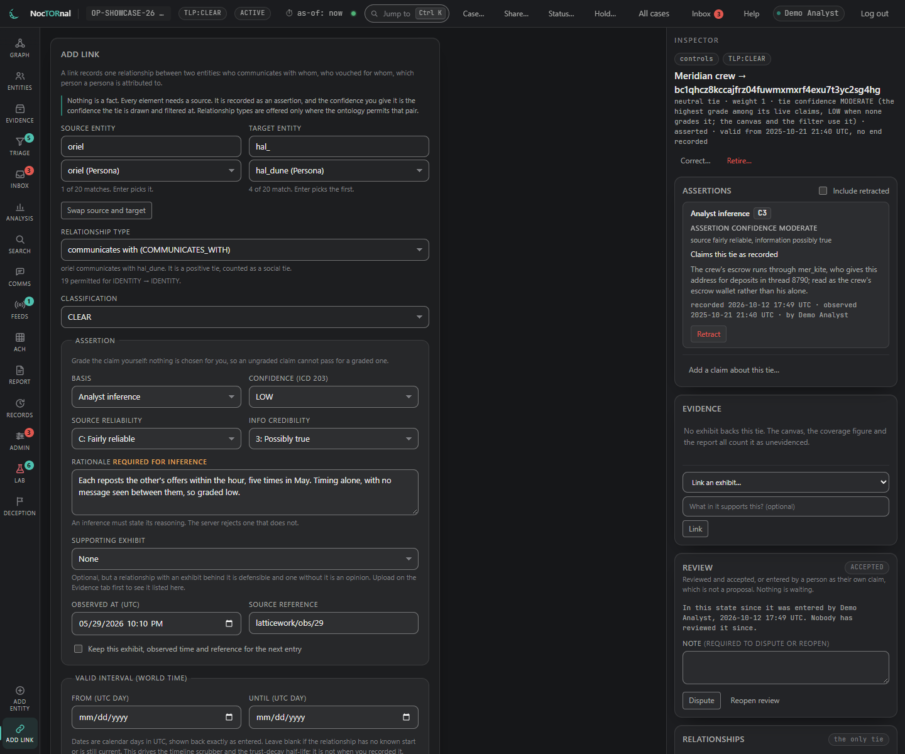

#### Step 5: capture text and review the suggestions

**Triage**, then **Capture text**: paste a thread, a chat export or a listing. Selectors in it are extracted with their offsets and raised as suggestions. Nothing enters the graph. Go down the queue with <kbd>J</kbd> and <kbd>K</kbd>, accept with <kbd>A</kbd> (it asks first), reject with <kbd>R</kbd> or defer with <kbd>D</kbd> (both ask for a reason).

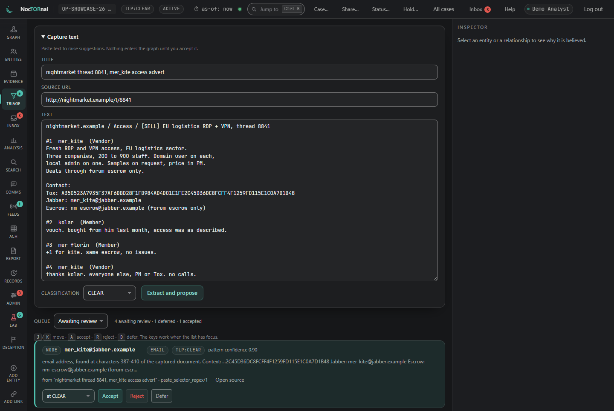

#### Step 6: look at it, then analyse it

The **Graph** now shows what you built. Click an element: the inspector says why it is believed. Open **Analysis** and choose **Run analysis** to see brokers, communities and key players over the current view. Treat the ranking as a prompt: on a sparse investigative graph, adding one edge can reorder the top five (Chapter 16).

#### Step 7: build a report

**Report**: choose the level to **Prepare at** and press **Prepare**. The platform builds the document from what you may read at that level and nothing above it. Then, under **Ask whether it may leave, then save it**, choose a destination, say who it is for and why, and press **Check egress**. It decides; it does not send. If it is cleared, **Save the cleared document** gives you the file.

#### Step 8: close it

When the work ends, move the case to **closed** from **Status...**. A closed case is read-only but still governed: legal holds, retention and sharing still work, and the retention dates you set in Step 1 now decide when its material falls due.

> **Tip.** A demonstration case is a good place to make mistakes. Retract a claim, run an analysis before and after, and watch what the inspector says changed. Nothing is overwritten in NocTORnal: a retracted claim stays on the record, marked, and an element that loses its last live claim leaves the graph at every as-of date.

---

## Part II. Ideas you need

>> The six ideas behind the console's behaviour: claims and grades, handles and people, handling labels, views and time, retention, and who may do what. Each one explains something the screens used to explain and now leave to this chapter.

### 5. Claims, grades and confidence

Every attribute and every relationship in NocTORnal rests on one or more **assertions**. An assertion is a row in a ledger with these parts, and the forms ask for exactly these:

| Part | What it records |
|---|---|
| **Claim** | What is being said: this entity has this label, this selector, this type; this tie exists between these two. |
| **Basis** | How you know. One of: **direct observation**, **third-party report**, **analyst inference**, **automated inference**, **self claim** (the actor said it of themselves), **legal process** (obtained under a warrant, order or other instrument; the reference is required). |
| **Confidence** | Your confidence in the claim, in ICD 203 analytic words: **low**, **moderate** or **high**. |
| **Source reliability** | How far the source can be trusted, **A** to **F**. |
| **Information credibility** | How far this piece of information can be trusted, **1** to **6**. |
| **Rationale** | Why you grade it so. Required for an inference. |
| **Exhibit** | The captured page, file or message that backs it. Optional, and the difference between a defensible claim and an opinion. |
| **Observed at**, **reference** | When you saw it (UTC) and where: a header line, a post number, a file path. |
| **Valid interval** | The days the thing was true in the world, as calendar days in UTC. Blank if unknown or still current. It drives the timeline scrubber and trust decay. It is not when you recorded the claim. |

An inference must state its reasoning. The server rejects one that does not, because an unreasoned inference is a guess the graph would then treat as evidence.

#### The Admiralty grading

Reliability and credibility are the Admiralty (NATO) system, graded separately on purpose: a reliable source can pass on something false, and an unreliable one can be right.

| Source reliability | | Information credibility | |
|---|---|---|---|
| **A** | Completely reliable | **1** | Confirmed by other sources |
| **B** | Usually reliable | **2** | Probably true |
| **C** | Fairly reliable | **3** | Possibly true |
| **D** | Not usually reliable | **4** | Doubtful |
| **E** | Unreliable | **5** | Improbable |
| **F** | Reliability cannot be judged | **6** | Truth cannot be judged |

`F` and `6` mean "cannot be judged", not "bad". They are also what an ungraded source counts as wherever a number needs one.

#### Weights

Wherever the system has to turn a grade into a number (the ACH ranking, Chapter 20), it uses this table. A1 counts as 1.00; a C3 claim counts about half of that, and an F6 claim almost nothing.

| | 1 | 2 | 3 | 4 | 5 | 6 |
|---|---|---|---|---|---|---|
| **A** | 1.00 | 0.85 | 0.70 | 0.50 | 0.30 | 0.20 |
| **B** | 0.85 | 0.72 | 0.59 | 0.42 | 0.26 | 0.17 |
| **C** | 0.70 | 0.59 | 0.49 | 0.35 | 0.21 | 0.14 |
| **D** | 0.50 | 0.42 | 0.35 | 0.25 | 0.15 | 0.10 |
| **E** | 0.30 | 0.26 | 0.21 | 0.15 | 0.09 | 0.06 |
| **F** | 0.20 | 0.17 | 0.14 | 0.10 | 0.06 | 0.04 |

#### How confidence reaches the picture

- A **tie** is drawn, and filtered, at the **highest confidence among its live claims**. A lower claim does not lower it by itself.
- An **entity** has no confidence of its own. It is drawn at the highest confidence among its ties in the current view, and an entity with no tie that meets the filter claims no confidence and is drawn at the lowest opacity, because nothing in the view vouches for it.
- Opacity is confidence, and the number is never opacity alone: the inspector spells the word out.
- **Dashed** lines are inferred: their basis is an analyst or automated inference. They stay dashed, and the metrics count them only while the view includes them (Chapter 8; the console opens with **Include inferred** ticked).
- **Hollow** entities and **hollow beads** on ties mark elements that nothing rests on, when **Mark unevidenced** is on. The line under the canvas counts how many elements rest on an exhibit you can see.

To lower a tie's confidence, add the lower claim under **Assertions** and retract the claims graded above it, giving the reason. A correction can raise a tie's grade but not lower it past a claim that still stands.

#### Retracting, dating, correcting, retiring

Nothing in NocTORnal is overwritten. History is superseded or retracted, never edited, and each of these is a different act:

- **Retract** withdraws one claim. The row is stamped and kept, with your reason. If it was the last live claim behind the element, the element leaves the graph, and it stays out at every as-of position, earlier ones included, because the graph leaves out a retracted claim at every date. **Include retracted** lists them.
- **Date this claim** is offered on a claim with no observation date, which **First seen** and **Last seen** therefore ignore. Dating it records a new claim with the date and your reason, and marks the old one superseded. Nothing is rewritten.
- **Correct...** fixes a label, or records when a tie ended. The corrected label is recorded as a claim with the basis and grading you choose, the label it replaces stays in the audit record, and retracting the correction puts it back. A date in **Stopped being true on** records that the thing ended without retiring it, so the as-of view still shows it before then. Nothing is graded for you.
- **Retire** removes the element from every view, including as-of queries into the past. Nothing is destroyed: the row, its assertions and its evidence links stay in the database and the act is recorded against your name. But it cannot be undone from the console. To say instead "this stopped being true in March", cancel and use **Correct...** with a date.

#### Reviewing ties

A tie a machine proposed, a reviewer reopened, or nobody has reviewed since it was entered is **proposed**: both of its ends carry the unreviewed-proposal ring until someone **accepts** or **disputes** it. **Accepted** means reviewed and accepted, or entered by a person as their own claim, which is not a proposal. **Disputed** means a reviewer doubts it: it stays in the graph on its claims, and if it is wrong the remedy is to retract the claim it rests on, giving the reason, or to retire the tie. Reviewing needs `proposal.review`, which a Lead investigator and a Reviewer hold on a case.

### 6. People, handles and attribution

#### A handle is not a person

The two kinds of entity are kept apart because the gap between them is where analytic mistakes happen.

- An **`IDENTITY`**, which the console calls a **Persona**, is a handle you observed: an account, an alias, a nick.
- A **`PERSON`**, which the console calls an **Assessed person**, is a human you concluded stands behind one or more personas.
- They are joined only by an **`ATTRIBUTED_TO`** relationship, which is a claim like any other, carries a confidence, and can be reversed without losing the observations underneath.

The console enforces this in three places. Add entity refuses to record one as the other. The merge list offers only entities of the same type, because saying a persona **is** a person is an attribution, not a merge. And the model has no field that would hold a real name on a persona.

#### Selectors

A **selector** is a durable identifier attached to an entity: an email address, a Jabber id, a Tox key, a wallet address, a phone number. There are 53 kinds (Appendix F), some **strong** (a Tox public key identifies one key) and some **PII** (an email or a phone number is personal data, and the console treats it so in lookups).

Selectors are indexed in their **durable** form, not the one a person sees:

- **Tox** is indexed on the 64-hex public key, never the 76-hex Tox ID, because the trailing nospam and checksum are user-rotatable and are not part of the identity.
- **Telegram** is indexed on the numeric id, never the `@username`, because usernames are recycled.
- **Jabber** drops the resourcepart, which is per-connection.

The preview in the Comms pane shows exactly what the system will store. Choose the type so the selector is indexed the way the same selector seen anywhere else is; **None of these** is a valid answer.

When a selector you add is already held by another entity, the form says so and the new entity **does not hold it**: two entities with one selector may be one and the same, and the console puts them in front of you under **Entity resolution** rather than guessing. The console **never auto-merges** on a strong selector match.

#### Merging two entities

A merge folds one entity (the loser) into another (the survivor) of the **same type**:

- the loser keeps its history, its ties move to the survivor, and it leaves the live graph;
- it is **reversible** from the entity resolution panel;
- it is a **dual-control** operation where the case, or the deployment, has put it behind two people.

By default a case takes one signature for merges. A Lead investigator can press **Require a second signature** on the Triage pane, and from then on a merge is a **request** that another person with `graph.merge` on the case must approve. Turning that off again is itself a request, and needs a person who has held `case.update` on the case for the window (seven days unless the deployment declares another; the console tells you the date they qualify). If the deployment requires a second signature for every merge, a case cannot turn it off.

An approval request names the entities, shows the justification, the parameters exactly, who asked, when it expires, and what approving does. It authorises **one execution** of the exact parameters it was raised over, not the operation in general; it is spent when used (the card says **spent**), and the requester presses **Execute merge** to spend it. Rejected and withdrawn requests stay listed, because a request that vanished would hide the fact that somebody once asked. You cannot decide your own request, and approving means you have checked the specific parameters, not that you trust the person asking.

### 7. Handling: classification, clearance, compartments

Four things decide whether you can see a piece of material, and the server checks all four on every read and every write. There is no setting that turns any of them off.

#### Classification (TLP)

Every case, entity, exhibit, claim, capture and sample carries a **classification**, from lowest to highest:

| Label | Meaning in NocTORnal |
|---|---|
| `CLEAR` | No restriction inside the platform. |
| `GREEN` | Community. |
| `AMBER` | Limited. The ceiling for email and for most external destinations. |
| `AMBER_STRICT` | Limited to the named holders. **Never leaves the platform.** |
| `RED` | Named recipients only. **Never leaves the platform.** |

A new element starts at the case's own label and can go no lower: the label a capture, claim or proposal is written at is never below the case's. A case's classification can only be raised, and no higher than your own clearance; anyone on the case cleared below the new level loses access when it is saved, and is named once it is.

#### Clearance

Each account has a **clearance**, the highest label it may read. The default for a new analyst is `AMBER`. Material above your clearance is not hidden by a filter you could undo: it is excluded in the database query, so a count, a search hit or an error message cannot reveal it. Where a number is computed over what you may read, the console says so: a centrality over a redacted graph is a **lower bound**, not a measurement of the case.

#### Compartments

A **compartment** is a need-to-know lock on a case, a record or a document: only accounts **read into every compartment** the thing carries can open it, whatever their clearance. Compartments are keys such as `NIGHTJAR`, registered by an administrator (Chapter 30) and given to people from their own account card. A compartment is why your clearance can be high and a case can still be invisible to you.

#### Case assignment and roles

Being cleared is not being assigned. You see a case only if you are **assigned** to it, and what you may do there is decided by your **role on that case**: Lead investigator, Analyst, Reviewer, Contributor, Read only, External liaison. Appendix B says what each holds. Access is the intersection: the case, its classification, its compartments and your role on it must all reach.

An assignment row is only half of access, which is why the case's **Share...** panel shows everyone assigned **and whether their access works**. When you grant someone access the grant is checked: a colleague whose clearance or compartments do not reach the case is refused, not written and then silently filtered out of every read.

#### Why you get a 404 for a thing you know exists

If you are not assigned to a case, or not read into its compartment, or the material is above you, the answer is the same as for something that does not exist: **404**. It is deliberate. A different status for "exists but not yours" would be an existence oracle for a compartmented operation.

#### What may leave

Everything that crosses the boundary passes through one check, `can_egress`, with the same rules wherever it is called (email, webhook, Jira, export, a lookup, a model host, the sandbox):

1. `AMBER_STRICT` and `RED` never leave, whatever a destination is configured to accept.
2. **Compartmented material never leaves.** No external system models compartments, so sending it would silently drop the control.
3. A lookup provider, key directory, model host, collection target or the sandbox with **no declared ceiling** receives nothing. Email, webhook, Jira and export may go out without one: the Report pane's ceiling is optional.
4. A destination's ceiling can only **lower** what is permitted, never raise it past the floor.

A refusal says which rule applied and does not restate the content, because an explanation that leaks what it just refused to send is not much of a refusal. Email carries a summary and a link, never the detail; the detail is in the app, behind your clearance. A refusal is audited as loudly as a permission.

### 8. Views, projections and "as of"

#### The view

The graph on screen and every number beside it describe a **view** of the case, not the case. A view is the answer to five questions, and the Analysis pane restates the answers in words, for example **View: All social ties · 12 relationship types · confidence LOW and above · inferred included · as of now**:

1. **Which relationships?** A **preset**:
   - **All social ties**: every relationship type the ontology marks as a social tie. Identity plumbing (`SAME_AS`, `ALIAS_OF`) stays out, because it would make whichever persona you researched hardest look the most central.
   - **Trust**: the signed network of vouches, guarantees, escrow, rip reports, disputes and rivalries. Negative ties are included, because removing them throws away the most diagnostic signal.
   - **Communication**: who talks to whom and who replies. Co-participation is excluded on purpose: it is a projection, not an observation.
   - **Financial**: payments, laundering, escrow and wallet control. It usually names different leaders than the trust network does.
2. **How confident?** A **confidence floor**: low and above, moderate and above, or high.
3. **Inferred ties in or out?** In while **Include inferred** is ticked, which it is when the console opens; untick it to leave them out.
4. **Trust decay**: off, or a half-life in months. Where it is on, a claim loses weight as its valid interval recedes. Claims with no dates are not decayed, and the view says how many were left alone.
5. **As of when?** A moment in world time. **Now** is the default.

Change any answer and the numbers change, correctly. The commonest misreading in the whole tool is quoting a metric without its view.

> **Note.** Every figure in the Analysis pane is computed over the view, and the view excludes what your clearance does not reach. The canvas says how much was withheld from you by classification, as far as the case discloses it: a count, or only that something is withheld.

#### Counts

The Entities pane counts **entities** and **relationships in the case**, and splits the relationships into **social ties** and **other links**, which the **All social ties** view leaves out. So "28 relationships in the case (23 social ties and 5 other links)" beside a graph that draws 23 is not a loss: five are identity or other links the view omits.

#### As of

The **as-of** control moves the whole console to a moment in world time. An element is present if it had a live claim and its valid interval covered that moment. The **timeline strip** under the graph shows how many dated elements fall in each stretch, with bar height growing with the square root of the count so one busy stretch cannot flatten the rest. A gap on the strip is a gap in **coverage**, not necessarily in activity. Elements with no date are counted and not drawn on it.

Moving the timeline spends from the same request budget as analysis, so a throttled analysis can be caused by scrubbing. The console says so and tells you how long to wait.

### 9. Retention, holds and destruction

#### Why it exists

NocTORnal holds two kinds of material. Material **about the subjects of the case** is kept for the life of the case and governed by the case's dates. Material **about people who are not under investigation** (the contents of a stealer log, a chat export, a database leak) is governed by **retention rules**, one per category, that apply in every case in the deployment. The second kind is the one that makes a platform a data-protection incident, so its periods are decisions a named person makes.

#### Rules

Each ingest category has a rule with a period in days and a rationale. Until someone **confirms** a rule it is a **placeholder**: the period the build shipped with, typed by a developer, not chosen by anybody who knows the jurisdiction. Records are stamped with the period when they arrive.

| Category | Shipped period | Why it is cautious |
|---|---|---|
| `STEALER_LOG` | 90 days | Third-party personal data at scale: the stolen credentials, cookies and documents of people who are not the subject. The likeliest way for the platform to become a data protection incident. |
| `CREDENTIAL_DUMP` | 180 days | Third-party credentials; same exposure, lower volume. |
| `DATABASE_LEAK` | 365 days | Often contains uninvolved account holders. |
| `PASTE` | 365 days | Mixed content, frequently personal data. |
| `CHAT_EXPORT` | 730 days | May contain the messages of uninvolved third parties in group channels. Whether those may be kept at all, and for how long, is for counsel to settle. |
| `TELEMETRY` | 180 days | High volume, low individual value. |

A category with **no rule at all** runs on a **fallback of 365 days**, a period nobody chose. The Retention page lists every category in use on your cases, ruled or not, because a category with no rule used to be on no screen at all.

A **confirmed** rule applies to material ingested **from then on**, in every case. Nothing already on file is recomputed: records keep the deadline they were stamped with when they arrived. Confirming needs `retention.manage` and a sign-in from the last 15 minutes, a rationale, and a name; confirming again replaces the earlier decision and says whose it was.

#### The case's own clocks

A case has a **retention** date and a **review** date. The retention date is when its exhibits fall due. **Ingest records follow the clock of their own category, not the case's**: a record can fall due before the case or after it, and the Due list gives each one's own deadline.

**Exhibits are locked.** Every accepted byte is written once and locked in object storage under COMPLIANCE mode until the case's retention date (as far ahead as the deployment sets a lock in one step, and for at least a fixed period from the moment it is lodged). Extending the date lengthens the lock. **Nobody can shorten a storage lock once it is set**: not an administrator, and not the dual-control purge. That is why retention can only be extended, why one person typing `2208` for `2028` is asked a question first ("Check the year"), and why a lock that ends before the case's retention date is flagged so the Evidence pane can offer to lengthen it. Once a lock ends, the case's retention, any legal hold and the dual-control purge are what protect the exhibit.

#### Legal hold

A **legal hold** stops every deletion of what it covers, whatever the retention date says, until somebody lifts it.

- An **exhibit** is held from its card in Evidence; a **case** from **Hold...** in the case strip; a **collected document** from its card under Feeds, Collected.
- Holding and lifting each need a **written reason** of at least five characters and a **sign-in from the last 15 minutes**. The reason goes into the audit log with the thing it names.
- A hold works on a closed case.
- A case hold stops the case's exhibits (including any lodged later), its ingest records, lookups and samples, and the collected documents it cites. A purge already running when a case hold arrives **finishes the exhibit it is destroying and keeps everything after it**, and the hold's answer says what the purge destroyed while it waited.
- **Lifting is one person's act and is refused below the material.** An exhibit's lift needs you cleared for that exhibit; a case's lift needs a clearance that covers everything the case holds.
- Lifting a hold lets the case's retention dates and rules govern again, so a purge can destroy what is past its date.

Everyone who can open a held exhibit or case sees a **LEGAL HOLD** chip.

#### Destruction

**Purge** is the act that destroys a case's material that is due. It is deliberately slow:

- It **defaults to a dry run**, every time the pane opens, and stays that way. An endpoint whose default is destruction will eventually be called by a script that meant to ask a question.
- A real run is offered only after a dry run of this case **under the same authority**, and it asks you to confirm what that dry run counted. If anything has changed since (something newly due, a hold placed or lifted) the server refuses and nothing is destroyed.
- It needs an **authority** of at least 10 characters, which the **tombstone** keeps after the material is gone, and the confirmation asks you to type the case code.
- Nothing schedules it. A purge that runs on a timer nobody watches is how data disappears on a Sunday: the Due list reports what has expired, and a person acts, a case at a time. A **purge out of schedule**, of exhibits whose retention has not expired, takes a second person under dual control, and the approval is consumed inside the purge transaction.
- If the object store refuses a delete under a retention lock, **those exhibits keep their bytes and are not marked purged**. A tombstone recording a purge that did not happen is a false record, so the pane says what was refused and why, and the rows are not touched. If no object store was contacted at all, the pane says so and says **not to report it as a destruction**.

The **Destroyed** page is the **tombstone ledger**: what was destroyed, how much, by whom, under whose authority, and whether the object store actually let go of the bytes. It is append-only and outlives the thing it records, otherwise a destruction and a deletion of the record of it look identical.

### 10. Who may do what

NocTORnal has 11 roles and 71 permissions. Appendix B lists every role and every permission with who holds it. These are the points that change how you work.

#### Two kinds of role

- **Deployment roles**, held by an account everywhere: **System administrator** (`SYS_ADMIN`), **Security officer** (`SECURITY_OFFICER`), **Collection manager** (`COLLECTOR`), **Malware analyst** (`MALWARE_ANALYST`), **Service account** (`SERVICE`).
- **Case roles**, held on one case: **Lead investigator** (`CASE_OWNER`), **Analyst**, **Reviewer**, **Contributor**, **Read only**, **External liaison**.

A deployment role gives no case access. A System administrator has none by default, a Security officer cannot read case content, and a Malware analyst is **deliberately given no case access**: being trusted with hostile binaries is a different trust from being trusted with the case file.

#### Step-up

37 of the 71 permissions need a **recent second factor**, not merely a valid session. When your last sign-in is older than 15 minutes the pane asks you to sign in again and carries on from where you were. This covers merging, exporting, purging, downloading a sample, legal holds, break-glass, key rotation, and most administration.

#### Two people

Some acts take two different people on purpose, so that one person's mistake or compromise is not enough:

| Act | Who asks | Who signs second |
|---|---|---|
| Merge, where a case or the deployment requires it | An Analyst, Lead investigator or Reviewer (`graph.merge`) | A different person in one of the same roles on the case |
| Destroy evidence outside the retention schedule | A Lead investigator | A different Lead investigator; the approval is spent inside the purge |
| A lookup to a vendor or a public service | The analyst, who names who signs it off | The named Lead investigator, in a separate action with a fresh sign-in |
| Retrieve a preserved, rejected sample | A Lead investigator | A Security officer authorises that one person for that one sample |
| A collection authority | A Collection manager records it | A Security officer confirms it, and each source under it |
| Lower a lookup provider's exposure, or move it | An administrator | A different administrator holding `integration.manage`, within 72 hours |
| Change which acts take two people | A System administrator proposes | A Security officer, who is not an administrator, countersigns, and the administrator applies |
| A break-glass grant | You, for yourself | A Security officer reviews it afterwards |

The exact list for your deployment, with the roles that may be each party, is under Administration, Two-person controls (Chapter 31). The pairs of permissions no single role may hold together, so that whoever holds one half needs someone else for the other, are listed there too: break-glass review and invoke, authority confirm and record, authority confirm and run, countersign and manage, preserved-sample authorise and retrieve, YARA manage and activate, victim-PII authorise and reveal.

#### Why a button is missing

Nobody sees a button the server would refuse them. A missing button usually means the role you hold on this case, or the deployment role you hold, does not carry the permission, or the case is closed. If you press something you should be allowed to and the answer is a refusal, the refusal names the roles that would allow it and who can give you one. Some refusals name the permission, such as `case.update` or `evidence.read`; Appendix K explains the ones you will meet.

---

## Part III. The panes

>> One chapter per pane: what it is for, what you see, the controls, how to read the numbers, and the places where it will refuse you on purpose.

### 11. Graph: the sociogram

The case as a network, and the working surface. Entities are nodes, relationships are lines, and everything on it describes the current **view** (Chapter 8).

#### Controls above the canvas

- **Projection** chooses the preset (All social ties, Trust, Communication, Financial). The **i** beside it explains what the preset includes and why.
- **Confidence** is the confidence floor.
- **Node size** is **degree** by default: activity and visibility, not importance. A busy persona is not a central one. After you run an analysis the brokerage measures join the list, captioned with the run they come from; offering them before a run would be inventing the number. Area is in proportion to the value, from zero.
- **Full projection** (<kbd>Esc</kbd>) leaves a focus (an ego network, a path, a set from Analysis) and returns to the whole view.

#### The canvas

| Do this | To get |
|---|---|
| **drag** the background | pan |
| **scroll** | zoom |
| **click** a node or line | inspect it: the inspector shows *why it is believed* |
| **double-click**, or <kbd>Enter</kbd> | the ego network: this entity and its immediate ties |
| **shift-click** one entity, then shift-click another (or press <kbd>P</kbd> on each) | the shortest path between them, treated as undirected; the first one only sets the anchor |
| **drag a node** | move and pin it |
| <kbd>U</kbd> | pin or unpin the selected node |
| <kbd>0</kbd> | fit every entity |
| <kbd>&larr;</kbd> <kbd>&rarr;</kbd> | select the next or previous entity (<kbd>&larr;</kbd> is previous); <kbd>[</kbd> <kbd>]</kbd> step through ties; shift with an arrow pans |
| **hold** <kbd>space</kbd> | hide inferred ties, so you can see how much of the picture is assessment rather than evidence |
| <kbd>Esc</kbd> | clear |

The strip under the canvas repeats these, and the canvas's accessible name lists the keyboard half for screen-reader users.

**Re-layout** runs the force layout again; **Save layout** keeps your pinned positions for your next visit; **Clear pins** releases them (it confirms with a count and offers Undo); **Reload** fetches the case and the view again.

#### What is drawn

- **Nodes** are drawn by type, with a ring for the **unreviewed proposal** state. A **LEGAL HOLD** chip is on an exhibit's card and in the case strip. When part of the case is above your clearance, the canvas shows one **INCOMPLETE** chip for the whole view; it never says which entities or where.
- **Lines** carry a sign: a `+` or `-` mark, because colour is never the only encoding. **Dashed** means inferred. A line's opacity is its confidence.
- **Hollow** nodes and beads mark elements nothing rests on, while **Mark unevidenced** is on. The bar says how many elements in view rest on an exhibit you can see, "counted from the elements on the canvas" and, if the canvas shows a focus, also for the whole view.

> **Note.** Metrics are computed over the **view**, not the case. Change the preset, the confidence floor or the as-of date and the numbers change, correctly. The bar under the canvas states what was actually computed, and the canvas says how much of the view you cannot see, as far as this case discloses it: a count, or only that something is withheld.

#### Notes the canvas may show

- **"The projection has more entities than this page holds."** Narrow it, or raise the ceiling, before reading structure off it. Layout is a force-directed simulation, and larger views take longer to settle.
- **"Only this neighbourhood is on screen."** In an ego network the metrics panel still reports numbers for the whole view, not for the subgraph.
- **"Nodes are sized by the ties drawn until the metrics load."** Which is not the same number as the view's metric.
- **"The path could not be recomputed for this projection. Whether these two are connected is UNKNOWN."** This is not a finding that they are unconnected. Change the view, or press <kbd>Esc</kbd> and shift-click them again.
- **"...are not connected under the current projection."** A different preset, or including inferred ties, may connect them, and whether it does is itself a finding.
- **Path and as-of.** The path endpoint does not take an as-of parameter, so a path is traced against the latest state of the view even when the scrubber is in the past, and says so.

#### The timeline

The strip at the bottom, **Timeline (world time)**, shows how many dated elements fall in each stretch, and scrubs the whole console to a moment. **Jump to now** returns. With no dated element in the case the strip says so and switches on as soon as one exists. Bar height grows with the square root of the count, so one busy stretch cannot flatten the rest. A gap is a gap in coverage, not necessarily in activity.

#### The live dot

In the case strip, green means another analyst's changes arrive without a refresh; grey means they do not, and you should refresh by hand. It is a convenience, never a correctness feature.

### 12. Entities and the inspector

#### Entities: the case file

Every entity, **unprojected**. The Graph shows a view; this pane shows what is in the case, deliberately not filtered by the view. If you are looking for something, look here.

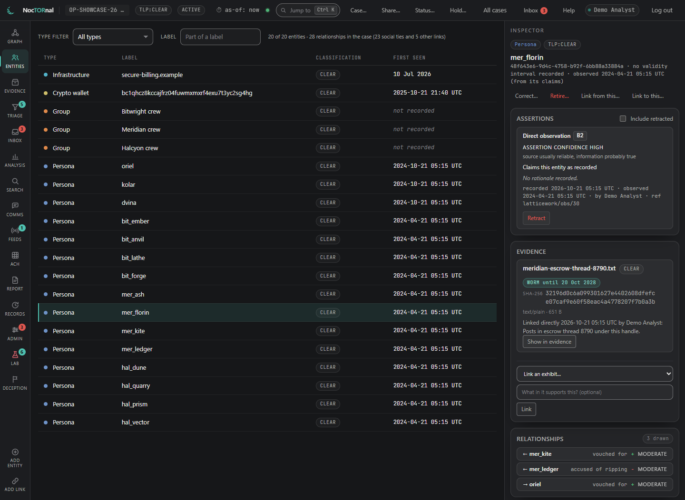

The header counts what is in the case: for example "20 of 20 entities, 28 relationships in the case (23 social ties and 5 other links)". Filter by **Type filter**, find by **Label**, and sort by any column (Type, Label, Classification, First seen). Selecting a row selects the entity everywhere, and the inspector opens on it.

#### The inspector

Select anything and the inspector, on the right of every pane, answers **why is it believed**. For an entity:

- **Assertions**: every claim behind it, with its basis, Admiralty grade, confidence and exhibit, live ones first. Beside each: **Retract**, **Date this claim** where it has no observation date, and the history of what superseded what. **Include retracted** lists the withdrawn ones. On a relationship, **Add a claim about this tie...** adds another source for it, or the same tie at another grade, as its own assertion; on an entity, **Correct...** records a graded correction.
- **Evidence**: the exhibits behind the claims, each with the digest and whether it is verified.
- **Relationships**: every tie in the case, social or not, each one opening its own inspector. **Link from this...** and **Link to this...** open the Add link form with this end filled in.
- **Metrics**: **local** measures for this entity (degree, weighted degree, k-core, clustering), each describing the entity's own neighbourhood. Brokerage (betweenness, constraint, key-player) is global, so it lives in the Analysis pane; the line under the metrics says whether this entity is in a run and where to see it.
- **Tags**: your own organising labels. A tag is not a claim and carries no evidential weight, so it renders as a plain chip, never next to a confidence or a grade.
- **Selectors**: the durable identifiers it holds, each with a **Look up** control where a provider is enabled.
- **Entity resolution**: **Merge this entity into** another of the same type. The entity you are looking at becomes the losing record: it keeps its history, its ties move to the one you choose, and it leaves the live graph. Same type only. It can be reversed.
- **Correct...** and **Retire...** (Chapter 5), **Score evidence against a hypothesis** (Chapter 20).

For a relationship the inspector adds **Review**: **Accept**, **Dispute** or **Reopen review**, with a reason required to dispute or reopen.

##### Metric definitions

| Metric | What it measures |
|---|---|
| **Degree** | How many different entities it is tied to in the view; parallel ties count once. |
| **Positive ties** | Every positive tie at this entity in the view, each parallel tie counted. |
| **Weighted degree** | The total strength of its ties. |
| **k-core** | How deep it sits in the durable core: the largest k for which it survives repeated removal of everything with fewer than k ties. |
| **Clustering** | How closed its neighbourhood is: how far its neighbours are tied to each other. |
| **Vouches received / given** | Only "vouched for" ties in this view. Received vouches are accumulated reputation; given vouches are reputation staked. |
| **Negative ties** | Rip reports, accusations, disputes and bans, each parallel tie counted. A node with many negative ties is not a well-connected node. |

An entity outside the current view has no numbers: widen the preset, lower the minimum confidence, or move the as-of position forward.

#### Looking a selector up

When a lookup provider is enabled for a selector's type, the inspector shows **Look up** beside it. The panel names each provider with its exposure and says, in plain words, who learns that you asked:

- **NONE**: your own instance. It is asked at once.
- **VENDOR**: the vendor learns that this deployment asked about the value, under your account. Several "private" tiers still share hashes with partners; confirm what yours does.
- **PUBLIC**: anyone watching the provider can see it was looked up. Assume the subject learns of the interest the same day.

A lookup to a VENDOR or PUBLIC provider is **not sent when you press the button**. You name a colleague who may sign it off (a Lead investigator on the case) and say why; nothing leaves until they sign it off under Records, Lookups, within 24 hours. The answer is kept as case material, never labelled below the question, and what it found arrives as suggestions in Triage: a lookup never writes the graph.

**Show answer**, on each lookup under Records, Lookups and on a Triage card raised from one, reads the stored answer when you press it. If you may upload exhibits on the case, **File as exhibit** keeps the answer exactly as it came back, locked like any exhibit. An answer labelled above your clearance says so and shows nothing of itself, not even whether it could be read.

**Look up all**, below an entity's selectors, plans a lookup of every one of them on your own instance (NONE): a batch never goes to a vendor or the public. The plan says how many would go, how many are already answered, which are refused and why, and when the sends start and end; nothing is queued until you say why and press **Queue them**. Whoever asked for a batch, and a Lead investigator, can cancel what is still queued; what was sent stays sent.

A lookup refuses personal data toward every provider until a transfer authority is recorded (legal item L2), and an address that is shaped like an email address, a Jabber id for one, counts as personal data. No sample hash leaves the deployment while no prohibited-content policy is declared, no hash list is loaded, or the sample was rejected.

### 13. Evidence: exhibits and custody

An **exhibit** is one item of evidence: a file, a capture, a message, a recorded call. The Evidence pane is where exhibits are lodged, verified, exported and held.

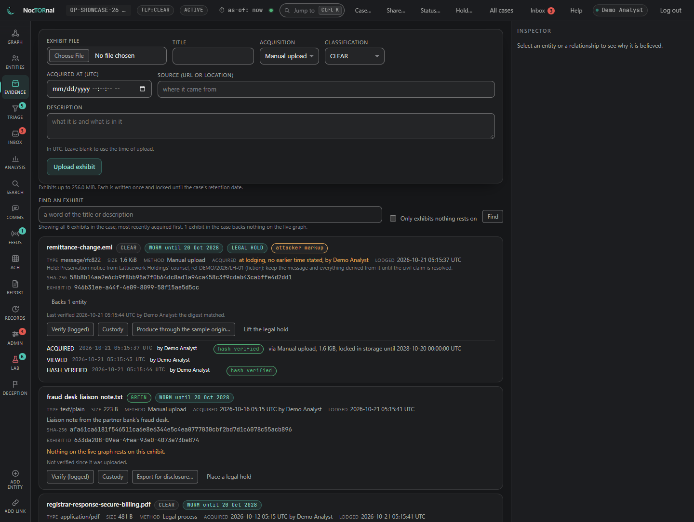

#### Lodging an exhibit

Choose the file, give it a **title**, choose the **Acquisition** method (Manual upload, Collector or Legal process), and its **classification**. **Acquired at** (UTC) is when the material was obtained; leave it blank only for material obtained just now, and a blank field records the moment the server received it. **Source** is the URL or location it came from. **Legal process** needs the authority reference it was obtained under: the warrant, production order or other instrument.

Exhibits are accepted up to the deployment's declared size, shown above the list (the default is 256 MiB). Every accepted byte is written once and locked until the case's retention date (Chapter 9). If **identical bytes were already held**, the existing exhibit is reused and this acquisition is its own entry on that exhibit's custody record.

#### Two hashes, and custody

The server computes **SHA-256 and BLAKE3** on receipt. Two hashes, because if one is ever weakened, or a column is doctored, the two must still agree. The digest is what a later verification is checked against.

Every *read* is a custody row, not just every change: "who looked at this exhibit, and when" is answerable. The **Custody** button shows the ledger for one exhibit: acquired, verified, exported, held, lifted, read. Rows are to the second, and a re-acquisition reads as one row. A **verification** that fails writes a row that says **HASH MISMATCH**, keeps it permanently, and raises an integrity alarm in the audit log and in the Inbox as an urgent notice.

#### Verify

**Verify (logged)** re-reads the stored bytes and compares them with the recorded digest. The check is written to the exhibit's custody record **in your name, for good**. The card then says "Last verified ... by ...: the digest matched", or "Not verified since it was uploaded".

#### Export for disclosure

**Export for disclosure...** saves the verified bytes to your computer. An exhibit of attacker markup shows **Produce through the sample origin...** instead, which delivers it in a password-protected archive (the password is `infected`) served by the separate sample origin. Export needs `evidence.export` (a Lead investigator holds it), a sign-in from the last 15 minutes, and writes an **EXPORTED** entry to the custody record in your name. The stored bytes are checked against the digest first: a mismatch releases nothing and raises the alarm. Material at `AMBER_STRICT` or `RED`, and compartmented material, is refused, and the refusal is recorded.

An exhibit that is **attacker-authored markup** (an email, a captured page, a HAR) shows a chip saying so. Its metadata, digest and custody are shown on the card; its bytes are never served from the console's origin and its export goes through the sample origin, in an archive with the password `infected`, which is public and is there to stop a double-click and a mail gateway, not to protect anything.

#### Legal hold on an exhibit

**Place a legal hold** and **Lift the legal hold** are on the card for someone who may. Both need a written reason and a sign-in from the last 15 minutes, and the reason is kept in the audit log. Once lifted, the exhibit follows the case's retention date again, unless the case itself is held. Chapter 9 has the rules.

#### The WORM chip

Each exhibit shows **WORM until** a date: its storage lock. If that date is earlier than the case's retention date, the card says the lock ends before the case's retention date, so the store would accept a delete the case still forbids, and the pane offers to lengthen it. A lock whose end is only known to the day does not carry a time of day, so it is not counted on from the start of that day: the object store may already accept a replacement or a delete.

#### Finding an exhibit

**Find an exhibit** searches title and description. **Only exhibits nothing rests on** lists the ones no live claim cites and no entity or relationship links to. The line under it counts them, and says how many exhibits the case has and how many back nothing on the live graph. An exhibit is **evidenced** the way the canvas marks an element as evidenced: a live claim carries it, or it is linked to the element directly, on an entity or relationship you can see. An exhibit whose claims were all retracted, or purged, says so: nothing on the live graph rests on it now, and where it was attached the inspector still lists it, marked.

### 14. Triage: suggestions waiting

Machines propose; you dispose. Extractors, importers, lookups and inference jobs write **suggestions** here, never to the graph. This is where a human decides.

#### Capture text

Paste a thread, a chat export or a listing under **Capture text**, give it a title and a source URL, and choose **Extract and propose**. Selectors in it (email addresses, Tox and Jabber ids, wallets, domains) are extracted **with their offsets**, and each is raised as a suggestion. **Nothing enters the graph here.**

- The document is stored as the record of what was looked at, even if nothing is found, **never below the case's own classification**.
- Text captured before under the same compartments is **not stored twice**: it keeps the label it was first stored at, and what it raises here carries the stricter of that label and this capture's. The note after a capture says which label the document and its suggestions ended up at, in which compartments, and when an earlier capture's label stayed.
- A case walled off for victim data takes no capture, and says so.

#### The queue

Choose the **Queue**: awaiting review, deferred, accepted, rejected. Each card shows what would be created ("mer_kite (Persona) gains comms.TOX"), the **value**, a **pattern confidence**, the classification it would be written at, and **Why this was proposed**.

- **Pattern confidence** says how reliable this *kind* of match is in running text. It is not how significant the finding is, and it only orders the queue.
- **Why this was proposed** opens the full reasoning: how the selector was found, and how it was scored. A domain found in prose, for example, scores low because it is common; a Tox key published in a contact block alongside other identifiers scores higher, because the actor themselves asserted the identifiers belong to one operator. That is still **a claim**: only a CONFIRMED binding carries weight in automatic identity resolution, and confirmation needs a signature over the identifier, not a parse of it.
- **Open source** shows the captured text around the match, where it was found, and the hash of the document.
- A card for something the server would refuse to attach says so where **Accept** would be (for example, a claim whose label is higher than the entity it would attach to), and you reject or defer it.

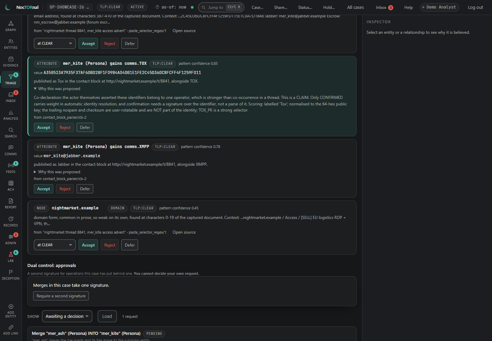
#### Keys

<kbd>J</kbd> and <kbd>K</kbd> move; <kbd>A</kbd> accepts; <kbd>R</kbd> rejects; <kbd>D</kbd> defers. They work while the list has the focus (Tab to it, or click a suggestion), never in a field, on a button or with <kbd>Ctrl</kbd>, <kbd>Alt</kbd> or <kbd>Cmd</kbd> held. <kbd>A</kbd> asks before it accepts, naming what it accepts; the line above the queue then says what was accepted and offers an **Undo** when your role can retire it. <kbd>R</kbd> asks for a reason first, and <kbd>D</kbd> for a note on what is unresolved. The single-letter keys can be turned off in the keyboard map (<kbd>?</kbd>).

#### What Accept does

Accepting promotes a suggestion to a real assertion with your name on it: the element is created **inferred**, **graded low**, and recorded as a machine's suggestion that you accepted (basis `AUTOMATED_INFERENCE`). You then raise the grade yourself, by adding your own claim, if your assessment supports it. A suggestion at a label above the case is written at its own label, never below the case's, and the **at ...** picker on the card lets you write it higher.

**Undo** retires what the accept wrote. The suggestion stays in the Accepted queue, and the retirement is recorded with it. A role that cannot retire does not see Undo.

#### Why the score is what it is

The queue is ordered by pattern confidence alone. A watched selector raises the score of an item in the Ingest queue (Chapter 19), not here.

#### Dual control: approvals

Below the queue, **Dual control: approvals** is where second signatures are asked for and given (Chapter 6). It shows this case's **merge policy** ("Merges in this case take one signature", with **Require a second signature**), the requests waiting, and the history. A request names the entities, the justification and the exact parameters; you **Approve**, **Reject** or, if it is yours, **Withdraw** (behind a confirmation, and not reversible). A request past its expiry reads **EXPIRED**, because a pending request nobody can act on any more is not pending.

### 15. Inbox: notifications

What happened that you need to know about, across every case you may read. Subject lines carry no intelligence, because they render on phone lock screens and in email: they name the case and what happened. The body may name entities and is in-app only.

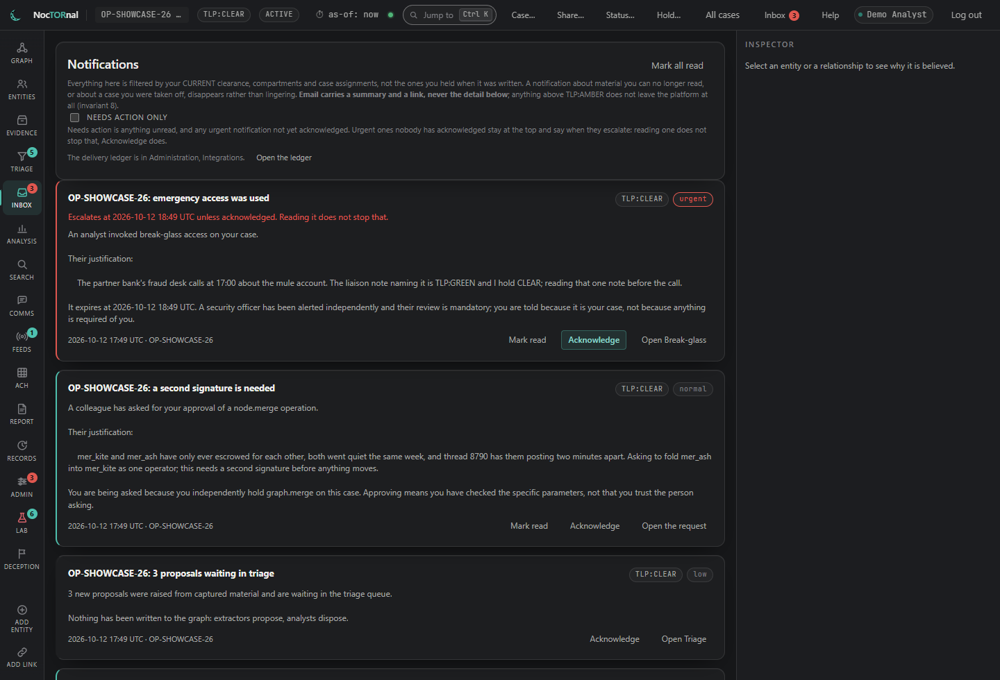

#### What you see

Each notification has a **priority** (urgent, normal, low), a **TLP** chip, a subject, a body, the time and the case, and a link to the thing it is about. The list is filtered by your **current** clearance, compartments and case assignments, not the ones you held when it was written: a notification about material you can no longer read, or about a case you were taken off, disappears rather than lingering. Email carries a summary and a link, never the detail; anything above `AMBER` does not leave the platform at all.

- **Needs action only** shows anything unread, and any urgent notification not yet acknowledged.
- **Mark read** marks one; **Mark all read** marks them all. There is no way to mark a notification unread again.

#### Reading is not acknowledging

Acknowledgement is the signal that stops something nagging, and glancing at a list is not that. An **urgent** notification nobody has acknowledged stays at the top and says when it **escalates**: at that time it is passed to someone else. **Reading it does not stop that. Acknowledge does.** After the time passes the card says it has been passed on, or will be at the next sweep.

#### Preferences

Open **Delivery preferences** to choose, for each outside channel (Email, Webhook, Jira); in-app notifications are always on:

- **Deliver on this channel**;
- a **minimum priority**. Under it, **What this delivers** lists every kind of notification the channel will carry at that priority and every one it will leave out. The one consequence worth reading before you open the list is said apart: if raising the minimum drops **requests for your second signature**, they will not arrive on that channel, only in this inbox;
- an **hourly digest** instead of one message per event;
- **Quiet from ... to ...**, and the **Zone** the hours are read in.

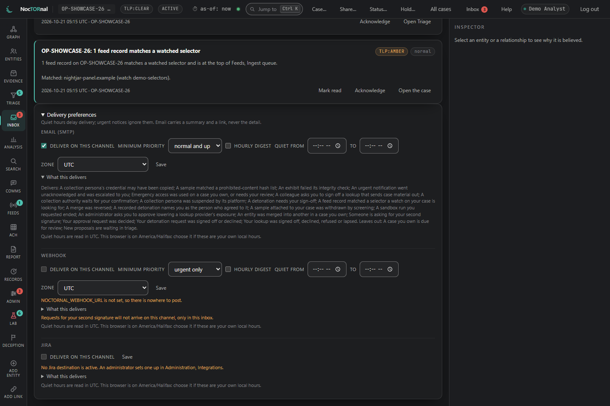
**Quiet hours delay delivery; they never drop it.** A deferred notification is still queued with a due time. Priority 1 (an evidence integrity alarm, a break-glass use) ignores quiet hours, which is the only reason silencing a channel overnight is safe. The hours are read in the zone shown beside them, UTC unless you choose another; if this browser is on a different zone the line says so and tells you to choose it if these are your own local hours.

#### The delivery ledger

**Open the ledger** takes you to Administration, Integrations (Chapter 34), where an administrator can see every attempt to send a notification out of the platform: kinds, channels, destinations, and why each did or did not go. A webhook address is shown with its path withheld, because a path commonly carries the hook's secret.

### 16. Analysis: structural measures

Centralities, communities, brokerage, cut vertices, key-player sets, roles and signed balance, computed over the current view.

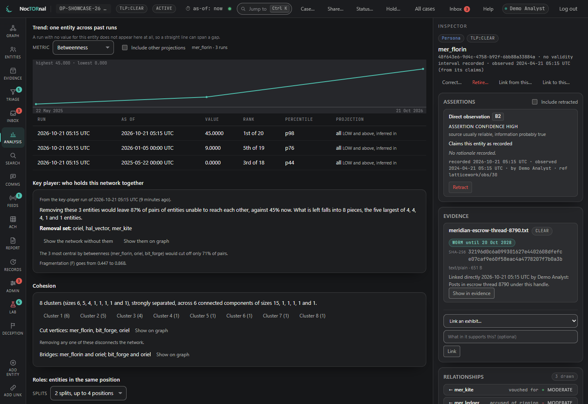

#### Running it

Choose **Run analysis**. It computes over the current view and stores the result, so the pane opens on the last stored run for this view, with its time and whether the graph has changed since: **"The graph is unchanged since."** or **"The graph has changed since. Run the analysis again."** Rows and the run itself are cached; moving a view parameter clears the pane, because runs under different parameters are stored, cached and charted apart.

Beside **Run analysis**: **Trust decay half-life**, **Ties**, **Removal set** (how many entities the key-player search removes), and **Project venues to entities**.

Two cautions the pane repeats, which are worth taking seriously:

- **Every figure is over the view**, and the view excludes what your clearance does not reach. A centrality computed over a redacted graph is a **lower bound**, not a measurement of the case.
- **Betweenness on a sparse investigative graph is unstable.** Adding one edge can reorder the top five. Treat the ranking as a prompt, not a finding.

The caveat flags above the results are warnings, not decoration. They say when the graph changed since the run; when the run was **approximate** (betweenness computed from sampled pivots, so small movements between two approximate runs may be sampling noise); when eigenvector centrality is **not meaningful** on this graph; when the projection includes **non-actor vertices** (INFRA, WALLET, ...) that carry ties, so brokerage means "central in the actor-artefact graph", not "central among actors", or that have no ties, so density and every percentile are computed over a larger population than the actors; and what the ties rest on: **"All 23 ties behind these numbers have been reviewed, and 11 of 23 rest on an exhibit."** A run that includes ties nobody has accepted warns.

#### Options

Three choices beside Run analysis change what the numbers are computed over. Each is part of the run's name.

- **Ties: Accepted ties only** computes over the ties a reviewer has accepted. Unreviewed proposals, disputed, rejected and superseded ties are left out and counted by state under the results. Every entity stays, as an isolate if all its ties were left out.
- **Project venues to entities** replaces forums and channels, or wallets and transactions, with ties between the entities they link: co-posters, co-controllers, and a payer's controller to a payee's. A venue counts for less the more entities share it; one larger than the chosen limit draws nothing and is named. These ties are **derived, not observed**, and the graph keeps drawing the venues as recorded. **Conversations are not projected here**: the Comms pane's co-participation view does that, with its protections for third parties.
- **Trust decay** is described in Chapter 8.

#### Brokers worth a look

Two leads, each in the numbers that qualified the actor:

- **Few ties, high brokerage** (a *broker signature*): three or fewer ties, or fewer than the median entity, with brokerage in the top fifth. These may be the only connections between clusters, which usually matters more than the loudest poster.
- **Spans a structural hole**: among the least constrained quarter and the top quarter for brokerage. Burt's reading is that this actor's contacts are poorly connected to each other, so what passes between them tends to pass through this actor.

Each says things like "degree 3 (median 3), 1st for brokerage of 15 entities with ties". **How these are chosen** opens the rule. A list is cut at five and says "Showing 5 of 9". When nobody qualifies it says so.

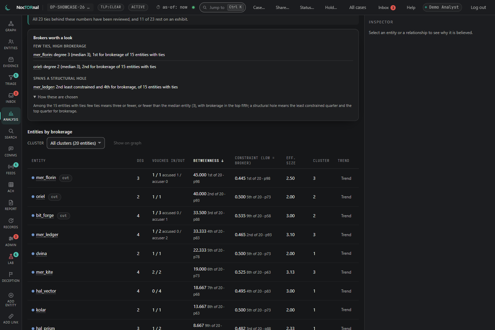
#### The table

**Entities by brokerage**: one row per entity with ties. Rank and percentile sit beside every value, because a betweenness of 0.0341 means nothing on its own and "3rd of 214" does. **Constraint** runs the same way as the rest: **rank 1 and the highest percentile are the *least* constrained entity**, the one spanning a structural hole. Select a column heading to sort by it; a name shows that entity on the graph; **Trend** charts one entity across past runs.

| Column | Meaning |
|---|---|
| **Betweenness** | How often the entity lies on the shortest path between two others. High betweenness with low degree is the classic broker signature. |
| **Constraint** (low = broker) | Burt's constraint: how far an entity's ties are to people who are tied to each other. Low means spanning holes. |
| **Eff. size** | Effective size: how many of an entity's contacts are non-redundant. |
| **Cluster** | The community the entity falls in. |
| **Vouches in / out** | From the trust ties in the view. |

#### Trend

A rising betweenness is a claim about a **person**, so the chart is exact about what it shows: every completed run in this case that recorded the metric, at your visibility, placed at the moment it measured (its as-of time, or when it ran), oldest on the left. Only runs under the **same view** are joined into a line; a run at another confidence floor, with inferred ties in or out, or with other decay, measured something else, and appears only when you include other projections, as separate rings. **A run in which this entity had no defined value does not appear at all** (an isolate has no constraint to measure), and that cannot be told apart from no run having happened, so the line spans such a period rather than breaking: a long straight segment is not evidence that nothing changed.

#### Key player: who holds this network together

Removing a set of entities and seeing how much of the network can no longer reach itself. The pane shows the set, the share of pairs that become unable to reach each other (for example "87% of pairs, against 45% now"), what is left (the pieces), and **Fragmentation (F)**, the same share as a fraction: 0 means everyone can reach everyone, 1 means nobody can reach anybody. **Show the network without them** and **Show them on graph** put the set on the canvas; nothing is removed from the case.

It compares the set with the **top n by betweenness**: the optimal set is usually *not* the top n most central, because two brokers often span the same gap and removing both is redundant. "The 3 most central by betweenness would cut off only 71% of pairs" is the surprise made legible instead of asked for on trust. The set comes from a fast search (a greedy start, then swaps) that is usually, but not always, the best there is. A set that cuts nobody off is not a finding, and the pane says so rather than naming people for nothing.

**Cut vertices** are entities whose removal alone disconnects the network; **bridges** are ties whose removal does. Both are single points of failure in the structure, and the cheap, exact companion to the key-player search.

#### Cohesion and communities

"8 clusters (sizes 6, 5, 4, ...), strongly separated, across 6 connected components of sizes 15, 1, ...". Modularity below 0.3 is weakly separated, 0.3 to 0.5 moderately, above 0.5 strongly. Each cluster has a button that lights it on the graph with the ties inside it.

#### Roles: entities in the same position

**Roles** (CONCOR) finds entities in the same *position*: the same pattern of ties to the same others, **whether or not they are tied to each other**. Choose one to four splits. CONCOR always splits in two, so the number of positions is set by the depth, not found in the data: **read the fit before reading the positions**. A weak fit means the positions are a sorting, not a finding. "Alike but not tied" lists pairs that may fill the same role, one may be the other's replacement, or one person may be behind both; the pattern does not say which. **How the positions were found** opens the method.

#### Regular roles

**Regular roles** (REGE) finds entities with the same *kinds* of ties to the same *kinds* of others: two launderers serving different crews can share a role without sharing a single contact. Choose the most roles to find (two to eight) and whether ties count as present or absent, or by weight. REGE is sensitive to that choice, so a role that holds both ways is the firmer lead. Entities alike at the level of the cut are never split, so fewer roles than asked is an answer.

> **Warning.** **A role is a hypothesis about how entities sit in this view, never an attribution.** Two entities in one role are not one person, and the role does not say who is behind either. **What these roles can and cannot say** opens the card's limits: REGE is an approximation over three rounds, it compares only the ties the view admits, and on ties of one kind with no direction it finds nearly every entity alike, so read the direction and valence of the ties before reading a result as a finding.

#### Signed balance

On a view with positive and negative ties, **signed triads** are counted: "4 of 5 are balanced (80%)". An unbalanced triad is a lead: one hostile tie inside an otherwise friendly triangle (check the grading, or a relationship is breaking), or all three ties hostile (classically unbalanced, but common among rivals with no common ally). **Contested pairs** carry both a positive and a negative tie, a lead in its own right: a vouch and an accusation between the same two entities usually means a relationship that changed.

#### Results on the graph

Where the brokers sit, which cluster community 2 is, and what the network looks like with the removal set taken out are drawn on the sociogram by **Show on graph** buttons. A set shown on the graph says so, with the note it came from, when its run goes stale.

### 17. Search

One box over the whole case, gated the same way everything else is. Search entities, selectors, exhibits, claims and documents.

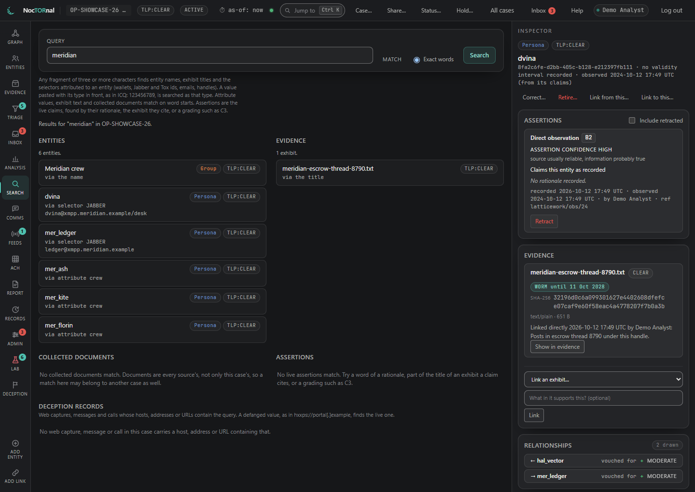

- **Three or more characters** of any fragment find entity names, exhibit titles and the selectors attributed to an entity (wallets, Jabber and Tox ids, emails, handles).
- A value pasted **with its type in front**, as in `ICQ: 123456789`, is searched as that type.
- Attribute values, exhibit text and collected documents match on **word starts**. **Assertions** are the live claims, found by their rationale, the exhibit they cite, or a grading such as `C3`. **Match: Exact words** (the default) is the word-start search; **Similar wording** and **Similar meaning** compare passages and appear only where the deployment supports them.
- Web captures, messages and calls match on **hosts, addresses and URLs** they contain, and a defanged value, as in `hxxps://portal[.]example`, finds the live one.
- The **collected documents** section searches every source, not only this case's, so a match there may belong to another case as well, and it says so when nothing matches.
- Every route filters by your clearance and compartments in SQL, so the cap applies after filtering, and a selector on an entity you may not see is never matched, counted or named. The pane says "showing 50 of 73" rather than cutting the list silently.

### 18. Comms: channels, identifiers and signatures

Where identifiers are normalised into durable form, and where messages are bound to the actors who sent them. Nothing here is a fact: an identifier an actor advertises is a **claim**, and the pane is built to keep it one until something stronger is recorded.

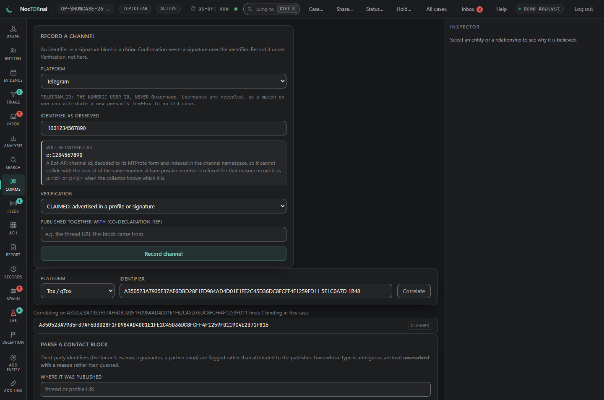

#### Record a channel

Choose the **platform**, type the **identifier as observed**, and the pane shows **Will be indexed as**: what the system will actually store. This matters more than it looks, because indexing the wrong form creates an identifier that never matches the same one seen anywhere else:

- **Tox** is indexed on the 64-hex public key, never the 76-hex ID, because the trailing nospam and checksum rotate and are not part of the identity.
- **Telegram** is indexed on the numeric id, never the `@username`, because usernames are recycled and a match on one can attribute a new person's traffic to an old case. A Bot-API channel id is decoded to its MTProto form and indexed in the channel namespace, so it cannot collide with a user id of the same number; a bare positive number is refused for that reason, and you record it as `u:<id>` or `c:<id>` when you know which it is.
- **Jabber** loses its resourcepart, which is per-connection.

**Verification** chooses where the binding starts: **CLAIMED** (advertised in a profile or signature, the default) and upward as evidence accumulates. **Published together with** records the thread or profile URL a block came from, a co-declaration reference, which is stronger evidence than co-occurrence in a thread because the actor themselves asserted the identifiers belong to one operator. It is still a claim.

**Correlate** takes an identifier and says which bindings in this case hold it, so you can see whether two entities advertise the same one.

#### Parse a contact block

Paste a block of text where somebody publishes their identifiers (a vendor's signature, a forum profile). Each line is classified and bound. **Third-party identifiers** (the forum's escrow, a guarantor, a partner shop) are **flagged, not attributed to the publisher**: if the block says "Escrow: nm_escrow@jabber.example (forum escrow only)", that is the forum's escrow, and the pane does not tell you it is the vendor's. Lines whose type is ambiguous are kept **unresolved with a reason** rather than guessed. Later lines in a block are more often somebody else's, which the score reflects (it falls with position).

Four defences keep a forum's escrow from being read as the vendor's, in order of strength: the **label** on the line (`Escrow:`, `Guarantor:`, `Admin:`), an **in-line marker** such as "NOT mine", the **stoplist**, and **shared-service detection**.

The **stoplist** is a list of known escrow, guarantor and admin identifiers. It is global by default, because an escrow belongs to the forum and not to one case, and a case can hold entries of its own. A line that matches it is flagged **On the service stoplist** and is not attributed to the publisher. The console shows the flag and has no screen for editing the list: a Lead investigator or Reviewer keeps it through the API (`POST /api/v1/comms/stoplist`, and `POST /api/v1/cases/{case_id}/comms/stoplist` for a case's own entries). An entry is retired and never deleted, because parses already cite it, and retiring one needs a reason (`POST /api/v1/comms/stoplist/{entry_id}/retire`). Shared-service detection counts distinct publishers: an identifier advertised by several unrelated ones is shown as **a shared service, not a shared identity**, counted only over cases you can already see.

#### Verification of messages

**A valid signature from a key named in a contact block is evidence of control.** Everything else on this pane produces claims. A message signed by a key whose fingerprint appears in the contact block binds the signer to the identifier cryptographically, and that is the only thing here that can move a binding from CLAIMED to CONFIRMED.

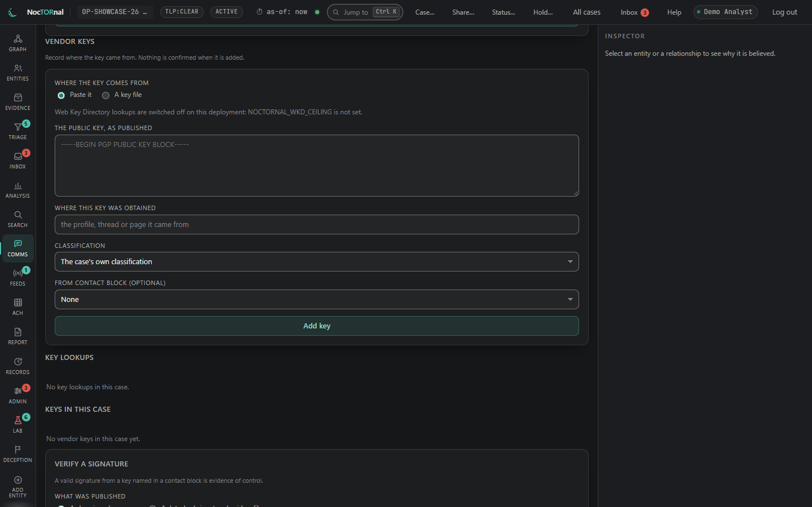

**PGP verification has three outcomes and they are not two**: *confirmed*, *failed*, and **no verifier available**. The third is not a failure and it is not a pass. It means nothing checked the signature: for example GnuPG is not installed, or the key is not known. It is displayed distinctly because treating it as either of the others is how a forged attribution gets believed. A failure to *look* is not a finding about the evidence: the binding stays CLAIMED and should be checked again when a verifier is available.

- **Upload the signed file** if you have it. A pasted copy can lose Windows line endings, and a signature over the file's exact bytes then fails.
- A key you record under **Vendor keys** says where it was obtained and who compared its fingerprint with the one the actor published. **Nothing is confirmed when a key is added.**
- **Key lookups** ask a Web Key Directory for a vendor's key. Nothing is sent until a second person approves, because the request leaves the deployment; the pane says when lookups are switched off on this deployment (`NOCTORNAL_WKD_CEILING` is not declared).
- **Bindings still at CLAIMED** lists the ones nobody has checked.

#### Co-participation

**Ties inferred from being in the same room**: two people in a 500-member channel is not the same evidence as a private exchange, so these ties are inferred, weighted by the room's size, and excluded from metrics unless a view opts in. **Rooms** with too many participants are excluded and named, with how many participants they had and how many were projectable. Conversations are projected here, with their protections for third parties, and not in Analysis.

For a peer-to-peer platform the form says so. For Briar it says **P2P over Tor with no server. There is nothing to serve process on**: there is no operator to serve legal process on to get the account's records, so do not plan on that route. For Tox it says there is a DHT with no server and no offline history, so content comes from a seized device or not at all. Message bodies can be dropped, keeping the metadata graph (`comms.minimise`, a Lead investigator, step-up).

### 19. Feeds: ingest, sources, watches and keys

Material arriving from outside the case. Five sections, one per tab.

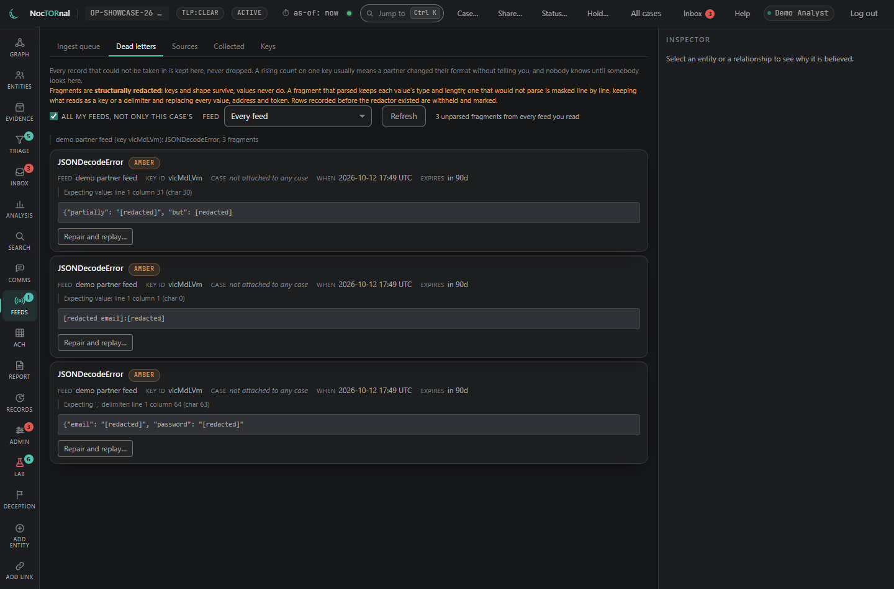

#### Ingest queue

Records that partner feeds sent, **scored and prioritised**.

- **Duplicates are folded into one row**, not dropped: the row says how many copies were folded into it and which feeds sent them. A copy from the row's own feed is **a resend, not a second source**, so it is not corroboration.
- Each row shows every term of its score. **The watched-selector term dominates on purpose**: a hit should surface in seconds, and a generic combo list should sink. A selector one of this case's watches names is worth the most. A watch's selectors count only against records scored after they were added; **Rescore all** scores every record in this case's queue again, which you do after a watch's selectors change.
- **Open** shows a record's metadata and the **shape** of its payload, never a value. A record can hold a whole stealer log, and this is a queue.
- The **category** the classifier chose decides the record's retention, its handling rules and its score. The classifier's guess is kept beside the correction.
- **Quarantine: material attached to no case.** A record with no case cannot be reached by a case assignment, so nobody sees it through the ordinary gate. It still expires: until it is attached to a case it runs on the category's retention clock, not a case's. **Attach to case** puts one under a case's authority; its expiry stays the category's.

#### Dead letters

Every record that could not be taken in is kept here, **never dropped**: a silent drop is how you discover six months later that a feed has been half-failing. A rising count on one key usually means a partner changed their format without telling you, and nobody knows until somebody looks.

- **Fragments are structurally redacted**: keys and shape survive, values never do. A fragment that parsed keeps each value's type and length; one that would not parse is masked line by line, keeping what reads as a key or a delimiter and replacing every value, address and token. Rows recorded before the redactor existed are withheld and marked, and `scripts/redact_dead_letters.py --apply` repairs them.
- **Replay** puts a repaired record back: the fragment is redacted, so take the values from the partner or from the batch's raw object. The repair must be one JSON object.
- **All my feeds** adds the dead letters attached to no case. Those need a sign-in from the last 15 minutes, and when yours is older the list says it is not complete.

#### Sources

Collection schedules and health. **Nothing polls on its own**: a collector that runs itself on a timer nobody watches is how a persona gets burnt at 3am, so polling is **Poll now**, and it needs the collector role.

| Section | What it lists |
|---|---|
| **Unhealthy** | Sources whose recent polls failed. A parser that stopped matching fails silently, so consecutive failures are the signal: usually the site changed its markup. |
| **Never polled** | Added, never run. Not broken and not healthy either: a source somebody added and nobody ever ran is the quiet way a collection plan turns out to have been aspirational. |
| **Due to poll** | Active, past due. |
| **Waiting on a person** | A ceiling to declare, a persona to replace or rest, or an authority to confirm. **Nothing here is polled, and nothing here counts as a failure.** |
| **Sources** | Every source, with its host, parser, the persona it reads as and its exit. |

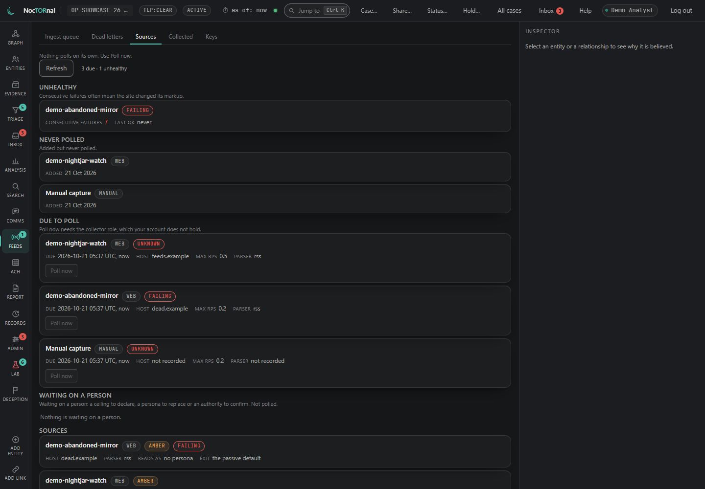

**Add a source** is for a Collection manager. A **forum** source is a public XenForo or MyBB thread or board, read without signing in: the forum sees `NocTORnal-collector` in its access logs, from the egress profile and never from this server. Each poll reads the new pages and rechecks the last few for edits and deletions. A MyBB board prints times in its own zone with no offset, so you give the zone and the two formats its settings show, or no posting time is stored. A forum or Telegram source is **not read** until its classification is within the declared ceiling and a Security officer has confirmed the authority that covers it.

**Telegram chats.** Each chat is read by one persona, through that persona's egress profile, under an authority a second person confirmed. Nothing is sent, nothing is marked read, and no watch term leaves this server: matching happens here, after the messages arrive. **Look up a chat** asks Telegram, as the persona, which chat a name belongs to, and Telegram records that this account looked it up; an invite link is **never followed**: join a private chat from the persona's own device, then add it by its id. **Mark as a member chat** makes the chat read as a member, which needs a member authority, is checked at once, and never goes back to public. **Joining is an overt act**: the chat's administrators can see this persona in the member list and in the recent actions log, and some groups announce every new member; leaving is visible too.

**Personas** are the collection accounts. A **persona** has a platform, a handle, an egress profile, active hours, and a status that ends in **BURNED**, which is permanent: re-using one a forum admin has already flagged is how you burn the next one too. A credential is enrolled on the server and **never through this console**: do not enter the phone number or password here. **Locked by its platform** means the platform refused its credential, and it comes back only with a new one enrolled after the lock. **Telegram device** is what Telegram is told this persona's device is: choose something ordinary and keep it for the life of the persona.

**Persona acts** are what the console asked the collector to do for a persona (look a chat up, join, check, rebind, sign out, poll now). Each is queued, runs in the **collector** service, and reads pending, running, done, refused or failed. An act the collector has not started in time (fifteen minutes, unless the operator set another limit) is not run.

**Collection authorities** are the written authority a collection runs under. The authority itself is a **document outside this system**. **Record an authority** takes its reference exactly as an auditor would look it up, the persona it covers and the sources under it; a Collection manager records it and a **Security officer confirms it, and each source under it**, before any of them is read. Reading as a member needs its own reference, because it is a different act from reading what is public. An authority for a persona with no sources allows the persona's own acts and no read. A change that makes a source reach further (a new exit, a rebinding) stops the authority recorded for the old binding at once: the new binding needs its own confirmed authority before the next poll. Adapter collection **carries no compartments**: work that needs a compartment, or a label above the declared ceiling, is collected by hand into its case.

#### Collected: hits, watches and documents

**Watch hits** are what this case's polls matched, **unacknowledged first**, then by score, so a hit nobody has looked at outranks a higher-scoring one somebody has already dealt with. **Suppressed** hits stay in the list with their reason: a watch drowning in one recurring thread and a watch that has gone quiet look the same if you hide them, and they need opposite responses. **Suppress...** takes a noisy thread out, with a reason of at least five characters that the next analyst reads; **Unsuppress** puts back a hit that alert hygiene hid wrongly; **Acknowledge** marks one read. A feed record that contains a watched selector is **not here**: it is scored to the top of the Ingest queue.

**Watches** are what this case's polls look for. A watch is a **standing tasking against one source**: its keywords, selectors and patterns are tried on every item the collector reads from that source, and each match is a hit. It applies from the source's **next poll**, to what that poll reads, so documents already collected are not matched again. A selector also counts toward the score of a partner feed record in the Ingest queue, once that record is scored again.

**Add a watch** is shown only to an account that holds the Collection manager role (`COLLECTOR`, which carries the global `watch.manage`) and is also assigned to the case, in a role that can read its collection: Lead investigator, Analyst or Reviewer. The account the installer creates, a Lead investigator and a System administrator, does **not** see the form: an administrator grants the Collection manager role under Administration, Accounts, with **Grant role**. A source has to exist as well; the form reads "No source is available" when there are none. A closed case takes no new watch.

Choose the source, name the watch (three characters at least), say what it looks at, give **at least one keyword, selector or pattern**, one to a line, choose a priority from 1, the most urgent, to 5, and say for how many minutes repeats on one thread are thinned (0 gives a hit for every match).

- Keywords and selectors match anywhere in an item's title or text, whatever the case; a selector that equals an id the item carries, such as its author, matches too.
- A **pattern** is a Python regular expression, matched without regard to case in a separate process that is stopped if it runs long; the server checks that it parses when you add the watch, and the API never matches it.
- What a watch **looks at** (a board, a thread, a user profile, a channel, a feed or a search) is a note for the people reading the list: the collector reads the source's own address and does not visit that one. **A Telegram chat is the exception.** It is named by its typed id, `c:` for a channel or supergroup and `g:` for a basic group, **never by an `@name`**, because a name can be given to someone else, and choosing the Telegram source that reads the chat fills the id in, so it cannot be mistyped or aimed at a chat the source does not read. A chat watch fires only on a message collected from that chat, and with no term at all it fires on every message there.
- Adding a watch is audited with the **number** of its terms and never the terms. Nothing stops or edits a watch yet.

**Collected documents** lists everything collected at your clearance, from **every source and not only this case**: a document hangs off a source and has no case of its own, so the same forum post is material in however many cases cite it. Bodies are excerpted, and a row marked truncated has more behind it. Purged documents are absent, not shown empty. Filter by triage state, and place a legal hold from a document's card; lifting one lets the document and its earlier versions follow their retention rule again, unless a case that cites them is held.

#### Keys

**Ingest keys are write-only.** A key can submit batches and read nothing back. A leaked key means junk data in a quarantine bucket, never the case file, and the database itself enforces that.

**Issue a key for a partner feed** takes a name, an **expiry** (mandatory, one year at most), the classification it is cleared for, and optionally the **addresses** it may be used from (empty accepts it from anywhere). A **stealer log, credential dump or database leak** feed must name a **compartment you hold**, or every record it sends is refused at parse. The key is shown once. A key unused for over thirty days is either a dead integration or somebody else's: revoke it if nobody can say whose it is. **Revoking** refuses every submission on it from then on, and a revoked key is not restored: the partner needs a new one. Key administration needs `ingest.manage`, because which feeds exist and what they are cleared for is operational intelligence about the deployment.

### 20. ACH: competing hypotheses

Heuer's Analysis of Competing Hypotheses, scored. **This pane ranks by inconsistency, ascending.**

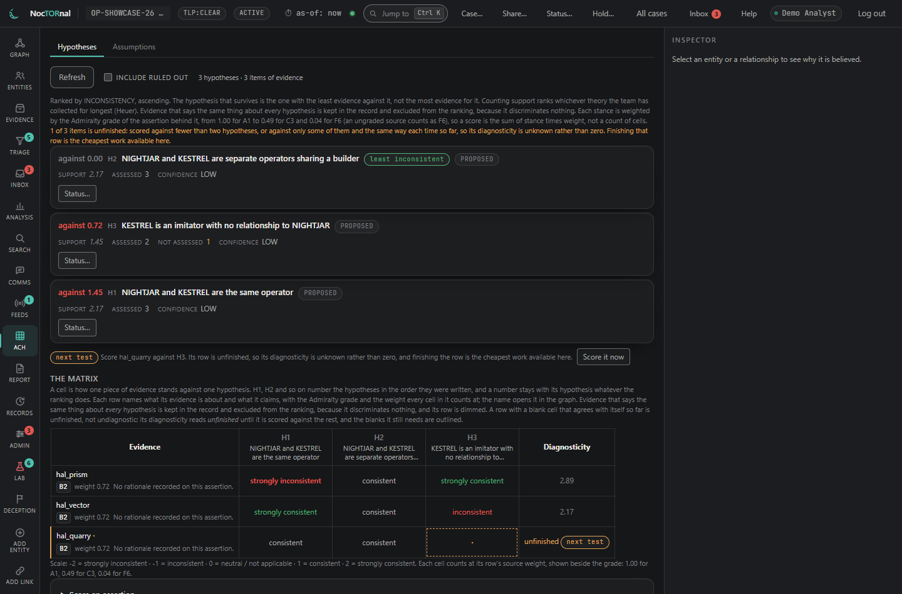

> The hypothesis that survives is the one with the least evidence **against** it, not the most evidence **for** it.

Counting support ranks whichever theory the team has spent longest collecting for, which is confirmation bias with a scoreboard. So **support** is shown and never ranks.

#### How the ranking works

Every cell of the matrix is a **stance**: how one piece of evidence stands against one hypothesis, on a five-point scale (-2 strongly inconsistent, -1 inconsistent, 0 neutral / not applicable, 1 consistent, 2 strongly consistent). **Evidence in the matrix is an assertion, never free text**: each row inherits the Admiralty grading and the retraction status of the claim it rests on.

- **Every score is stance times weight.** A row's weight comes from its Admiralty grade, 1.00 for A1 down to 0.04 for F6 (the table in Chapter 5), and an ungraded source counts as F6. A ranking card prints the result as *against 0.49*, never as a bare number.
- **Evidence that says the same thing about every hypothesis is kept in the record and excluded from the ranking**, because it discriminates nothing. Its row is dimmed. It feels like strong evidence and settles nothing.
- A row's **diagnosticity** is how far it separates the live hypotheses: the spread of its stances (0 to 4) times its source weight. 0 means it says the same thing about each.
- **H1, H2 and so on number the hypotheses in the order they were written.** A number never moves when the ranking does, and a ruled-out hypothesis keeps its number.

The pane opens with **How the ranking works** collapsed; it carries the service's own statement of the rule.

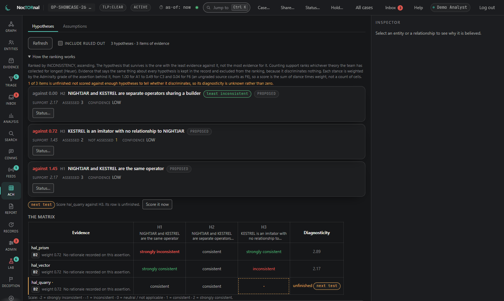
#### Warnings: read them

They are not decoration.

- **An untested hypothesis is excluded from the ranking** and named. It has not survived; it has not competed. Score the existing evidence against it first. A hypothesis assessed against nothing scores inconsistency 0.0, the lowest the scale can produce, so without this rule it would sort first and be named the survivor on the strength of never having been examined.
- **A row with a blank cell that agrees with itself so far reads *unfinished*, not 0.00.** Its diagnosticity is *unknown*, not zero; the blanks it still needs are outlined, and finishing that row is usually the cheapest useful work on the screen. The **next test** line names the row and the hypotheses it lacks, and **Score it now** opens the first blank. It is the most diagnostic item with a blank cell, and a blank cell is a gap, not a neutral stance.
- **Items that say the same thing about every hypothesis** are counted and left out of every score.
- **The top two hypotheses are equally inconsistent**: the matrix does not discriminate between them yet. Look for evidence that would be inconsistent with exactly one.
- **Only one hypothesis**, or none: ACH needs at least two, and a single hypothesis with evidence gathered for it is what ACH exists to correct. Write the one you think is **wrong** too. A set of hypotheses that are all variations of the same theory produces a confident answer to a question nobody asked.
- **Some evidence is above your clearance.** A cell you cannot see is blank for you, so a hypothesis may have more against it than the matrix shows. Depending on the case's setting, the pane says that some items, or how many, rest on material above your clearance or outside your compartments, and never which or where.

#### Working the matrix

- **Score an assertion**: select an entity or tie on the graph, load its live assertions here, and score one against a hypothesis. Every further cell in that row is then one click in the matrix.
- **A cell keeps its note.** The chooser opens with it and says who wrote it and when, a save keeps it unless you change it, and a replaced note stays listed as an earlier note and in the audit trail. The report prints each note beside the stance it explains.
- **Clear** puts a cell back to not assessed, which *neutral* is not.
- **Status...** accepts, disputes, rejects or supersedes a hypothesis, or puts it back in play. Rejecting needs the reason, and so does taking a rejection back. **Rejected** and **superseded** hypotheses leave the ranking; tick **Include ruled out** to list them after it. A rejected one stays in the report with its status and the reason given for it. A superseded one leaves the report. A status can be changed again later; the note is kept with it and printed in the report.
- **Reword...** corrects a hypothesis while nothing has been scored against it. After that, write the new wording as a new hypothesis and mark the old one superseded.
- Each row **says what its evidence claims**: the entity, or both ends of a tie, and the rationale. The name opens it in the graph.
- Reading a matrix needs `report.generate`, not only access to the case, because an ACH matrix is an analytical product with a conclusion in it.

#### Assumptions

The **Assumptions** tab lists what the analysis takes for granted: a claim the case rests on that nobody has evidenced (that a handle belongs to one person, that a timezone is local, that a leaked database is genuine). Writing it down is what makes it reviewable. An **open** assumption is a question still owed an answer, and a **refuted** one that nobody revisited is how an analysis quietly becomes wrong. Refuting one needs the reason, and so does confirming or reopening one that was refuted. A refuted assumption is a good outcome: the register worked. **Open and confirmed assumptions appear in the report**; withdrawn and refuted ones do not. **Withdrawing is permanent**: it records that the assumption was entered in error, it leaves the report and the working list, it stays in the audit trail under your name, and it can never be reviewed again. To say it is false, **refute** it instead. Every analysis has assumptions; one with none written down has not looked for them.

### 21. Report: build, then release

Two steps, deliberately separate, so you can see exactly what would leave before anything does.

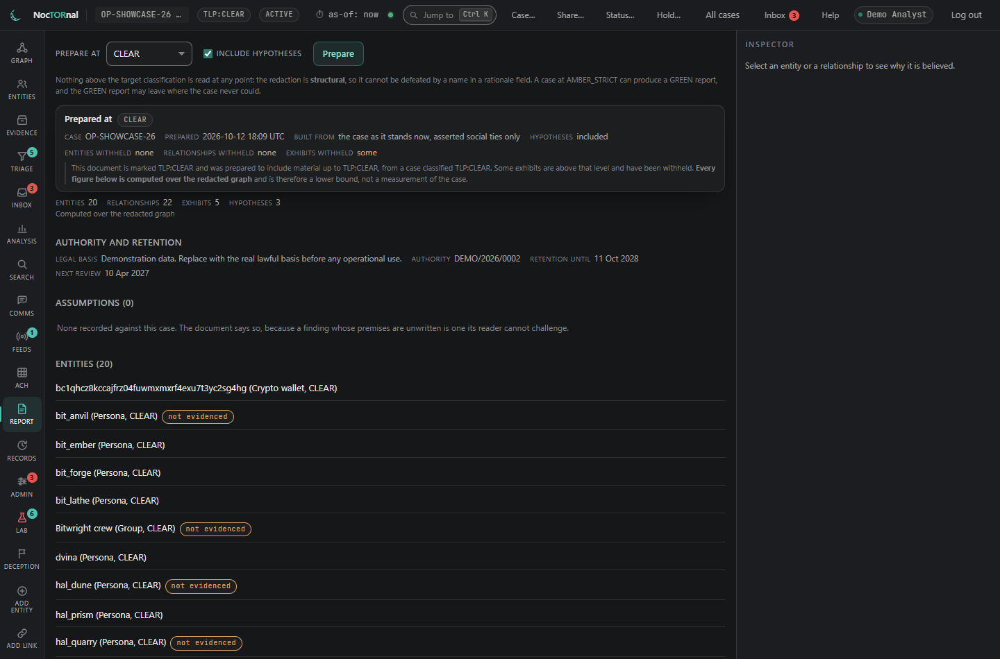

**Prepare** builds a document at a target classification, **Prepare at** a level. **Nothing above the target classification is read at any point**: the redaction is *structural*, so it cannot be defeated by a name in a rationale field. A case at `AMBER_STRICT` can produce a `GREEN` report, and the `GREEN` report may leave where the case never could. If the case's own title and code are above the target, they are withheld too and the document says so. **Include hypotheses** adds the ACH matrix, which has to be scored, so preparing runs on a button and not on opening the pane.

The preview shows what the document is built from ("the case as it stands now, asserted social ties only"), what was withheld (entities, relationships, exhibits), the authority and retention, the **assumptions** (None recorded against this case: the document says so, because a finding whose premises are unwritten is one its reader cannot challenge), and the entities.

**Every figure in a redacted report is labelled as computed over the redacted graph**, because a number carried across a classification boundary without that label is a number that will be quoted without it.

**Ask whether it may leave, then save it.** Choose a **destination**: *export* (an analyst saves it as a file), *smtp* (email), *jira* or *webhook*. The last three cross the boundary into a system with its own access model, which this platform does not control and cannot audit. Optionally state the **destination ceiling**. Say **who it is for and why**, and press **Check egress**. It **decides; it does not send.** Sending it, and to whom, is still a human act with a human's name on it, and a refusal is audited as loudly as a permission. **Save the cleared document** gives you the file, and only if it matches the preview.

- A report is always built from the case as it stands **now**, so the document can contain material the graph is not showing.
- If the case changed after the preview was prepared, the document just cleared is not the one shown above: prepare again, read it, and check again before saving anything.
- Saving or sending a report needs the **Lead investigator** role on the case.
- Checking egress needs a sign-in from the last 15 minutes; press **Check egress** again to be asked for one.

### 22. Records: retention, destruction, break-glass, audit and lookups

The governance pane. The rules behind it are in Chapter 9; this chapter is the pane.

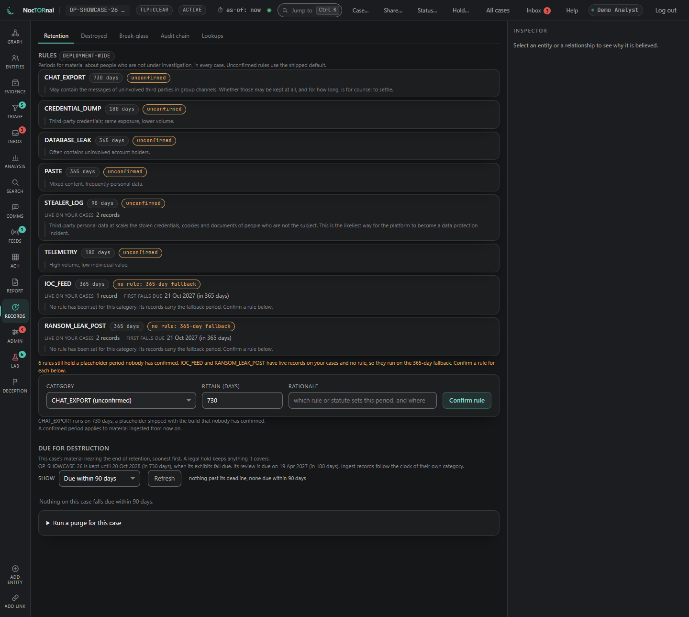

#### Retention

**Rules (deployment-wide)** lists every ingest category with its period, whether it is **confirmed**, and how much live material on your cases runs on it. Periods for material about people who are not under investigation, in every case. A banner says how many rules still hold a placeholder nobody confirmed, and which categories in use have no rule at all and run on the 365-day fallback. **Confirm rule** takes a category, a period in days, and a rationale ("which rule or statute sets this period, and where"), and needs `retention.manage` and a sign-in from the last 15 minutes. A confirmed period applies to material ingested from now on; **nothing already on file is recomputed**.

**Due for destruction** is this case's material nearing the end of retention, soonest first, with a **Show** filter (due within 90 days, and so on). The line above it says when the case itself is kept until and when its review is due; ingest records follow the clock of their own category. A legal hold keeps anything it covers.

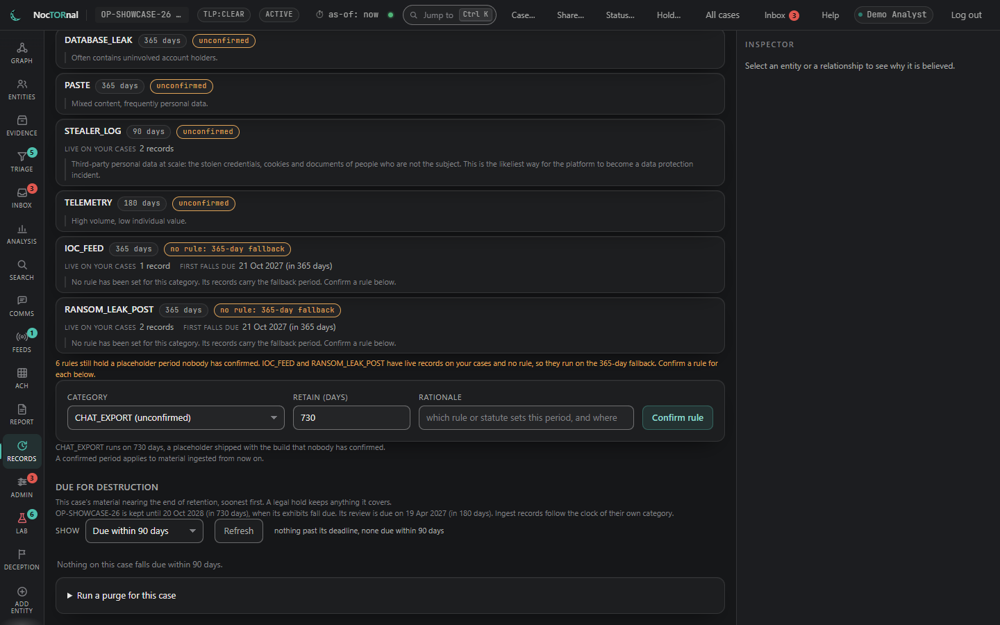

**Run a purge for this case** and **Confirm destruction**: a **dry run** reports what would be destroyed and destroys nothing, and it is the default every time the pane opens. A real run needs a dry run first, under the same authority, and asks you to type the case code.

#### Destroyed

The tombstone ledger: what was destroyed, by whom and under whose authority, with a storage outcome per batch (destroyed, refused under a lock, failed).

#### Break-glass

**Invoke emergency access.** Easy to obtain, loud in every other way, capped at **eight hours**. It raises your clearance for a few hours and nothing else: it adds **no permission and no compartment**. Everything it opens above your own clearance is counted, and a Security officer must review it afterwards.

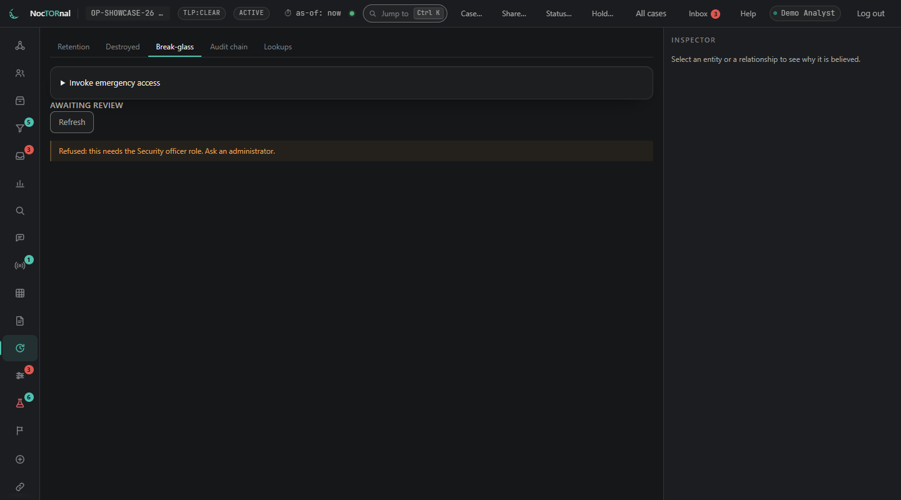

- **Scope**: this case only, or every case you are assigned to. **Raise my clearance to**: choose the level the emergency needs; levels you already hold are listed but cannot be picked, because a grant to them would raise nothing. **For**: the number of hours. **Justification** is the text somebody defends later: at least 40 characters.
- **Why** is the text somebody defends later: at least **40 characters**, and the counter says how many you have. The review is the control that makes emergency access acceptable at all. A grant nobody looked at is a role.
- Invoking **alerts every Security officer at once, even in quiet hours**, and one of them must review it. It **refuses outright if nobody other than you holds `SECURITY_OFFICER`**, because the mandatory review is the control and a grant nobody will review is just access with a better story.
- What it opens, on a **case** grant: the graph, the entity and exhibit lists, the inspector, search, comms, analytics, tags and captures include material up to the level, on that case only. What you create, and any report you build, stay within your own clearance. On a **deployment** grant the same holds on every case you are assigned to, what you may create there and the reports you build are raised too, and so are the Lab, collection and ingest views.
- **What is counted:** each exhibit, capture or message you open above your own clearance, and each change you make to an entity above it. Nothing else a grant widens is counted (the graph, the inspector, lists and search), except on a case classified above your own clearance, where every request on that case is. The count is therefore **not** a statement that nothing above your clearance was seen.
- While a grant is live the header shows **BREAK-GLASS** and the level in force where it is in force, and a live grant ends on its own: that is intended, not a limitation.
- **Awaiting review** is the queue a Security officer works. A live grant cannot be reviewed yet: **End it now**, or review it once it has expired. Ending a grant is not reviewing it. Reviewing your own grant is refused: somebody else has to review it. The verdict is permanent.
- The queue and the review live under **Oversight** for a Security officer, and are refused to everyone else: the review belongs to the Security officer, and only to them, because a team that can review its own emergencies is the one thing the separation exists to prevent.

#### Audit chain

**Re-computes the audit log's hash chain** to check it is intact. Every audit row hashes its predecessor and all of its own payload columns, and re-computing that chain is the only way to tell an intact log from an edited one: until somebody asks, the two look identical. **Chain of custody** checks the custody ledger, which is what goes to a court. It is **one chain across every exhibit**, so naming an exhibit narrows what is *reported* and not what is *checked*; leave it blank for the answer to "is this exhibit's history complete". Verifying needs `audit.read`: the administrator configures, the officer audits, and neither reads case content by default.

#### Lookups

A lookup sends one selector from this case to a provider. **Your own instance** (NONE) is asked at once; a vendor or a public service is asked only after the colleague the requester names signs it off here. The pane lists **Waiting for your sign-off** (signing off sends case material out, so it needs a sign-in from the last 15 minutes), **This case's lookups**, and **Planned batches**. Every answer is kept as case material and becomes suggestions in Triage, never graph. A batch goes to your own instance only: preview it, and nothing is sent or written until you queue it with a reason.

### 23. Lab: malware samples

**Metadata renders. Bytes never do.**

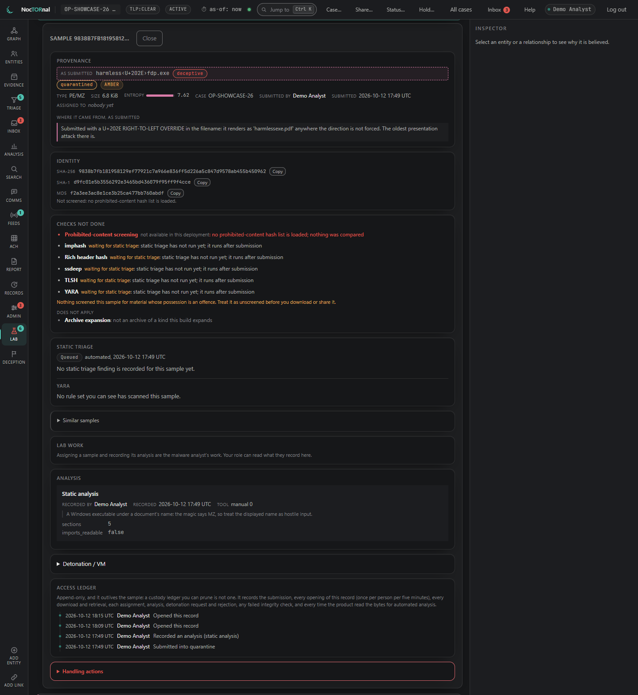

There is no preview, no hex view and no icon taken from the file. Rendering attacker-supplied bytes in the same origin as the case file would build a drive-by vector into your highest-trust system, seeded with hostile files by design.

#### The banner

The Lab opens on a **Restricted on this deployment** notice until two declarations are made: a **prohibited-content policy** and a **separate origin for sample downloads**. Without the policy submissions are refused, and without the origin downloads are off; the banner says which, and who to contact. It also carries the legal notice: counsel must review this deployment before it is used, because a store of attacker-supplied binaries will eventually receive material whose possession alone is an offence, and the handling rules differ by jurisdiction; this software records a declaration, and cannot verify one. Once read, the banner folds to one line and stays folded for you. Its facts say what is declared: the policy, whether downloads are on, and what happens to **rejected samples** (preserved under a legal hold, destroyed, or "not set", in which case a rejection that disposes of bytes is refused).

#### Queue

Lists the samples attached to the case you have open, by **state**: quarantined, triaged, assigned, in analysis, reported or rejected. **All cases I can see** adds the other cases and the unattached samples, each card naming its case. Either way the list is filtered by **your own clearance and compartments** and not the case's, because a sample can be classified above the case it belongs to, and the case gate alone would leak that it exists. A sample whose case you cannot open is shown because your clearance covers the sample, not because you can open the case.

**Search by hash** finds the samples you can see by imphash, Rich header, ssdeep or TLSH. The value travels in the request body, and the server neither logs nor keeps it.

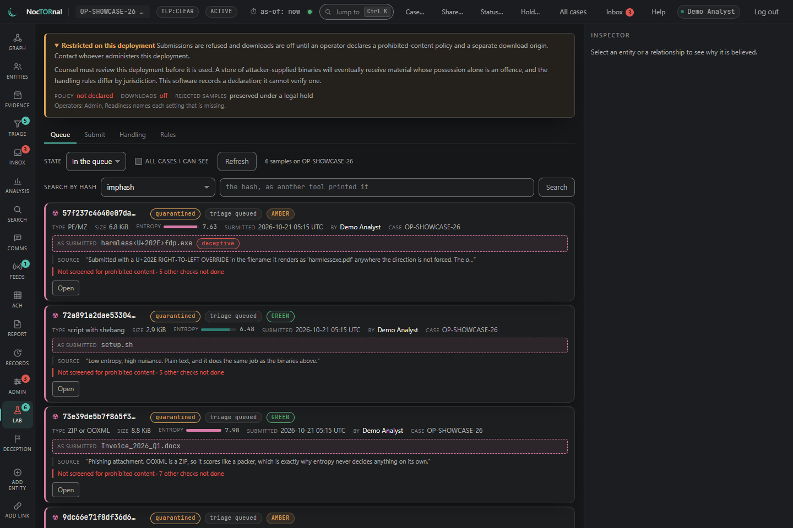
Each card shows the SHA-256, the file type, the size, the **entropy**, the case, who submitted it and when, the **as-submitted filename**, the source note, and the **gaps**.

- **The filename is evidence, not a path.** It is shown boxed, and characters that change how it renders without changing what it is (a right-to-left override, a zero-width character, a control) are replaced with a visible escape and the row is flagged `deceptive`. `harmless‹U+202E›fdp.exe` would otherwise read as `harmlessexe.pdf`. It is stored for the record, never used as a path component, and never trusted to say what the file is.
- **Entropy is a hint, not a verdict.** Shannon entropy over the whole file, 0 to 8. Above about 7.2 is usually packed, compressed or encrypted. A ZIP scores the same as a packer, which is why the bar sits next to the file type rather than alone.
- **Gaps are listed before findings.** A step that has not run, one that was refused (an archive entry, a file over the analysis maximum) and one the build does not do (a RAR or 7-Zip archive is not expanded) are each recorded on the row with their reason. A missing imphash reads as "this sample has no imports", and a recorded gap says nobody looked. A sample **not screened for prohibited content** says so, and you should treat it as unscreened before you download or share it.

**Open** puts a sample's card under its row: its hashes, imports, sections, strings, the static triage and YARA matches, an **access ledger** (append-only, and it outlives the sample: it records the submission, every opening of this record once per person per five minutes, every download and retrieval, each assignment, analysis, detonation request and rejection, any failed integrity check, and every time the product read the bytes for automated analysis), and the actions.

#### Submit

**Submit** quarantines a file: you choose the case, the **classification** and any compartments you are read into, and say where it came from. It lands in **QUARANTINE**, encrypted at rest under a per-sample key, stored under its SHA-256 and never under its filename. Nothing reaches the analysis queue before static triage has run. While sample ingest is refused (legal item L1) the form says so before you choose a file. Samples up to the deployment's cap are accepted; larger is a disk image or a mistake and is refused before a byte is read. If you are read into no compartments, a sample you submit carries only its case's.

#### Static triage

After a sample is submitted, static triage computes its **imphash and Rich header**, its **ssdeep and TLSH** fuzzy hashes, and scans it with the **YARA rule sets** a Security officer has activated. It runs outside the upload, in **child processes** limited in time, and on Linux in memory and file writes too; the card says which limits applied. A child is started without this deployment's secrets, but where it could still read them from another process or reach the database host, the Readiness page says so. **Findings are recorded as the lab's, never written into a case**: a hash becomes a case entity only when an analyst proposes it and the case accepts it.

An **archive** is expanded after its static triage, within limits on depth, member count, size and ratio, and each member it stores becomes a **sample of its own**, screened and triaged like any other, carrying its archive's case and labels, never lower. A member that matches a prohibited-content list isolates the whole tree for good. Caps are named when they refuse. By default they are 200 members, 256 MiB, a 100 to 1 ratio and two levels per archive, and 1,000 members in a whole tree (`NOCTORNAL_ARCHIVE_MAX_*` set them, and the analysis memory limit bounds the total). Zip, tar, tar.gz, tar.bz2 and tar.xz are expanded.

#### Handling

The **Handling** tab is the one-page list of what this screen will and will not do: metadata renders and bytes do not; the filename is evidence; downloads come from a separate origin and need a recent sign-in; the archive password is not protection; a rejected sample is preserved; screening compares exact hashes; archives are expanded after triage; every read is recorded; sandbox sends need a second person's sign-off when the sandbox is exposed. The line under it says what is true of **this deployment's** download origin. The rest of this chapter is the detail.

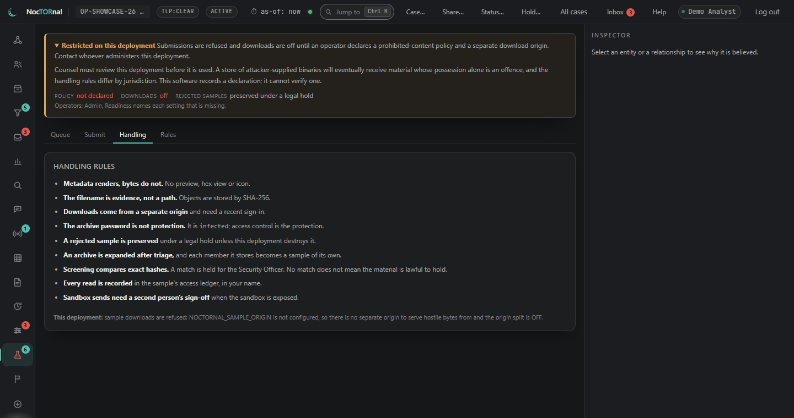

- **Download is a separate origin, step-up gated.** It is the one action here that puts working malware on a disk. It refuses unless the request arrived at the configured sample origin, and the check lives in the service so a second caller cannot skip it. The archive password **`infected`** is an interlock against a double-click and a mail gateway, **not confidentiality**. It is public and ZipCrypto is broken by design. Confidentiality comes from access control, transport and audit. It needs a fresh second factor.
- **A rejection preserves the sample.** Rejecting takes the sample out of the working queue and keeps the row, with your reason: an auditor asking "did anything prohibited come through here" needs an answer. Unless the deployment chose otherwise, the encrypted bytes are **moved** into the object-locked `noctornal-preserved` store under a legal hold and the data key is kept. Getting them back takes two people: a Security officer authorises one named Lead investigator for that one sample, for at most 30 days and in writing, and that investigator retrieves it as an encrypted archive. Nobody can authorise their own retrieval. Nothing in this console can lift the hold or delete the bytes.
- **Destruction is a deployment's declared choice, and a legal hold beats it.** A rejection destroys the bytes and the key only where the deployment has declared `NOCTORNAL_REJECTED_SAMPLE_DISPOSITION=destroy`, and if the sample or its case is under a legal hold that is refused: preservation and destruction can both be legal obligations, and software does not get to choose.
- **Screening compares exact hashes** against the lists this deployment imported. **No match does not mean the material is lawful to hold.** A matched sample disappears from the Lab for everyone, its bytes are kept under a legal hold, and it is never downloaded, retrieved or sent anywhere from here. The Security officer sees which lists matched and what happened, never the file's name or the case's content. Import a list only if counsel has confirmed this deployment may hold it; one md5, sha1 or sha256 in hex per line, `#` starts a comment, and one bad line refuses the whole list.

#### Rules

**Rule sets** are the YARA sets the lab scans with, labelled, and you see only the sets your clearance and compartments reach. A **lab member** creates a set, uploads a version of it with its licence or adopts one that `scripts/yara_db.py import` brought in, and can queue a rescan of the samples they can see with the active version. A **Security officer who did not sponsor a version activates it**, under Oversight, and writes down the clearance they are relying on when the source asks for its licence to be reviewed; it is kept with the activation and in the audit trail. Activating does not rescan samples already held. **A match is the lab's finding about a sample, never a fact about an actor.**

#### Detonation

**Detonation / VM** records an authorisation. Where the operator has configured one self-hosted **CAPEv2**, the sandbox worker can then send the sample, as the encrypted archive and never the raw file, after a second person's sign-off where the target or route is exposed; where none is configured, nothing is submitted and the row says so. Requesting a detonation needs the detonation permission, which no role carries unless the deployment grants it. The exposure level is the decision the panel exists to slow down:

| | |
|---|---|
| **Private instance** | A sandbox you run: the sample goes only to it, outside NocTORnal's labels, holds and retention. No authoriser is required unless its network route is live. |
| **Vendor sandbox** | The sample and its hash reach a commercial vendor. Several "private" tiers still share hashes with partners; confirm what yours does before relying on this being quiet. |
| **Public sandbox** | The sample, its hash and the fact that somebody submitted it become public. Operators monitor public sandboxes for their own samples. **Assume the subject learns you have it, the same day.** |

Anything but private needs a **named authoriser** and a **written reason**, held by a database constraint rather than by the form remembering to ask: a named human and a written reason are required, and submitting to a vendor or public sandbox exposes the sample *and* your interest in it, so it cannot be a side effect of clicking Analyse. Nothing compartmented is sent.

### 24. Deception: phishing, BEC and vishing

Three kinds of social-engineering evidence, each in a section of its own: **Web captures**, **Email / BEC** and **Calls / vishing**. One rule is applied three times: **what the attacker chose is shown, marked as the attacker's, beside what the infrastructure proved.** Reading any of it needs `evidence.read` on the case.

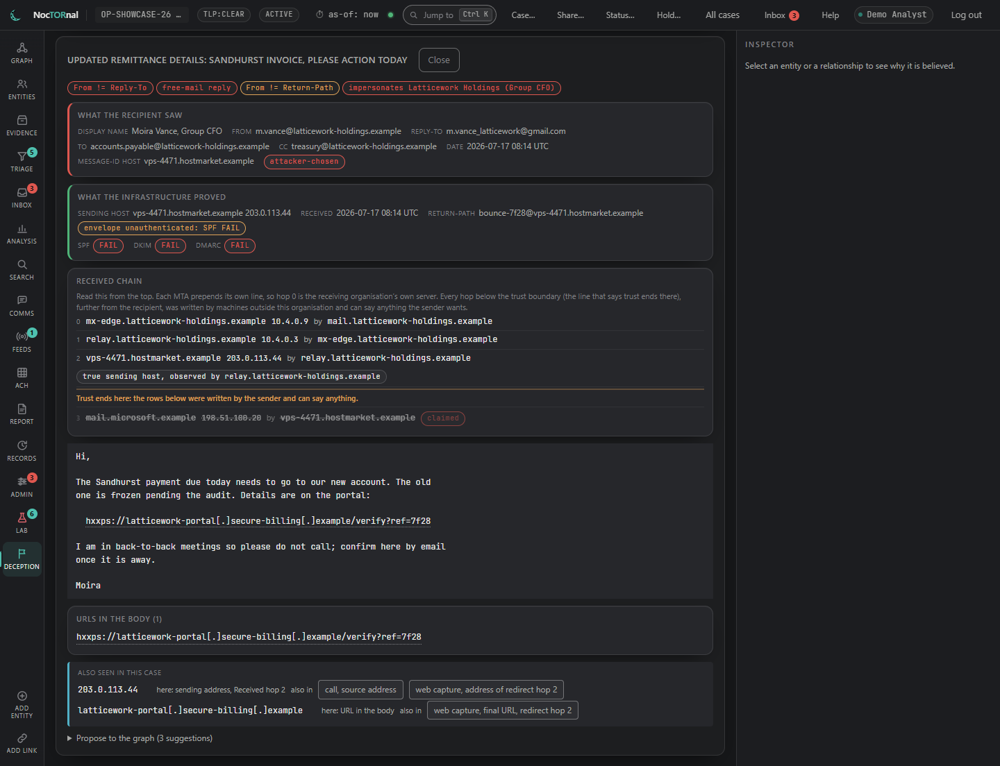

**Nothing in this pane is live.** Every URL is **defanged** and drawn as text, never a link, because a mis-click would fetch attacker infrastructure from this machine and tell them the investigation exists; copying one copies the defanged form. An email body is **never rendered**: an HTML message loads remote images and fires the actor's tracking pixel from this organisation's IP at a timestamp that tells them when the investigation reached them. So only its extracted plain text is shown, with every URL defanged, and the HTML stays in the exhibit. A captured page's DOM is held as evidence and not shown, because it is attacker-authored code; it is download-only from the separate sample origin.

#### Web captures

A screenshot on its own proves somebody had a screenshot. **The evidence is the whole fetch**: requested URL, redirect chain, final URL, TLS certificate, screenshot and DOM, all at one timestamp, so a screenshot cannot be re-paired with another page's DOM. A row says how it was captured (supplied by the victim, an analyst's own upload or a passive feed), whether the page is live or dead, and whether an analyst entered input into it. **Open** shows the screenshot and each **hop** with its status, address, network (AS number) and server banner, and the **certificate** (subject, issuer, dates and key hash) with its age against the first lure in the case: a certificate issued days before the first message is infrastructure built for the job.

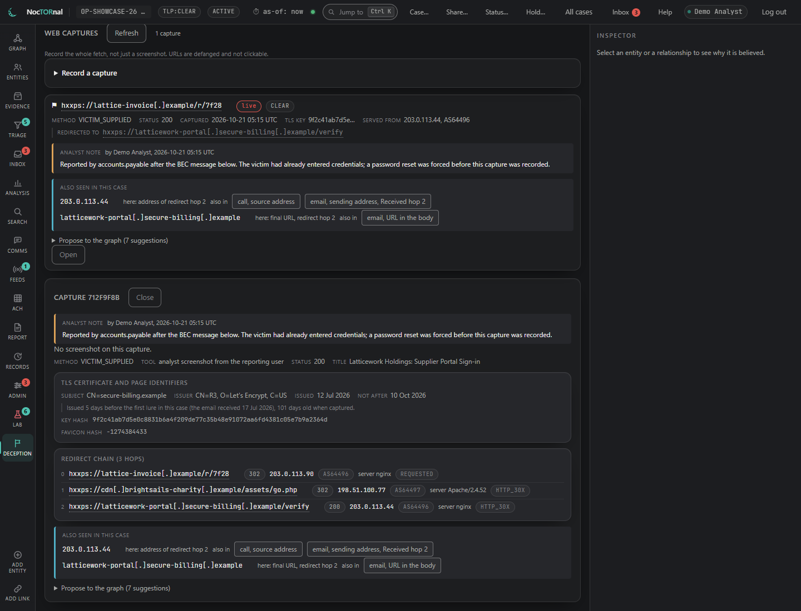

- The **certificate public-key hash** is the durable identifier for pivoting: phishing infrastructure rotates domains constantly and keys rarely, so it outlives the domain.
- The **favicon's MMH3 hash** is the usual way phishing kits are clustered, but **weak on its own**: a stock framework icon is shared by thousands of unrelated sites.
- **Record a capture** files what somebody else captured; an active fetch is the collection tooling's. Ticking that an analyst **entered input into the page**, canary credentials included, asks for the **written authority** it was done under (legal item L5), and the schema refuses to record the submission without one.

#### Email / BEC

A message has two blocks. **What the recipient saw** is the display name, From, Reply-To, To, Cc, Date and the Message-ID host, every one marked **attacker-chosen**: every header written by whoever sent the message, so the display name and From are the lure, and none of them is an identity. **What the infrastructure proved** is the sending host as the recipient's own relay observed it, the envelope sender, the Return-Path and the SPF, DKIM and DMARC results.

Chips flag the BEC tells: **From != Reply-To**, a **free-mail reply**, **From != Return-Path** (amber, because bulk mail diverges there legitimately), and **impersonates** followed by the party the display name imitates, which is the uploading analyst's reading and not something the headers prove. **Reply-To differs only** keeps the first. The envelope sender the receiving server recorded is at a different domain from the From: header: ordinary for mail sent through a bulk provider, but in a message claiming to be from a colleague it means the From: was not the sending system's.

The **Received chain** is drawn recipient-first with the **trust boundary** marked. Hop 0 is the receiving organisation's own server: that line is **an observation**, written by that relay. **Every hop below it, further from the recipient, is a claim**, because the sender wrote it, and is labelled so. Where nobody has named the organisation's mail servers (`NOCTORNAL_TRUSTED_MTA_HOSTS`) the boundary is only **assumed** to be hop 0, and the pane says so: if none were named, this host may be the recipient's own relay rather than the sender. The sending address the receiving server recorded is authenticated only where SPF passed for its domain; without a passing check it is the sender's claim, observed, and not proof of where the message came from. A check nobody ran reads **not checked**, which is not a failure; one that could not complete is amber, because nobody knows. A part that could not be decoded has no size or hash established: it is **not** an empty attachment, so see the parse gaps.

**Upload a message (.eml)** keeps the file exactly as uploaded, as an exhibit, never rendered, and reads its headers from it.

#### Calls / vishing

The caller ID is the attack, so a row keeps two blocks apart. **What the victim saw** is the number and name the handset displayed, marked attacker-chosen, and it **never becomes a selector**: putting it on an entity would attribute the crime to whoever's number the attacker picked. **What the network recorded** is the originating trunk, the P-Asserted-Identity (set by the trusted network; the SIP From URI came from the trunk, not the display), the carrier, the source address, the number called, the length, the outcome, the SIP Call-ID and the **STIR/SHAKEN attestation**, said in words:

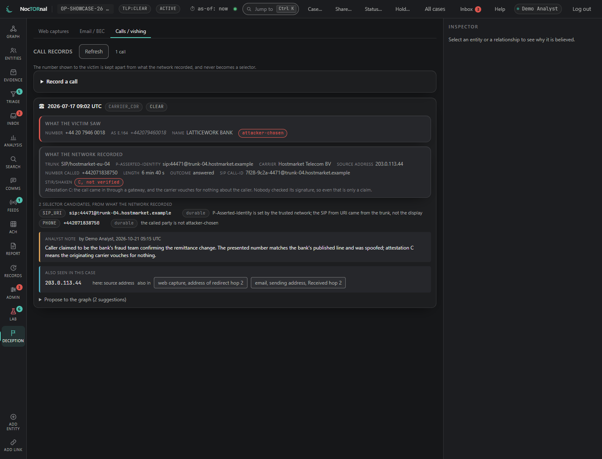

| Attestation | What it lets you conclude |
|---|---|
| **A** | The originating carrier knows the caller and vouches that they may use this number. |
| **B** | The carrier knows the customer who placed the call, but not that they may use this number. |
| **C** | The call came in through a gateway, and the carrier vouches for nothing about the caller. |
| **none** | No attestation arrived: the network vouched for nothing about the caller. |

An attestation whose signature nobody checked is only a claim. **Record a call** keeps the two blocks apart in the form too, and a recording attached to a call asks for the **lawful basis** it was obtained under (legal item L4), or you leave the recording out.

#### Across the three

A host or address that appears in more than one channel is listed under **Also seen in this case**, with a button that opens the other record, and Search lists deception records whose host, address or URL contains what you typed. **Propose to the graph** offers the infrastructure and lure entities a record's durable fields can raise; each goes to Triage as a suggestion, and nothing reaches the graph until an analyst accepts it.

### 25. Adding entities and links

The two forms that write the graph. Everything on them is about making the claim defensible.

#### Add entity

| Field | What to put in it |
|---|---|
| **Entity type** | What it is: Persona (`IDENTITY`), Assessed person (`PERSON`), Group, Victim entity, Infrastructure, Crypto wallet, Legal entity, Malware sample, and the rest of the ontology (Appendix E). A persona is a handle you observed; a person is a human you assessed. Never record one as the other. |
| **Selector type** | When the entity is a selector (an email, a Jabber id, a wallet), which kind, so it is indexed the way the same selector seen anywhere else is. **None of these** is a valid choice. |
| **Label** | The name people will read. If it looks like an entity already in the case the form says so: open it, or press **Create anyway** if it is a different one. |
| **Classification** | The label the element is written at. It starts at the case's own and cannot go lower. |
| **Basis**, **Confidence (ICD 203)**, **Source reliability**, **Info credibility** | The claim (Chapter 5). Nothing is preselected, so an ungraded claim cannot pass for a graded one. |
| **Rationale** | Why. Required for an inference: an inference must state its reasoning, and the server rejects one that does not. |
| **Supporting exhibit** | Optional. A claim with an exhibit behind it is defensible and one without it is an opinion. Upload on the Evidence tab first to list it here. |
| **Observed at (UTC)**, **Source reference** | When, and where. **Keep this exhibit, observed time and reference for the next entry** saves you retyping them across a run of entries. |
| **Valid interval (world time)** | **From (UTC day)** and **Until (UTC day)**: calendar days, shown back exactly as entered. Blank if there is no known start or end. It drives the timeline scrubber and trust decay; it is not when you recorded it. |

The claim is recorded as an assertion, graded by you, and stays attached to this entity for the life of the case. If the selector is already held by another entity, the entity is created and **does not hold it**; compare the two under Entity resolution (Chapter 6).

#### Add link

A link records **one relationship between two entities**: who communicates with whom, who vouched for whom, which person a persona is attributed to. Pick the two ends (type above each list to filter by label or type; the list is grouped by type), and then the relationship. **The types on offer depend on what the two entities are**, so they appear once both are chosen: the ontology permits a relationship only between particular kinds of entity, and 50 types exist (Appendix E). Each type has a **direction** and a default **sign**: positive (vouches, communication, membership), negative (accusations, disputes, bans) or neutral, and an inverse name, so "vouched for" reads "was vouched by" from the other end. Make the claim as for an entity. **The confidence you give it is the confidence the tie is drawn and filtered at.**

A tie between two ends that already have one is a **second tie**: each is a separate claim with its own assertions and grading, and the inspector says "This pair has 1 other tie".

### 26. Cases

#### The case list

**All cases** lists the cases you may open, with their code, title, classification, status and dates, a filter, and a sort. **New case** creates one (Chapter 4). If you have no case yet, the page says how: fill in New case with a code, a title, a lawful basis, and the retention and review dates, then choose Create case; if it refuses, ask an administrator whether your account may open cases. To look around on synthetic data first, ask whoever runs the install to load the demo case.

#### The case record

**Case...** opens **Case record** for the case: its **Code**, **Title**, **Status**, **Closed** (when it is), **Classification**, **Owner**, **Your role**, **Created**, **Lawful basis**, **Authority reference**, **Review due** (marked overdue when it is), **Retention until** and **Summary**. Under **Correct the record**, a holder of `case.update` (the Lead investigator) can change the **Title**, **Summary**, **Authority reference**, **Review due**, **Retention until** and **Classification**, and press **Save corrections**; anybody else is told which permission is missing, and a purged case's record cannot be corrected at all. **Copy link to this view** copies an address that opens this case on the pane you are on.

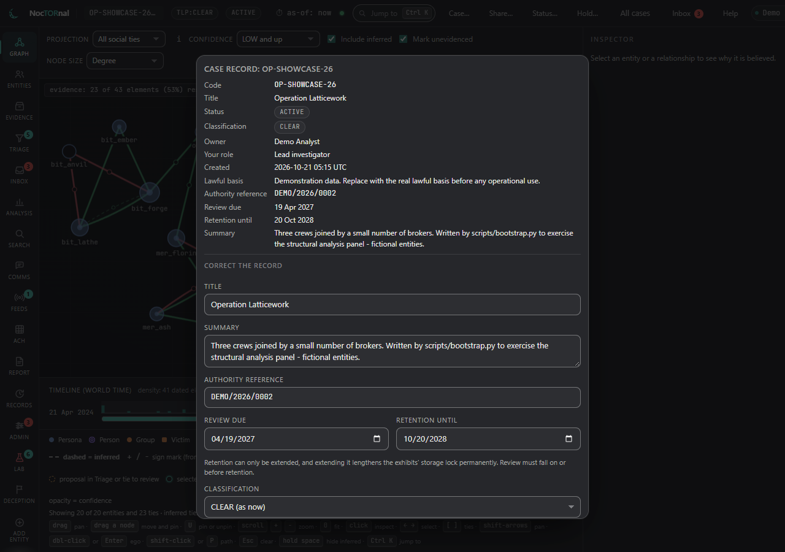

- **The lawful basis cannot be changed after creation.** It is the answer to "why is this case allowed to exist", shown on a report whenever the case header is within the level prepared at, and a case cannot exist without one: name the authority, statute or instruction that permits the collection. The **authority reference** is the document it points to.
- **Retention can only be extended.** Evidence is selected for destruction by this date. Extending it lengthens the storage lock on the case's exhibits permanently, which nobody can shorten afterwards, so the console asks a question that names the date and says it cannot be taken back, and the lock lengthens toward 00:00 UTC on that day. **Review must fall on or before retention.**
- **Classification can only be raised**, and no higher than your own clearance. Anyone on the case cleared below the new level loses access, and is named once it is saved.
- **Work items outside NocTORnal**: **Keep this case out of Jira**. A case owner can keep a case out of Jira from here, with a reason. Issues outlive retention (Chapter 34).

#### Share

**Share...** opens **Who is on** the case: **who is on this case** and **whether their access works**. An assignment row is only half of access, because the account, its clearance and its compartments have to reach the case too. **Add a colleague** takes a **Work email**, a **Case role** (the list offers `ANALYST`, `REVIEWER`, `CONTRIBUTOR`, `READ_ONLY` and `LIAISON`, that is Analyst, Reviewer, Contributor, Read only and External liaison; the Lead investigator is not offered here) and an optional **Access ends** date and time, in UTC; **Add to case** saves it. The grant is checked: a colleague whose clearance or compartments do not reach the case is refused, not written and then silently filtered out of every read. If you can see who is on a case but cannot change it, your role does not include adding or removing people (`case.grant`; the Lead investigator holds it, with a step-up).

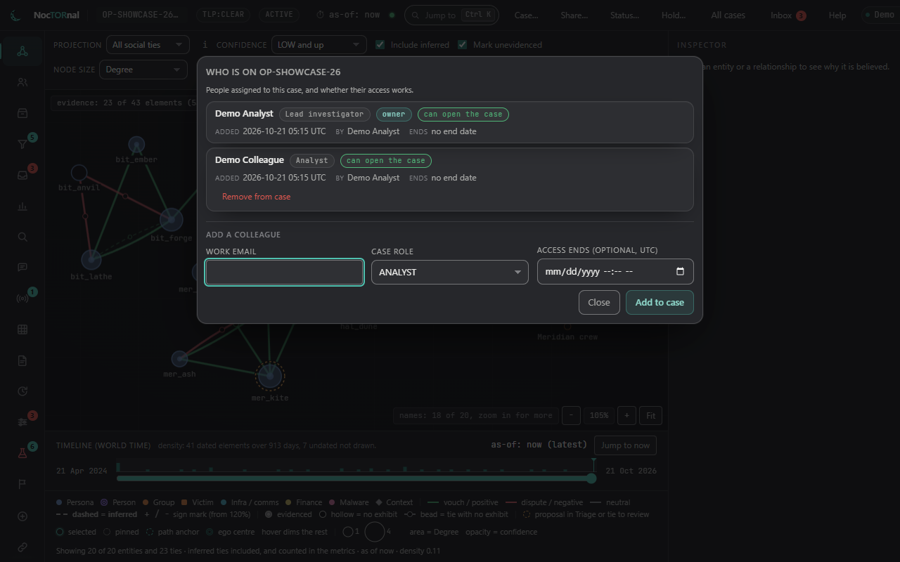

An **External liaison** is a **time-boxed, TLP-capped, export-disabled** view of one case. It is how a partner reads what you decide to show them and nothing else.

#### Status

**Status...** opens **Change the status of** the case. It offers only the moves the case's present state allows, says in a line what each one does, and selects nothing for you:

- A **draft** goes to **active** (open it for work) or **archived**.
- An **active** case goes to **dormant** (put it to sleep) or **closed** (the closing time is recorded and the case stops taking new material).
- A **dormant** case goes back to **active**, and the record shows when work resumed, or on to **closed**.
- A **closed** case is **reopened** to active, or goes on to **archived**.
- An **archived** case can only be **purged**.

**Archived** and **purged** are one-way, so the console asks you to **type the case code** before it saves. **Purged** marks the case for destruction, needs `case.delete` (the Lead investigator) and a sign-in from the last 15 minutes, and is final. It takes one signature today, and destroying a case is not built (Chapter 31). A role without `case.close` is told so, and is shown where the case could go. Material added after a case is closed matters for disclosure, so the console says the case's state, every time, in the strip every pane shares. A closed, archived or purged case is **read-only on the server**: content writes are refused, and the controls that would make them are switched off. Status, legal holds, retention and sharing still work on a closed case. Only a closed case can be reopened, by its Lead investigator (`case.close`); an archived case cannot.

#### Hold

**Hold...** places a **legal hold** on the whole case: a written reason, a sign-in from the last 15 minutes, and `retention.manage`. Chapter 9 has what it does and what it does not do.

### 27. Help, the tour and your account

#### Help

**Help** opens **Getting started**: five things to try, in order, on synthetic data only. **Open a case**; **Lodge an exhibit** (in Evidence, choose a file, give it a title and choose **Upload exhibit**, so your claims can cite it); **Add two entities** (a type, a label and an assertion you grade yourself: record a handle as a Persona and a human as an Assessed person, never one as the other); **Link them** (pick the **Source entity** and the **Target entity**, cite the exhibit and grade the claim); and **Read it back** (open Graph and click the line to see its claims, then Admin, then Readiness, to see what this install has not set up). **Take the tour** at the bottom runs the tour.

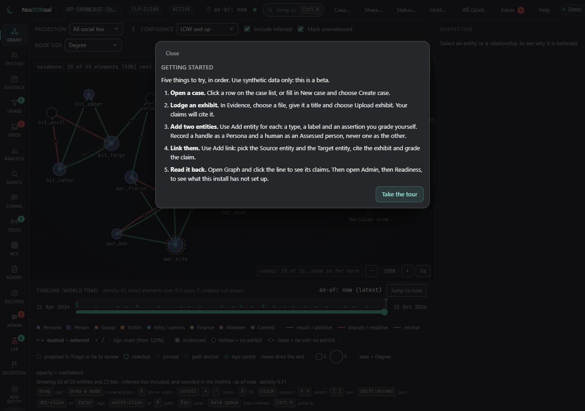

#### The tour

The first time you sign in on a browser, a six-step tour runs (the browser remembers that you have seen it, so it is once per browser and not once per account): *What NocTORnal is*, *This is a beta*, *Your first case*, *The map of the console*, *Believing things carefully* and *Where help lives*. **Next** and **Back** move through it, **Skip tour** leaves it, and the last step ends with **Done**. **Take the tour** on the Help page runs it again.

#### Your account

Click your name at the top right to open **Account**. It shows your **Name**, **Email** and **Session**.

- **Recovery codes**: **Generate recovery codes** replaces any earlier set (it needs a sign-in from the last 15 minutes, and asks first). A chip beside your name says **no recovery codes** until you have a set.
- **Password**: **Change your password** takes the current one, the new one twice, and your authenticator code or a recovery code. At least 12 characters; length is the only rule. Your other sessions are signed out; this one stays.

**Log out** ends the session on the server. If the server still holds the session after you press it (the browser kept only part of your sign-in), nothing was signed out: reload the page, and the sign-in form returns if the server has ended it since.

---

## Part IV. Operating a deployment

>> For the System administrator, the Security officer, the Collection manager and whoever runs the server: the register of what the deployment can check about itself, and the controls that govern accounts, labels, egress and integrations.

### 28. Administration, Oversight and Readiness

Administration covers the **whole deployment**, so it opens from the case list as well as from a case's Admin tab. An account that administers nothing but reviews break-glass, countersigns two-person changes or confirms collection authorities gets the same button labelled **Oversight**, with those queues in place of the sections below.

The sections are **Readiness**, **Accounts**, **Compartments**, **Two-person controls**, **Egress**, **Embeddings**, **Integrations** and **Providers**. The last four appear only for an account that holds what they need: `egress.manage` or `egress.log.read`, `embedding.manage`, and `integration.manage` for Integrations and Providers.

#### Readiness

**Readiness** is what this deployment can check about itself, with the evidence beside each line. It has 46 checks (Appendix G lists them all). **Check readiness** runs the register again, and opening the section does too; it says how many checks need attention and when it ran, in UTC, and asks for a sign-in from the last 15 minutes in place.

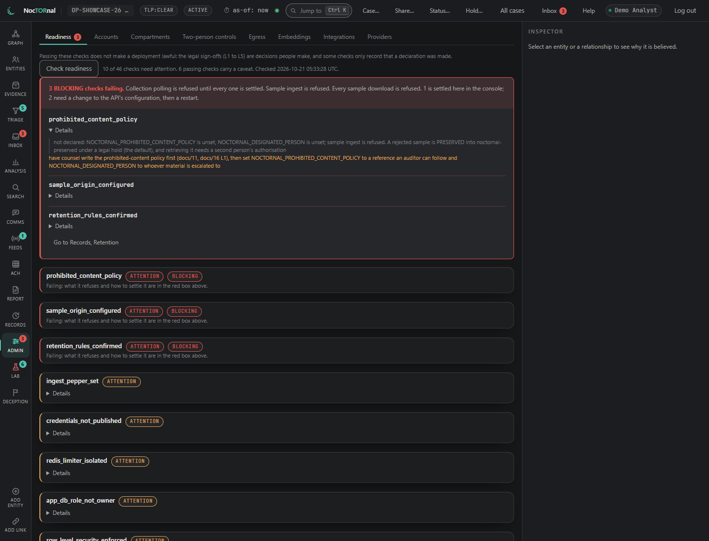

> **Warning.** **Passing these checks does not make a deployment lawful.** The legal sign-offs (L1 to L5) are decisions people make, and some checks only record that a declaration was made. The register is a list of things the deployment has *confirmed*; "the server would not say" confirms nothing, so an unknown is not a pass.

Each row shows the check's name, a verdict (**PASS** or **ATTENTION**, amber for an ordinary failure and red only on a failing blocker), and **Details**, which opens what it found and what to do about it. **Go to** takes you to where it is settled when that is in the console. A check that passes with a caveat keeps its green PASS and gains an amber **CAVEAT**, and is listed before the checks that pass plainly, which are folded under one line.

**Four checks are blocking**: `prohibited_content_policy`, `sample_origin_configured`, `retention_rules_confirmed` and `security_officer_present`. While one fails, **collection polling is refused**, and the red box above the list says what else is refused (sample ingest, every sample download, break-glass and reading the audit trail, from each check's own consequence), what to do about it, and whether it is **settled here in the console** or **needs the API's configuration changed and a restart**. That box has no dismiss button, because it is the one notice on the pane whose job is to still be there. The pane opens on Readiness while anything blocks, and the count shows on the Admin tab and beside the Administration button.

A check **passing with a caveat** is the one to read. The lone Security officer who can invoke break-glass passes on purpose and has no emergency access at all: on a fresh install the one operator holds System administrator, Security officer, Lead investigator and Analyst, so a passing row would hide that. A caveat is amber, never red: nothing is refused on that row's account.

### 29. Accounts

For an account holding `user.manage`, a step-up permission: when the last sign-in is older than 15 minutes the pane asks again in place, and nothing else on screen changes.

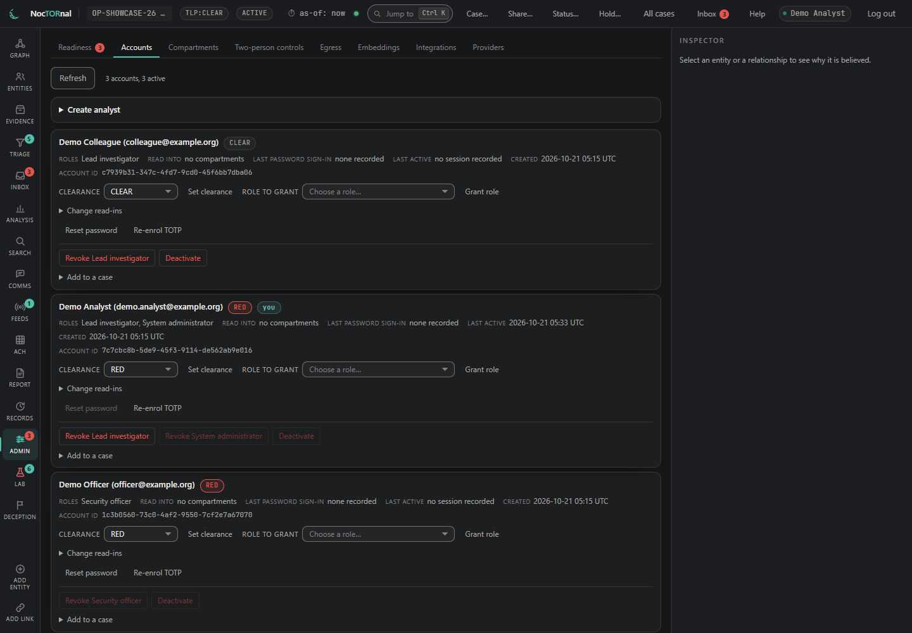

**Create analyst** takes a **work email**, a **display name**, a **clearance** (AMBER unless you change it), **roles** (a checkbox for each, with a line on what the role is for) and optionally the **compartments** to read the account into. The password and the authenticator secret are shown **once**, in the account's own card, with a button to clear them when you have handed them over. Nothing sends them for you: hand them over in person or by another channel you trust. The account's first sign-in makes them choose their own password.

An account's card shows its roles and clearance, the compartments it is read into, its last password sign-in and its last activity (they differ: a person who works all day through a minted session has no recent password sign-in), when it was created and its account id, and it acts through:

- **Set clearance** changes the ceiling everywhere. **Lowering it below a case the person leads or deputises is refused: transfer or close those cases first.**
- **Grant role** and, in a row of their own in the danger style, one **Revoke** button per role the person holds (for example **Revoke Analyst**).
- **Change read-ins** opens the set, and **Save read-ins** writes the **whole set** of compartments the person is read into, not a change to it. Who is read into each compartment is shown only after a sign-in from the last 15 minutes.
- **Reset password** issues a one-time password and signs the person out everywhere. It opens no session: at their next sign-in they choose their own, and their authenticator is unchanged. **Re-enrol TOTP** issues a new secret: the old authenticator stops at once, every session is signed out, and the new secret is shown once.
- **Unlock** after repeated failed sign-ins; **Deactivate**, which signs the person out everywhere and keeps the account and its history; **Reactivate**.
- **Add to a case** puts the account on a case you are on. You are on no case yourself? There is none to offer here: a case owner can add them from the case's Share panel, by work email.

The pane will not leave the deployment unable to repair itself: **the only active System administrator or Security officer cannot lose the role or be deactivated**, and you cannot deactivate yourself. **Make YOURSELF a Security Officer?** warns that nobody reviews their own break-glass, so while you are the only officer, break-glass is refused to you; the readiness register is satisfied by one officer, but the control needs a second person, so grant it to someone else as well. Revoking an administrator or officer role, resetting a password and any change to your own account ask first, by name.

### 30. Compartments

A **compartment** is a need-to-know lock on a case: only accounts read into every compartment a case carries can open it, **whatever their clearance**.

**Register** adds a key: 2 to 32 characters of A to Z, 0 to 9, underscore and hyphen, in **upper case**, because the lock compares it exactly, with a label people read. Registering a key again does not rename it. Each card shows who is read into the key (after a recent sign-in), and people are read in from their own card under Accounts.

**Rename or retire** is on each card. A **rename** moves the key everywhere it is used, in one step: every case, record and read-in filed under it. Who can open what does not change. Writes to compartmented records wait while it runs, so do it in a quiet moment. A **retire** removes a key nothing carries; otherwise it refuses and says what still carries it. Both ask for a sign-in from the last 15 minutes and are audited.

The compartment registry is read at the top of the pane; if it cannot be read, read-ins cannot be changed right now, and the pane says to refresh.

### 31. Two-person controls

Which acts take two different people, who can be each of them, and what is waiting.

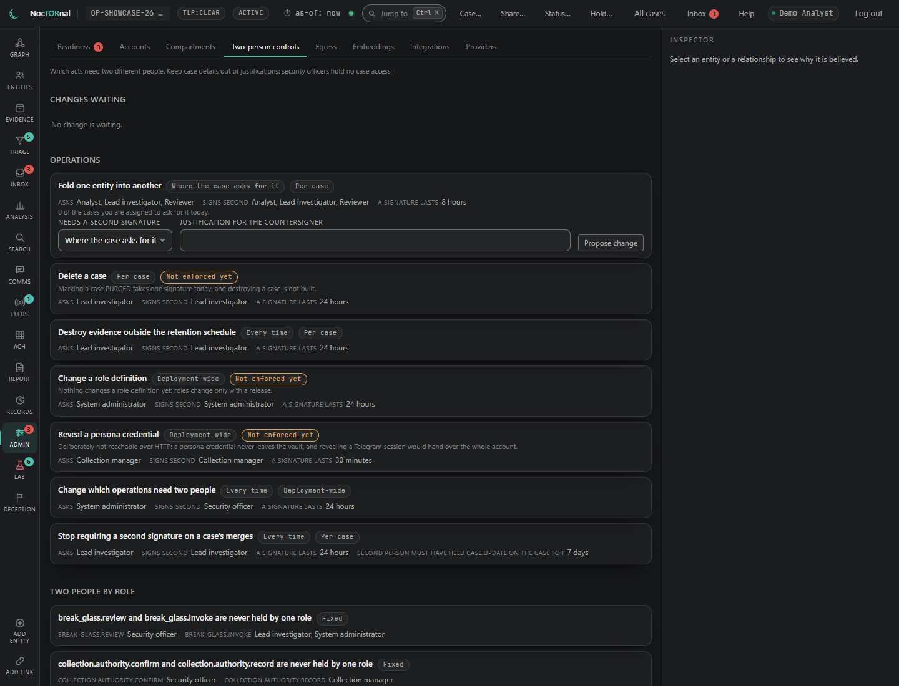

- **Operations** lists each act with its **mode** (every time, or where the case asks for it), whether it is deployment-wide or per case, the roles that ask and the roles that sign second, and how long a signature lasts. An act the build does not enforce yet says so, and why: marking a case PURGED takes one signature today and destroying a case is not built; nothing changes a role definition yet, because roles change only with a release; and an act is **deliberately not reachable over HTTP** when it would reveal a persona credential, which never leaves the vault, and revealing a Telegram session would hand over the whole account.
- **Two people by role** lists the **pairs of permissions no one role may hold together**, so whoever holds one half needs someone else for the other: `break_glass.review` and `break_glass.invoke`; `collection.authority.confirm` and `collection.authority.record`; `collection.authority.confirm` and `collection.run`; `dual_control.countersign` and `dual_control.manage`; `sample.preserved.authorise` and `sample.preserved.retrieve`; `sample.yara.manage` and `sample.yara.activate`; `victim_pii.authorise` and `victim_pii.reveal`. A pair is **Fixed** (installed with the software or by the database owner, so the screen cannot remove it) or **Added** (by a two-person change). A release that later grants both halves to one role stops at upgrade until the pair is removed here.
- **Changes waiting** and **History**: changing any of this takes **two people** as well. An **administrator proposes**, a **Security officer who is not an administrator countersigns**, and the administrator applies it. A proposal needs a **justification**, which the countersigner reads with no access to any case: **keep case details out of it**. Nobody sees a button the server would refuse them; a countersigner whom the **seven-day rule** blocks (someone else took over their account, or they changed the proposer's account, in the seven days before they signed) sees why, and can still refuse. If the policy changed after a change was proposed, it can no longer be applied: propose it again if it is still wanted.

The section asks for a sign-in from the last 15 minutes. An officer who administers nothing reads the same section under Oversight, as **Two-person changes**, and its badge counts the changes waiting for your countersignature. **Oversight** also holds the **break-glass review queue**, the **preserved-sample authorisations**, the **collection authorities** that wait for a second person, the two-person changes waiting, and the **prohibited-content screening record**. They cover the whole deployment, so no case is needed.

### 32. Egress

**Where anything may leave this deployment.** An account holding `egress.log.read` reads it; one holding `egress.manage` changes it, with a sign-in from the last 15 minutes, and every change leaves an audit row. **A change that lets a profile reach further than before stops the collection authorities recorded before it from working until a second person confirms a new one.**

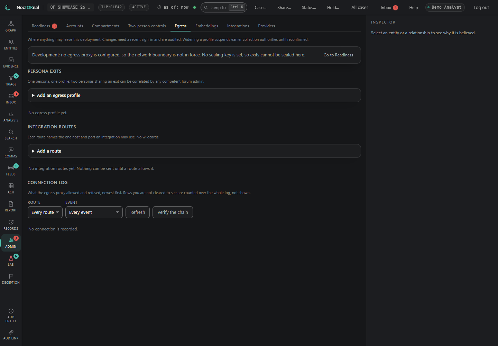

The card at the top says what mode the **egress proxy** is in and links to Readiness: **a proxy at an address** (HTTP CONNECT and SOCKS5); **Development** (no proxy configured, connections are made directly by this process under the same policy, so the network boundary is not in force); or **Production without an egress proxy** (nothing can leave). It also says whether a **sealing key** is set for this process, without which exits cannot be sealed here.

- **Persona exits.** An egress profile is where one kind of persona traffic may reach (host suffixes, public networks, ports, onion services, and whether the proxy resolves names) and the **highest label it may carry**, with a **kind** (residential, datacentre, VPN or Tor) and a **sealed exit**. The exit's address and credentials are **sealed for the proxy and never shown again**, so no field is ever filled from the server. **One persona, one profile**: two personas sharing an exit can be correlated by any competent forum admin. If the proxy does not resolve names, **the platform's own resolver then sees every target name**, which the exit is meant to hide. A change that lets a profile reach further asks first and says what it costs. A checkbox, **Send the exit's credentials in clear**, is the explicit acceptance that the credentials and every target name cross the internet in clear to this provider. Sealing another address, port, user name or kind makes a profile reach further than before, and its authorities stop working until new ones are confirmed; a password change alone does not. Profiles can be changed, switched off and retired; retired ones stay on the record.
- **Integration routes.** A route names **exactly** where one integration may connect: a host and port, or a host and the private network its address must be in. **There is no wildcard**, and an integration with no route can send nothing through the proxy. Mail and webhooks leave by routes named `smtp` and `webhook`, a lookup provider by `lookup-<key>`, Jira by `jira`. Destinations are added and retired one by one (an open connection to a retired one closes within 30 seconds), and a route can be switched off, or retired with a reason.
- **Connection log.** What the proxy **allowed and refused**, newest first: opened, refused, refused before sign-in, or sealed again, with the route, the destination, how much was sent and received and how it ended. **Verify the chain** recomputes the log's hash chain and says where it breaks. **Rows you are not cleared to see are counted over the whole log, not shown**, and that count ignores the route and event you chose.

### 33. Embeddings

For an account holding `embedding.manage`, with a sign-in from the last 15 minutes. Two cards, one for each kind of similarity:

- **Similar wording** runs **on this host and sends nothing anywhere**. It compares character patterns, so it finds reposts, light edits and the same passage in another alphabet or spelling.
- **Similar meaning** asks an **operator's model server**, and only what its ceiling and its declarations allow ever leaves; **each batch is audited before it is sent**. The card names the endpoint, where it is, its ceiling and the authority declared for it. With no endpoint configured, no case text is sent anywhere to be embedded.

A card shows each **index** (its slot, whether it is active, being built or retired, the model, and since when), a field, **Reason, for the audit trail**, of at least five characters, and the acts: **Rebuild...**, **Activate the new index...**, **Recheck...**, **Retire...** and **Run a pass now**. Each asks a plain question first. A **rebuild of similar wording** embeds every item again on this host, in a new index, and queries keep using the current one until the new one is complete; nothing leaves this host. A **rebuild of similar meaning** says that it will send the text of every eligible item at or below the ceiling to the model endpoint again. **Recheck** judges failed or withheld items again on the next pass and sends the model endpoint the public canary to see whether its model changed. The new index becomes active by itself once every item is in it.

**Not in the index** lists the documents you can read that an index does not hold, with why: failed, withheld, excluded, or nothing to compare. A document still waiting for the embedding pass is not listed, and the list needs access to collected documents as well as `embedding.manage`. Similar text is **not the same author**: one advert is reposted by many personas, and one author writes in many ways.

### 34. Integrations and Providers

#### Integrations

Administration, Integrations is for an account holding `integration.manage`; one that holds nothing else opens straight onto it. It shows **every channel that can carry a notification out** of the platform (email, webhook, Jira) with the **egress route** it leaves by, the **outbox** with **Drain now** and a retry of real failures, and the **delivery ledger**, which says for each delivery what happened, why, and what left.

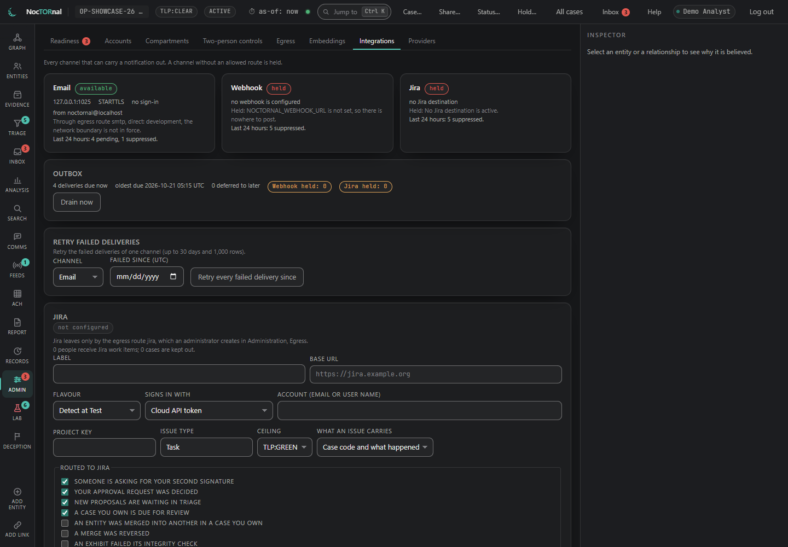

A channel whose route or setting is missing is **held**: its deliveries wait, spend no attempt, and go once it is fixed. Only an attempted send can fail. Mail and webhooks each leave by an egress route (`smtp`, `webhook`), created under Administration, Egress; without one they are held. **Retry the failed deliveries of one channel** puts every failed delivery since a time back in the outbox, up to 30 days back and 1,000 rows; the drain applies the recipient's access, the egress gate and Jira's routing again, so a retry never sends more than the first attempt could have.

**Jira** takes work items only, and only from analysts who turned it on for themselves. Declare the one destination (base URL, project, issue type, a credential that is sealed and never shown again), run **Test**, then **Activate**. The ceiling is **GREEN** unless you raise it, **never above AMBER**; the **What an issue carries** setting decides whether the case code travels. Give the Jira service account Browse, Create, Add Comments and Edit on that one project, and put the `labels` field on the issue type's create and edit screens. A case owner can keep a case out of Jira from the case's record. **Issues outlive NocTORnal's retention**: a purge warns with their count, and you close them in Jira. To find the issues raised about one case (a purge, a disclosure), give its id: the list never names a case, and an unconfirmed create shows its ref label, which finds the issue in Jira by JQL. Removing a destination destroys its credential, closes its issues here (not in Jira) and withdraws queued deliveries; a new destination starts as a draft.

The ledger shows **kinds, channels, destinations and why each did or did not go**, never subjects or summaries (it spans every case and every recipient), and a webhook address with its path withheld, because a path commonly carries the hook's secret.

#### Providers: outbound lookups

Two acts are needed before anything leaves, and either alone sends nothing:

1. **The host switch.** `NOCTORNAL_OUTBOUND_LOOKUPS=on` in `secrets.env`, read by the API and the cron alike. The lookup drain prints the value it read on its first line, so an API and a cron that disagree show in the cron log. Production refuses to start with it on and no egress proxy.
2. **An enabled provider**, under Administration, Providers. Register it from the catalogue, write why its exposure is right (it has no default), and enter its key: the key is sealed, never shown again by any route, and destroyed if the provider's host or route changes. Create its egress route `lookup-<key>` under Administration, Egress, admitting the provider's host. **A level below PUBLIC is a second administrator's act**: the provider cannot be enabled until one approves it, and so does every later lowering, and so does moving it to another host, port or private network; the approval card names the address being approved. Your own instance (NONE) also names the private network it answers from. Set at least one **quota window**; a share is kept back from queued work so an analyst's own lookup always has room. **Test** sends a fixed value that carries no case material and reports the status only.

A provider that refuses its key is **locked** until somebody replaces the key or unlocks it; a provider that answers 429 cools down for as long as it asked. The readiness row `outbound_lookup_providers` lists every enabled provider with its exposure, ceiling, quota and route.

### 35. Installing, upgrading and what to keep

This manual does not repeat the installer. [START-HERE.md](START-HERE.md) installs on one computer; [INSTALL.md](INSTALL.md) covers configuration, a production deployment, troubleshooting and verification. Four things belong to operators of any size:

- **Keep `.env.local` (or the production `secrets.env`).** It holds the keys. Without it stored data cannot be opened. An upgrade is: unzip the new release in a new folder, copy the file in, and run the installer again.
- **Back up the database and the object stores together.** Evidence is locked in the object store under COMPLIANCE mode and the database says what each object is; one without the other is not a case.
- **Run the production role split**: the application connects as `noctornal_app`, never as the schema owner, so that the append-only ledgers are enforced by the server and not by convention. The Readiness checks `app_db_role_not_owner` and `row_level_security_enforced` tell you whether you do.
- **Declare what the legal register needs** before anyone uploads a sample, ingests a leak or runs a persona: the prohibited-content policy and designated person, the retention periods, and a Security officer who is not the administrator.

The documents behind the controls are in `docs/`: `docs/08-governance.md` (retention and purge), `docs/05-security-rbac.md` (access and two-person controls), `docs/20-outbound-connections.md` (how anything leaves), `docs/16-legal-and-external.md` and `docs/18-legal-review-pack.md` (the decisions).

---

## Part V. Reference

>> Lookups: the glossary, every role and permission, the keyboard map, the types in the ontology, the readiness checks, the limits, the refusals and troubleshooting. Most of it is generated from the deployment's own tables, so it matches the software you are running.

### A. Glossary

Terms are listed alphabetically. A term in **bold** inside a definition has its own entry.

| Term | Meaning |
|---|---|
| **Acknowledge** | The act that stops a notification nagging and, for an urgent one, stops it escalating. Reading it does not. |
| **Admiralty grading** | Source reliability (A to F) and information credibility (1 to 6), graded separately. Chapter 5. |
| **ACH** | Analysis of Competing Hypotheses: rank hypotheses by the evidence **against** them. Chapter 20. |
| **As-of** | A moment in world time the whole console can be moved to. Chapter 8. |
| **Assertion** | A claim, with its basis, grading, confidence, source and time. Every element of the graph rests on at least one. Also called a **claim**. |
| **Assessed person** | The console's name for a `PERSON` entity: a human you concluded stands behind one or more personas. |
| **Attribution** | The `ATTRIBUTED_TO` relationship joining a persona to an assessed person. A claim, reversible, carrying a confidence. |
| **Authority** | The written authority a collection or a purge runs under. A document outside the system; the console records its reference. |
| **Basis** | How a claim is known: direct observation, third-party report, analyst inference, automated inference, self claim, legal process. |
| **Binding** | The claim that an identifier belongs to an entity. It starts at **CLAIMED** and is confirmed only by a signature over the identifier. |
| **Blocking check** | One of four readiness checks whose failure refuses collection polling and more. Chapter 28. |
| **Break-glass** | Emergency access to a case above your clearance, easy to obtain, loud, capped at eight hours, and reviewed afterwards by a **Security officer**. |
| **Broker** | An entity that connects groups that are otherwise apart. Found by **betweenness** and by low **constraint**. |
| **Case** | The unit of work: a graph, its exhibits and its people, with a code, a lawful basis, a classification, and retention and review dates. |
| **Case role** | A role held on one case: Lead investigator, Analyst, Reviewer, Contributor, Read only, External liaison. |
| **Claim** | See **assertion**. |
| **Classification** | The TLP label on a case, element, exhibit, capture or sample: `CLEAR`, `GREEN`, `AMBER`, `AMBER_STRICT`, `RED`. |
| **Clearance** | The highest classification an account may read. |
| **Collector** | The service that polls collection sources and runs persona acts. The role that may press **Poll now** is the Collection manager. |
| **Compartment** | A need-to-know lock: only accounts read into every compartment a thing carries can open it, whatever their clearance. |
| **Confidence** | Your confidence in a claim, in ICD 203 words: low, moderate, high. |
| **Constraint** | Burt's constraint: how far an entity's ties are to people who are tied to each other. **Low is good**: it means the entity spans holes. |
| **Contested pair** | Two entities with both a positive and a negative tie. |
| **Cut vertex** | An entity whose removal alone disconnects the network. A **bridge** is the same for a tie. |
| **Custody** | The append-only record of everything done to an exhibit: acquired, read, verified, exported, held, destroyed. |
| **Dead letter** | A record that could not be parsed, kept with the reason. Nothing is silently dropped. |
| **Defang** | Writing a URL so it cannot be clicked or fetched by mistake: `hxxps://portal[.]example`. |
| **Diagnosticity** | How far a row of evidence separates the live hypotheses. 0 means it says the same about all of them. |
| **Dry run** | A purge that reports what would be destroyed and destroys nothing. The default, every time. |
| **Dual control** | An act that takes two different people. Chapters 6 and 31. |
| **Egress** | Anything leaving the deployment. Every path calls one check. Chapter 7. |
| **Ego network** | An entity and its immediate ties. |
| **Entity** | A person, persona, group, victim, wallet, host or other node of the graph. |
| **Escalation** | An unacknowledged urgent notification being passed to someone else at a stated time. |
| **Exhibit** | One item of evidence: a file, a capture, a message, a recorded call. Hashed on receipt and locked. |
| **Fragmentation (F)** | The share of pairs of entities that cannot reach each other, as a fraction from 0 to 1. |
| **ICD 203** | The US intelligence community standard whose wording for analytic confidence the console uses. |
| **Imphash** | A hash of a Windows binary's imported functions, used to cluster samples. |
| **Inferred** | A relationship whose basis is an inference. Drawn dashed, excluded from metrics unless the view includes it. |
| **Ingest key** | A write-only credential for a partner feed. It can submit and read nothing. |
| **Inspector** | The panel on the right that says why the selected element is believed. |
| **Invariant** | One of the twelve rules the code enforces whatever anybody clicks. Listed in the README. |
| **k-core** | How deep an entity sits in the durable core of the network. |
| **Lead investigator** | The role (`CASE_OWNER`) that leads and controls a case, including access grants. |
| **Legal hold** | A stop on every deletion of what it covers, until somebody lifts it. |
| **Lookup** | A query of one selector at a provider, by exposure: NONE, VENDOR or PUBLIC. |
| **Merge** | Folding one entity into another of the same type. Reversible. |
| **Modularity** | How strongly a network separates into clusters. Below 0.3 weak, 0.3 to 0.5 moderate, above 0.5 strong. |
| **Oversight** | The Administration button for an account that reviews and countersigns but does not administer. |
| **Persona** | The console's name for an `IDENTITY` entity: a handle you observed. Also a collection account a collector operates. |
| **Pin** | Holding a node where you put it on the canvas. |
| **Placeholder** | A retention period the build shipped with that nobody has confirmed. |
| **Projection** | The view: preset, confidence floor, inferred in or out, decay, and as-of. Chapter 8. |
| **Proposal** | A machine's suggestion waiting in Triage. The console calls it a **suggestion**. |
| **Provenance** | The chain from an element to the claim, the exhibit and the custody record behind it. |
| **Quarantine** | Where records and samples wait until something decides they may proceed. |
| **Readiness** | The register of what a deployment can check about itself. Chapter 28. |
| **Regular equivalence (REGE)** | Entities with the same kinds of ties to the same kinds of others. |
| **Retention** | How long material is kept. A period per category, and the case's own dates. Chapter 9. |
| **Review** | The acceptance state of a tie: proposed, accepted, disputed, rejected. Also a break-glass review, and a case's review date. |
| **Rule set** | A set of YARA rules the lab scans samples with. |
| **Selector** | A durable identifier on an entity: an email address, a wallet, a Tox key. Appendix F. |
| **Signed balance** | Whether triangles of positive and negative ties are consistent with "the friend of my enemy is my enemy". |
| **Sociogram** | The graph drawing. |
| **Source reliability** | The A to F half of the Admiralty grading. |
| **Stance** | A cell of the ACH matrix: how one piece of evidence stands against one hypothesis, from -2 to +2. |
| **Step-up** | A requirement for a sign-in from the last 15 minutes. |
| **Structural hole** | A gap between two parts of a network that an entity spans. |
| **Suggestion** | See **proposal**. |
| **Tombstone** | The permanent record that something was destroyed: what, by whom, under what authority, and what the store did. |
| **TLP** | Traffic Light Protocol, the classification scale. `AMBER_STRICT` and `RED` never leave the platform. |
| **Trust decay** | Down-weighting a claim as its valid interval recedes, by a half-life. |
| **View** | See **projection**. |
| **WORM** | Write once, read many: the object-store lock that makes an exhibit's bytes undeletable until its retention date. |

### B. Roles and permissions

11 roles and 71 permissions, read from the deployment's own role tables. A permission marked **step-up** needs a sign-in from the last 15 minutes. A role key is what an administrator grants; the name is what the console shows.

| Role | Key | Kind | Code | Permissions | What it is for |
|---|---|---|---|---|---|
| **Lead investigator** | `CASE_OWNER` | case role | LI | 44 | The law-enforcement or threat investigator who leads and controls their cases, including access grants. Reveals victim PII only under an authorisation a Security officer grants. |
| **Analyst** | `ANALYST` | case role | AN | 25 | Create and edit graph, evidence, assertions on assigned cases. |
| **Reviewer** | `REVIEWER` | case role | RV | 14 | Approve proposals and merges; cannot originate. |
| **Contributor** | `CONTRIBUTOR` | case role | CT | 6 | Upload evidence and propose changes; cannot accept them. |
| **Read only** | `READ_ONLY` | case role | RO | 4 | View assigned cases. |
| **External liaison** | `LIAISON` | case role | XL | 4 | Time-boxed, TLP-capped, export-disabled view of one case. |
| **System administrator** | `SYS_ADMIN` | deployment role | SA | 11 | Platform config, users, integrations. No default case access. |
| **Security officer** | `SECURITY_OFFICER` | deployment role | SO | 10 | Audit review, break-glass review, key rotation. Cannot read case content. |
| **Collection manager** | `COLLECTOR` | deployment role | CM | 11 | Manage sources, watches, collection accounts. |
| **Malware analyst** | `MALWARE_ANALYST` | deployment role | MA | 4 | Sees the sample queue and sample metadata, and may download the encrypted archive. Deliberately grants NO case access: being trusted with hostile binaries is a different trust to being trusted with the case file (docs/11). |
| **Service account** | `SERVICE` | deployment role | SV | 1 | Machine identity for collectors and integrations. |

The permission table below uses the codes in the Code column. **LI** is the Lead investigator, **AN** Analyst, **RV** Reviewer, **CT** Contributor, **RO** Read only, **XL** External liaison, **SA** System administrator, **SO** Security officer, **CM** Collection manager, **MA** Malware analyst, **SV** Service account.

| Permission | What it allows | Step-up | Held by |
|---|---|---|---|
| `analytics.run` | Run SNA metrics |  | LI AN |
| `assertion.create` | Record an assertion |  | LI AN |
| `assertion.retract` | Retract an assertion |  | LI AN |
| `audit.read` | Read the audit trail |  | SO |
| `break_glass.invoke` | Emergency access to an unassigned case | yes | LI SA |
| `break_glass.review` | Record the mandatory post-hoc review of a break-glass grant | yes | SO |
| `case.close` | Close a case |  | LI |
| `case.create` | Create a case |  | LI |
| `case.delete` | Delete a case and its content | yes | LI |
| `case.grant` | Grant case access to a user | yes | LI |
| `case.read` | Read case content |  | LI AN RV CT RO XL |
| `case.update` | Edit case metadata |  | LI |
| `collection.authority.confirm` | Confirm a recorded collection authority, and each source under it, as the second person | yes | SO |
| `collection.authority.record` | Record a written authority to collect from forum and Telegram sources | yes | CM |
| `collection.read` | See collection sources, runs and their health |  | LI AN RV CM |
| `collection.run` | Poll a collection source and record the run |  | CM |
| `collection_account.manage` | Manage collection personas | yes | CM |
| `collection_account.reveal` | Decrypt persona credentials | yes | CM |
| `comms.bind` | Record a channel binding or parse a contact block |  | LI AN RV CT CM |
| `comms.key.lookup` | Ask for a vendor key to be looked up in a Web Key Directory. Nothing is sent until a second person approves | yes | LI CM |
| `comms.key.lookup.approve` | Approve and send a key lookup somebody else asked for, which sends a request outside this deployment | yes | LI RV |
| `comms.minimise` | Drop message bodies, keeping the metadata graph | yes | LI |
| `comms.read` | See channels, conversations and contact blocks |  | LI AN RV CT RO XL CM |
| `comms.stoplist.manage` | Add or retire a known escrow/guarantor/admin identifier |  | LI RV |
| `curation.manage` | Create and assign tags and node sets |  | LI AN |
| `dual_control.countersign` | Countersign a change to which operations need two people | yes | SO |
| `dual_control.manage` | Propose and apply a change to which operations need two people | yes | SA |
| `egress.log.read` | Read the egress connection log, within your clearance |  | SA SO |
| `egress.manage` | Create, change and retire egress profiles and integration routes, and seal exits | yes | SA |
| `embedding.manage` | Rebuild, activate or retire a similarity index, and run an embedding pass | yes | SA |
| `evidence.export` | Export evidence outside the platform | yes | LI |
| `evidence.purge` | Destroy evidence | yes | LI |
| `evidence.read` | View evidence |  | LI AN RV CT RO XL |
| `evidence.upload` | Upload evidence |  | LI AN CT SV |
| `graph.edge.create` | Create edges |  | LI AN |
| `graph.edge.delete` | Soft-delete edges (sets deleted_at; never destroys) |  | LI AN |
| `graph.edge.update` | Edit edges |  | LI AN |
| `graph.merge` | Merge two identities | yes | LI AN RV |
| `graph.node.create` | Create nodes |  | LI AN |
| `graph.node.delete` | Soft-delete nodes |  | LI AN |
| `graph.node.update` | Edit nodes |  | LI AN |
| `graph.unmerge` | Reverse a merge | yes | LI AN RV |
| `ingest.manage` | Issue, rotate and revoke ingest keys | yes | SA |
| `ingest.read` | See ingest batches, records and dead letters |  | LI AN RV |
| `ingest.replay` | Repair and replay a dead-lettered record |  | LI AN |
| `integration.manage` | Configure SMTP, Jira, webhooks and outbound lookup providers | yes | SA |
| `lookup.authorise` | Sign off a colleague's lookup that sends case material to a vendor or the public | yes | LI |
| `lookup.request` | Send a case selector to an outbound lookup provider |  | LI AN |
| `proposal.review` | Accept or reject machine proposals |  | LI RV |
| `report.export` | Export a report | yes | LI |
| `report.generate` | Generate a report |  | LI AN |
| `retention.manage` | Confirm a retention rule or set a legal hold | yes | LI SA |
| `retention.purge` | Run a purge, or purge out of schedule under a stated authority | yes | LI SA |
| `retention.read` | See retention rules, deadlines and purge tombstones |  | LI AN RV CT RO XL CM |
| `role.manage` | Change role definitions | yes | SA |
| `sample.analyse` | Record analysis findings against a sample |  | MA |
| `sample.detonate` | Submit a sample to a sandbox | yes | no role |
| `sample.download` | Download the encrypted sample archive | yes | MA |
| `sample.preserved.authorise` | Authorise one named person to retrieve one preserved (rejected) sample | yes | SO |
| `sample.preserved.retrieve` | Retrieve a preserved sample, as its encrypted archive, under a live authorisation somebody else granted | yes | LI |
| `sample.read` | See sample metadata and analysis |  | LI AN RV MA |
| `sample.screening.manage` | Import and retire prohibited-content hash lists, and start a screening pass | yes | SO |
| `sample.screening.review` | See prohibited-content screening matches and record their review | yes | SO |
| `sample.submit` | Submit a sample into quarantine |  | LI AN RV |
| `sample.yara.activate` | Activate or deactivate a YARA rule set version somebody else sponsored, clearing its licence | yes | SO |
| `sample.yara.manage` | Create YARA rule sets, upload and adopt versions, and queue rescans | yes | MA |
| `source.manage` | Create and edit sources |  | CM |
| `user.manage` | Create and edit users | yes | SA |
| `victim_pii.authorise` | Grant a time-boxed authorisation to look up victim PII | yes | SO |
| `victim_pii.reveal` | Reveal a masked victim credential under a logged authorisation | yes | LI |
| `watch.manage` | Create and edit watches |  | CM |

### C. Keyboard map

<kbd>?</kbd> opens this sheet in the console. The single-letter triage keys can be turned off there.

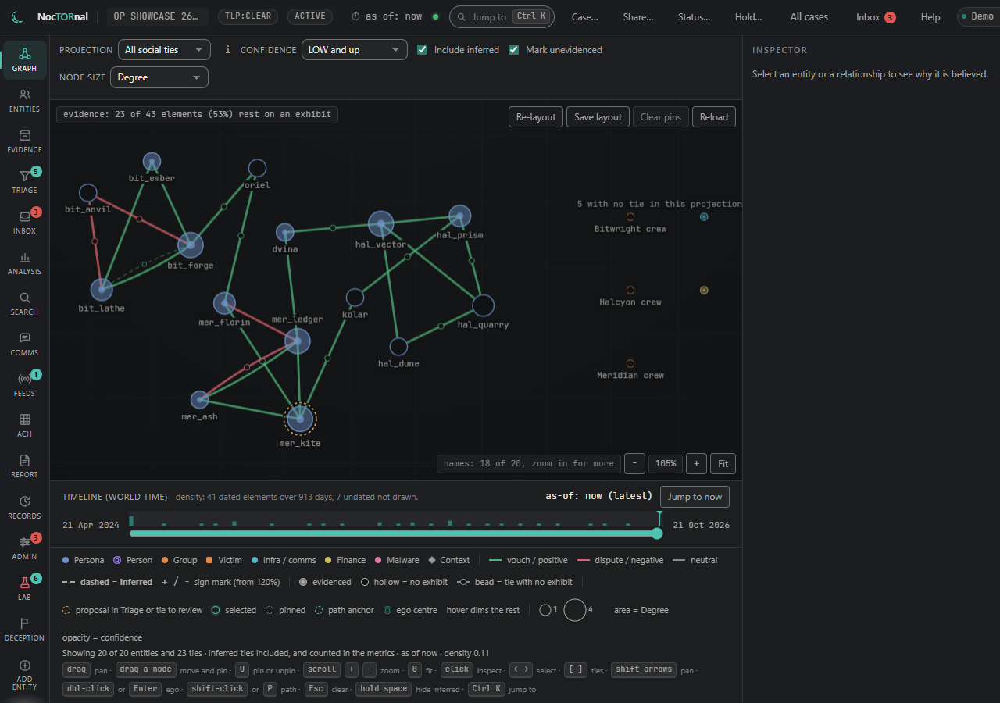

#### Anywhere

| Keys | What they do |
|---|---|
| <kbd>Ctrl</kbd> <kbd>K</kbd> | **Jump to**: entities, panes, projections and commands, and a full search of the case |
| <kbd>?</kbd> | This sheet |
| <kbd>Esc</kbd> | Close whatever is open |
| <kbd>Alt</kbd> <kbd>1</kbd> to <kbd>9</kbd> | Jump to a pane, in rail order |
| the copy button beside any selector, hash or TLS key | Copies the full value, and for a URL the defanged one, because that is what belongs in a report |

#### Sociogram

| Keys | What they do |
|---|---|
| **drag** | Pan |
| **drag a node** | Move it and pin it there; **Save layout** keeps it for your next visit |
| <kbd>U</kbd> | Pin the selected entity where it is, or unpin it |
| **scroll**, <kbd>+</kbd> <kbd>-</kbd> | Zoom; the level is shown on the canvas |
| **click** | Inspect an element |
| **double-click**, <kbd>Enter</kbd> | Ego network of the selection |
| **shift-click** one entity, then another; <kbd>P</kbd> on each | Shortest path between them (the first one only marks the anchor) |
| **hold** <kbd>space</kbd> | Hide inferred edges while held. Works anywhere on the graph tab, the timeline and the inspector included, except where Space already does something: typing in a field, or pressing a control you tabbed to |
| <kbd>&larr;</kbd> <kbd>&rarr;</kbd> | Previous or next entity; one off the canvas is brought into view |
| <kbd>[</kbd> <kbd>]</kbd> | Previous or next tie of the selected entity, including every tie on a pair that has more than one |
| <kbd>Shift</kbd> and arrows | Pan the view |
| <kbd>Home</kbd> | Back to the selection |
| <kbd>0</kbd> | Fit every entity |
| <kbd>T</kbd> | Go to the selection's relationships in the inspector |

#### Triage

| Keys | What they do |
|---|---|
| <kbd>J</kbd> <kbd>K</kbd> | Next or previous suggestion |
| <kbd>A</kbd> | Accept, after a confirmation; the line above the queue then offers an **Undo** when your role can retire it |
| <kbd>R</kbd> | Reject, with a reason |
| <kbd>D</kbd> | Defer, with a note |

They act only while the triage list has the focus, never in a field, on a button, or with <kbd>Ctrl</kbd>, <kbd>Alt</kbd> or <kbd>Cmd</kbd> held.

### D. Grading, confidence and handling at a glance

#### ICD 203 confidence

| Word | Use it when |
|---|---|
| **Low** | The information is scant, fragmentary or from a source whose reliability is doubtful, or the reasoning is thin. A reasonable alternative explanation exists. |
| **Moderate** | The information is credibly sourced and plausible but not corroborated enough to be higher, or open to more than one interpretation. |
| **High** | The information is well corroborated by good sources and the reasoning is sound; alternative explanations are implausible. High confidence is not certainty. |

#### The ACH stance scale

| Stance | Reads as |
|---|---|
| -2 | strongly inconsistent |
| -1 | inconsistent |
| 0 | neutral or not applicable |
| 1 | consistent |
| 2 | strongly consistent |

A blank cell is **not assessed**, which neutral is not. The weights each row counts at are in Chapter 5.

#### Modularity, in words

| Modularity | Reads as |
|---|---|
| below 0.3 | weakly separated |
| 0.3 to 0.5 | moderately separated |
| above 0.5 | strongly separated |

#### Priority

| Priority | Word | Quiet hours | Acknowledgement |
|---|---|---|---|
| 1 | urgent | ignored | stops escalation |
| 2 | normal | respected | stops nagging |
| 3 | low | respected | stops nagging |

#### What may leave

| Classification | May leave the platform | Notes |
|---|---|---|
| `CLEAR`, `GREEN` | yes, to a destination whose ceiling allows it | |
| `AMBER` | yes, to a destination whose ceiling allows it | The ceiling for email; never above `AMBER` for Jira |
| `AMBER_STRICT`, `RED` | **never** | Invariant 8. No destination setting changes this. |
| Anything compartmented | **never** | No external system models compartments |

### E. Entity and relationship types

#### Entity types

| Type | Shown as | Category |
|---|---|---|
| `IDENTITY` | Persona | actor |
| `PERSON` | Assessed person | actor |
| `GROUP` | Group | actor |
| `SUBGROUP` | Cell / sub-unit | actor |
| `ORGANISATION` | Legal entity | actor |
| `VICTIM` | Victim entity | actor |
| `SELECTOR` | Selector | artefact |
| `COMMS_ACCOUNT` | Comms account | artefact |
| `DEVICE` | Device | artefact |
| `WALLET` | Crypto wallet | artefact |
| `SERVICE` | Service / shop | artefact |
| `FORUM` | Forum / board | artefact |
| `CHANNEL` | Channel / group chat | artefact |
| `MALWARE` | Malware family | artefact |
| `SAMPLE` | Malware sample | artefact |
| `BUILDER` | Builder / kit | artefact |
| `INFRA` | Infrastructure | artefact |
| `CREDENTIAL_SET` | Credential set | artefact |
| `DATASET` | Leaked dataset | artefact |
| `TOOL` | Tool / kit | artefact |
| `LURE` | Lure / pretext | artefact |
| `EVENT` | Event | context |
| `CONVERSATION` | Conversation | context |
| `CAMPAIGN` | Campaign | context |
| `INCIDENT` | Incident | context |
| `LOCATION` | Location | context |
| `TRANSACTION` | Transaction | context |

The **category** decides how a type behaves in analysis: an **actor** is a person, persona or group that can act; an **artefact** is a thing actors use or leave behind (a wallet, a host, a sample); a **context** is a place or venue (a forum, a channel). Only actors count as people in brokerage, and a projection that includes non-actor vertices says so.

#### Relationship types

Direction and sign are defaults: **directed** means the relationship reads one way and has an inverse name; **sign** is positive (+), negative (-) or neutral (0). A **social tie** is one the All social ties view includes; the rest are identity and plumbing links.

| Type | Reads | Inverse | Directed | Sign | Social tie | From | To |
|---|---|---|---|---|---|---|---|
| `ACCUSED_SCAM` | accused of ripping | was accused by | yes | - | yes | IDENTITY | IDENTITY |
| `AFFILIATE_OF` | is an affiliate of | has affiliate | yes | + | yes | IDENTITY, PERSON, GROUP | GROUP |
| `ALIAS_OF` | is an alias of | has alias | yes | 0 | no | IDENTITY | IDENTITY |
| `ATTRIBUTED_TO` | attributed to | has persona | yes | 0 | no | IDENTITY | PERSON |
| `BANNED_BY` | was banned by | banned | yes | - | no | IDENTITY | FORUM, CHANNEL, IDENTITY |
| `BROKERED_ACCESS` | brokered access to | access brokered by | yes | + | yes | IDENTITY | VICTIM, ORGANISATION |
| `BUILT_WITH` | was built with | built | yes | 0 | no | SAMPLE | BUILDER, TOOL |
| `CLUSTERS_WITH` | clusters with | clusters with | no | 0 | no | SAMPLE | SAMPLE |
| `CO_DECLARED_WITH` | declared alongside | declared alongside | no | + | no | SELECTOR, COMMS_ACCOUNT | SELECTOR, COMMS_ACCOUNT |
| `COMMUNICATES_WITH` | communicates with | communicates with | no | + | yes | IDENTITY, PERSON | IDENTITY, PERSON |
| `CONFIRMED_CONTROL_OF` | confirmed control of | control confirmed by | yes | 0 | no | IDENTITY, PERSON | SELECTOR, COMMS_ACCOUNT, WALLET |
| `CONTACTS_C2` | contacts | contacted by | yes | 0 | no | SAMPLE, MALWARE | INFRA |
| `CONTROLS` | controls | controlled by | yes | 0 | no | IDENTITY, PERSON, GROUP | SELECTOR, WALLET, INFRA, SERVICE, CHANNEL, DATASET, CREDENTIAL_SET |
| `CO_POSTED_IN` | co-posted in | co-posted in | no | + | no | IDENTITY | IDENTITY |
| `DEVELOPED` | developed | developed by | yes | 0 | no | IDENTITY, PERSON, GROUP | MALWARE, TOOL, SERVICE |
| `DISPUTED_WITH` | in dispute with | in dispute with | no | - | yes | IDENTITY | IDENTITY |
| `ESCROW_FOR` | held escrow for | used escrow | yes | + | yes | IDENTITY | IDENTITY |
| `EXFILTRATED_FROM` | was exfiltrated from | source of | yes | 0 | no | DATASET, CREDENTIAL_SET | VICTIM, ORGANISATION |
| `GUARANTOR_FOR` | acted as guarantor | used guarantor | yes | + | yes | IDENTITY | IDENTITY |
| `HOSTED_ON` | is hosted on | hosts | yes | 0 | no | SERVICE, INFRA, FORUM | INFRA |
| `IMPERSONATES` | impersonates | is impersonated by | yes | 0 | no | IDENTITY, LURE, COMMS_ACCOUNT | ORGANISATION, PERSON, SERVICE |
| `LAUNDERED_FOR` | laundered for | used launderer | yes | + | yes | IDENTITY, SERVICE | IDENTITY, GROUP |
| `LEADS` | leads | is led by | yes | + | yes | IDENTITY, PERSON | GROUP, SUBGROUP |
| `LOCATED_IN` | is located in | contains | yes | 0 | no | PERSON, ORGANISATION, INFRA | LOCATION |
| `MEMBER_OF` | is a member of | has member | yes | + | yes | IDENTITY, PERSON, SUBGROUP | GROUP, SUBGROUP |
| `MENTORED` | mentored | was mentored by | yes | + | yes | IDENTITY | IDENTITY |
| `MET_WITH` | met with | met with | no | + | yes | PERSON | PERSON |
| `ON_DEVICE` | observed on device | has account | yes | 0 | no | COMMS_ACCOUNT | DEVICE |
| `PAID` | paid | was paid by | yes | + | yes | IDENTITY, WALLET | IDENTITY, WALLET |
| `PARTICIPANT_IN` | participates in | has participant | yes | + | no | COMMS_ACCOUNT, IDENTITY | CONVERSATION |
| `PARTICIPATED_IN` | participated in | had participant | yes | 0 | no | IDENTITY, PERSON, GROUP | EVENT, INCIDENT, CAMPAIGN |
| `PART_OF` | is part of | includes | yes | 0 | no | INCIDENT, EVENT | CAMPAIGN |
| `POSTS_ON` | posts on | has poster | yes | 0 | no | IDENTITY | FORUM, CHANNEL |
| `REBRAND_OF` | is a rebrand of | rebranded as | yes | 0 | no | GROUP | GROUP |
| `RECRUITED` | recruited | was recruited by | yes | + | yes | IDENTITY | IDENTITY |
| `REPLIED_TO` | replied to | was replied to by | yes | + | yes | IDENTITY | IDENTITY |
| `RIVAL_OF` | is a rival of | is a rival of | no | - | yes | GROUP, IDENTITY | GROUP, IDENTITY |
| `SAME_AS` | is the same as | is the same as | no | 0 | no | IDENTITY, PERSON | IDENTITY, PERSON |
| `SAME_DEVICE_AS` | shares a device with | shares a device with | no | 0 | no | COMMS_ACCOUNT, IDENTITY | COMMS_ACCOUNT, IDENTITY |
| `SAMPLE_OF` | is a sample of | has sample | yes | 0 | no | SAMPLE | MALWARE |
| `SHARED_INFRA` | shares infrastructure with | shares infrastructure with | no | 0 | no | IDENTITY, GROUP, SERVICE | IDENTITY, GROUP, SERVICE |
| `SOLD_TO` | sold to | bought from | yes | + | yes | IDENTITY | IDENTITY |
| `SPLINTER_OF` | split from | spawned | yes | 0 | no | GROUP | GROUP |
| `SUBMITTED_SAMPLE` | submitted sample | submitted by | yes | 0 | no | IDENTITY, PERSON | SAMPLE |
| `TARGETED` | targeted | was targeted by | yes | 0 | no | IDENTITY, GROUP, CAMPAIGN, LURE, INFRA | VICTIM, ORGANISATION, PERSON |
| `TX_INPUT` | is an input to | has input | yes | 0 | no | WALLET | TRANSACTION |
| `TX_OUTPUT` | is an output of | has output | yes | 0 | no | TRANSACTION | WALLET |
| `USED` | used | used by | yes | 0 | no | IDENTITY, PERSON, GROUP | MALWARE, TOOL, INFRA, SERVICE |
| `USES_ACCOUNT` | uses account | account used by | yes | 0 | no | IDENTITY, PERSON, GROUP | COMMS_ACCOUNT |
| `VOUCHED_FOR` | vouched for | was vouched by | yes | + | yes | IDENTITY | IDENTITY |

### F. Selector types

A **strong** selector identifies one account or key (a Tox public key, a wallet address); a weak one is common (a domain found in prose). **PII** means the value is, or looks like, personal data, and lookups treat it so. The durable form each is indexed in is the one the Comms preview shows.

| Type | Shown as | Strong | PII |
|---|---|---|---|
| `ASN` | Autonomous system |  |  |
| `BANK_ACCT` | Bank account | yes | yes |
| `BRIAR_LINK` | Briar contact link | yes |  |
| `BTC_ADDR` | Bitcoin address | yes |  |
| `CODESIGN_CN` | Code-signing subject |  |  |
| `DISCORD_ID` | Discord snowflake | yes |  |
| `DOC_NUMBER` | Identity document | yes | yes |
| `DOMAIN` | Domain |  |  |
| `EMAIL` | Email address | yes | yes |
| `EMAIL_MSGID` | Email Message-ID |  |  |
| `ETH_ADDR` | Ethereum address | yes |  |
| `FAVICON_MMH3` | Favicon hash |  |  |
| `FORUM_UID` | Forum user ID |  |  |
| `HANDLE` | Handle / nickname |  |  |
| `HASH_MD5` | MD5 | yes |  |
| `HASH_SHA1` | SHA-1 | yes |  |
| `HASH_SHA256` | SHA-256 | yes |  |
| `ICQ` | ICQ number | yes |  |
| `IMEI` | IMEI | yes | yes |
| `IMPHASH` | Import hash |  |  |
| `IPV4` | IPv4 address |  |  |
| `IPV6` | IPv6 address |  |  |
| `JABBER` | XMPP / Jabber | yes |  |
| `LICENCE_PLATE` | Vehicle plate | yes | yes |
| `MATRIX_DEVKEY` | Matrix device key | yes |  |
| `MATRIX_MXID` | Matrix MXID | yes |  |
| `MUTEX` | Mutex name |  |  |
| `OMEMO_FPR` | OMEMO device fingerprint | yes |  |
| `ONION` | Onion service | yes |  |
| `PDB_PATH` | PDB path |  |  |
| `PGP_FPR` | PGP fingerprint | yes |  |
| `PHONE` | Phone number | yes | yes |
| `RICH_HEADER` | Rich header hash |  |  |
| `SESSION_ID` | Session ID | yes |  |
| `SIGNAL_ACI` | Signal ACI | yes | yes |
| `SIP_URI` | SIP URI | yes | yes |
| `SKYPE_ID` | Skype name | yes | yes |
| `SOCIAL_URL` | Social profile URL |  | yes |
| `SSDEEP` | ssdeep fuzzy hash |  |  |
| `SSH_KEY` | SSH public key | yes |  |
| `TELEGRAM_ID` | Telegram numeric ID | yes |  |
| `TELEGRAM_USER` | Telegram @username |  |  |
| `THREEMA_ID` | Threema ID | yes |  |
| `TLSH` | TLSH fuzzy hash |  |  |
| `TLS_SPKI` | TLS public-key hash | yes |  |
| `TOX_ID_FULL` | Tox ID as observed (76) |  |  |
| `TOX_PK` | Tox public key (64 hex) | yes |  |
| `TRON_ADDR` | Tron address | yes |  |
| `URL` | URL |  |  |
| `USER_AGENT` | User agent string |  |  |
| `WIRE_HANDLE` | Wire handle |  |  |
| `WIRE_UUID` | Wire account UUID | yes |  |
| `XMR_ADDR` | Monero address | yes |  |

### G. Readiness checks

The 46 checks of Administration, Readiness, in register order. **Blocking** checks refuse collection polling while they fail, and what else they refuse is in the last column. "Console" means the check is settled in the console, where **Go to** takes you; "config" means a setting in the API's environment and a restart. Appendix J turns these into checklists.

| # | Check | What it confirms | Settled by | Blocking, and what it refuses |
|---|---|---|---|---|
| 1 | `prohibited_content_policy` | A prohibited-content policy and a designated person are declared, and the rejected-sample disposition is a known one (legal item L1). | config: `NOCTORNAL_PROHIBITED_CONTENT_POLICY`, `NOCTORNAL_DESIGNATED_PERSON` | **Blocking.** Sample ingest is refused. |
| 2 | `sample_origin_configured` | A separate sample origin exists, so downloads can be served from somewhere that is not the console's origin. | config: `NOCTORNAL_SAMPLE_ORIGIN` (its own host, cookie scope and CSP, never a path on the app's host), `NOCTORNAL_PUBLIC_ORIGIN` on the process that serves it, `NOCTORNAL_BASE_URL` on both | **Blocking.** Every sample download is refused. |
| 3 | `retention_rules_confirmed` | Every retention rule has been confirmed by a named person with a rationale (legal item L2). | console: Records, Retention, **Confirm rule** | **Blocking.** |
| 4 | `retention_sweep_current` | Nothing in collected documents, dead letters or unattached ingest records is past its retention clock. | config: run `scripts/retention_sweep.py` (a dry run unless `--apply`) | |
| 5 | `security_officer_present` | At least one active Security officer exists, so break-glass has a reviewer. | console: Administration, Accounts, **Grant role** | **Blocking.** Break-glass is refused, and nobody can read the audit trail. |
| 6 | `sys_admin_present` | At least one active System administrator exists. Without one, accounts can only be repaired from the database shell. | console: Accounts | |
| 7 | `totp_kek_set` | The key that seals authenticator secrets is set and usable. | config: `NOCTORNAL_TOTP_KEK`, a base64 32-byte key | |
| 8 | `kek_ring_opens_stored_secrets` | The key ring opens every key id the database actually holds. | config: `NOCTORNAL_TOTP_KEK`, `NOCTORNAL_TOTP_KEK_RETIRED` | |
| 9 | `ingest_pepper_set` | The pepper that ingest keys are HMAC'd with is set. Set it once and keep it: stored keys were HMAC'd with the previous value and do not survive a rotation. | config: `NOCTORNAL_INGEST_PEPPER` | |
| 10 | `credentials_not_published` | No credential this process holds carries a value somebody has already published (a development password). Under `NOCTORNAL_ENV=production` the API refuses to start on any of these. | config | |
| 11 | `rate_limiting_enabled` | The limiter is on. | config: unset `NOCTORNAL_RATELIMIT` | |
| 12 | `proxy_hops_declared` | The process knows how many proxies stand in front of it, so it reads the client's address correctly. | config: `NOCTORNAL_TRUSTED_PROXY_HOPS` | |
| 13 | `redis_limiter_store` | The limiter's Redis is reachable and is not an evicting store (`maxmemory-policy=noeviction`). | config: `REDIS_URL` | |
| 14 | `redis_limiter_isolated` | The limiter has its own Redis, with nothing else writing to it. | config | |
| 15 | `evidence_bucket_object_lock` | The evidence bucket enforces write-once: a canary delete is refused and the version is still there. | config: `MINIO_*`; the bucket must be created with object lock | |
| 16 | `preservation_bucket_object_lock` | The preservation bucket proves both COMPLIANCE retention and a legal hold, because the hold is what a preserved sample carries. | config: `PRESERVE_*` | |
| 17 | `evidence_size_cap_declared` | The exhibit size cap is a decision and not a default, and the value this process enforces is the one the environment says. | config: `NOCTORNAL_MAX_EVIDENCE_BYTES` | |
| 18 | `migrations_at_head` | The database is at the head of the migrations on disk. | config: `alembic upgrade head` | |
| 19 | `app_db_role_not_owner` | The application connects as a role that cannot switch off the append-only triggers (`noctornal_app`), never the schema owner. Expected to fail on a development or CI database. | config: `DATABASE_URL` | |
| 20 | `row_level_security_enforced` | Row-level security is actually the second line: the connected role is subject to it. | config | |
| 21 | `smtp_configured` | An SMTP relay that speaks TLS is set, and the plaintext exception is not in force. | config: `SMTP_HOST` | |
| 22 | `compartment_bindings_intact` | Every compartment-bound column this release knows has a readable, enabled binding, and the database binds nothing this release does not know. | config: `alembic upgrade head` | |
| 23 | `captured_documents_compartmented` | Captured documents that a compartmented case cites carry a compartment. | console: re-capture under the compartment | |
| 24 | `triage_claims_within_labels` | No accepted triage claim is readable below the label of what it was found in. | listed, never moved | |
| 25 | `triage_claims_dated` | Every accepted claim that cites a document carries its date. Always passes; an analyst dates a claim with **Date this claim**. | console: inspector | |
| 26 | `egress_boundary` | Outbound connections leave through the egress proxy. In development they do not, and the row says so. | console: Administration, Egress | |
| 27 | `role_analysis_thread_capped` | The numerical library's thread count is capped for the role analyses. Slow, not unsafe, when it is not. | config | |
| 28 | `dual_control_policy_changeable` | Two different people could change which operations need two people: one who may propose and one who may countersign without also being able to propose. | console: Accounts | |
| 29 | `sample_static_analysis` | Static triage and forum parsing can run here, where, under which limits, and something is draining the triage queue. | config: the analysis worker service and `NOCTORNAL_ANALYSIS_SOCKET` | |
| 30 | `yara_rules_active` | Every active YARA rule set has a build this host can load. | console: Lab, Rules | |
| 31 | `collection_sources_configured` | Every active forum and Telegram source could be read: a declared ceiling it sits within, an exit or persona that fits, and a parser that does not refuse it. | console: Feeds, Sources | |
| 32 | `collection_authority_current` | Every active forum and Telegram source is covered by a confirmed authority, and none ends soon. | console: Feeds, Sources | |
| 33 | `egress_routes_cover_sources` | Every outbound use has a route to leave through. | console: Egress | |
| 34 | `egress_exits_open` | The egress proxy holds the key every sealed exit is sealed under and can open each one. | console: Egress | |
| 35 | `pgp_verifier` | A signature check made now could produce a verdict: GnuPG 2.4.9 or later is present. Without it every check records "no verifier" and no binding can be confirmed. | config: install GnuPG, or `NOCTORNAL_GPG` | |
| 36 | `pgp_key_directory` | Web Key Directory lookups are off (a pass), on with the exposure said out loud, or half configured (a fail naming the fix). | config: `NOCTORNAL_WKD_CEILING` and the route `wkd` | |
| 37 | `embedding_wording_current` | Similar wording is built and still reproduces itself: its canary equals a fresh local embedding, and no item has been failing for over an hour. | console: Embeddings | |
| 38 | `embedding_meaning_endpoint` | Similar meaning can reach its model endpoint lawfully: settings without problems, a route, authority for an endpoint outside this host, the model unchanged. | console: Embeddings | |
| 39 | `notify_outbox_draining` | Something is draining the notification outbox over the email and webhook channels that can send. | console: Integrations; the cron service, or `scripts/notify_drain.py` every five minutes | |
| 40 | `jira_destination` | The Jira destination's route, credential, health and backlog. | console: Integrations | |
| 41 | `outbound_lookup_providers` | The host switch and every enabled provider's key, route and adapter. | console: Providers | |
| 42 | `prohibited_content_screening` | The hash lists held are held under a recorded authority, every held sample has been screened against the newest, and every matched sample's bytes have left the working store. | config and console | |
| 43 | `sandbox_integration` | The configured CAPEv2 can be reached through its egress route, takes the token, and refuses every read made without it. | config | |
| 44 | `forum_collection` | The forum parser is installed and the forum sources are in a usable state. | console: Feeds, Sources | |
| 45 | `telegram_collection` | Telegram collection has its ceiling declared and its sources in a usable state. | console: Feeds, Sources | |
| 46 | `collector_split` | The API holds no persona key, a collector drains the persona act queue, and every persona credential is under the persona ring. Not blocking: the acts a missing collector stops are refused by name where they are asked for. | console: Feeds, Sources | |

### H. Notification kinds

Every kind a notification can have, with its default priority. A channel's **minimum priority** (Chapter 15) decides which kinds it carries. Urgent notices ignore quiet hours, and an urgent notice nobody acknowledges escalates.

| Kind | Priority | What it tells you |
|---|---|---|
| `BREAK_GLASS_INVOKED` | urgent | Emergency access was used on a case you own, or needs your review |
| `ESCALATION` | urgent | An urgent notification went unacknowledged and was escalated to you |
| `EVIDENCE_INTEGRITY_ALARM` | urgent | An exhibit failed its integrity check |
| `PERSONA_CREDENTIAL_ALERT` | urgent | A collection persona's credential may have been copied |
| `SAMPLE_SCREENING_MATCH` | urgent | A sample matched a prohibited-content hash list |
| `APPROVAL_DECIDED` | normal | Your approval request was decided |
| `APPROVAL_REQUESTED` | normal | Someone is asking for your second signature |
| `COLLECTION_AUTHORITY_PENDING` | normal | A collection authority waits for your confirmation |
| `DETONATION_NAMED` | normal | A recorded detonation names you as the person who agreed to it |
| `DETONATION_SIGNOFF_DECIDED` | normal | Your detonation request was signed off or declined |
| `DETONATION_SIGNOFF_REQUESTED` | normal | A detonation needs your sign-off |
| `FEED_SELECTOR_HIT` | normal | A feed record matched a selector a watch on your case is looking for |
| `LOOKUP_SIGNOFF_DECIDED` | normal | Your lookup was signed off, declined, refused or lapsed |
| `LOOKUP_SIGNOFF_REQUESTED` | normal | A colleague asks you to sign off a lookup that sends case material out |
| `MERGE_PERFORMED` | normal | An entity was merged into another in a case you own |
| `MERGE_REVERSED` | normal | A merge was reversed |
| `PERSONA_SUSPENDED` | normal | A collection persona was suspended by its platform |
| `PROVIDER_CHANGE_REQUESTED` | normal | An administrator asks you to approve lowering a lookup provider's exposure |
| `SAMPLE_WITHDRAWN` | normal | A sample attached to your case was withdrawn by screening |
| `SANDBOX_RESULT` | normal | A sandbox run you requested ended |
| `CASE_REVIEW_DUE` | low | A case you own is due for review |
| `PROPOSAL_QUEUED` | low | New proposals are waiting in triage |

### I. Limits and defaults

The numbers the console enforces or quotes. A deployment may declare different ones where the last column says so.

| Area | Limit | Value | Declared by the deployment? |
|---|---|---|---|
| Sign-in | Failed attempts before lockout | 5, locking the account for 15 minutes | No |
| Sign-in | Authenticator code drift allowed | one 30-second step either side | No |
| Sign-in | Password length | at least 12 characters | No |
| Session | Idle timeout | 30 minutes | No |
| Session | Absolute lifetime | 12 hours | No |
| Session | Step-up freshness | a sign-in from the last 15 minutes | No |
| Evidence | Largest exhibit | 256 MiB by default; the pane shows the figure in force | Yes: `NOCTORNAL_MAX_EVIDENCE_BYTES` |
| Evidence | Storage lock | to the case's retention date, as far ahead as the deployment sets in one step, and for at least a fixed period from lodging | Yes |
| Samples | Largest sample | 256 MiB by default in development; a production deployment must declare it; the Submit tab shows the figure in force | Yes |
| Samples | Static analysis | up to 256 MiB analysed by default (the sample cap), fuzzy hashing up to 32 MiB, 300 seconds per step | `NOCTORNAL_SAMPLE_ANALYSIS_MAX_BYTES` |
| Samples | Archive expansion | 200 members, 256 MiB, a 100 to 1 ratio and two levels per archive; 1,000 members in a whole tree | Yes: `NOCTORNAL_ARCHIVE_MAX_*` |
| Samples | Preserved-sample authorisation | at most 30 days, one named person, one sample | No |
| Search | Shortest query | 3 characters | No |
| Break-glass | Longest grant | 8 hours | No |
| Break-glass | Justification | at least 40 characters | No |
| Legal hold | Reason, to place or lift | at least 5 characters | No |
| Purge | Authority text | at least 10 characters | No |
| Retention | Fallback for a category with no rule | 365 days | No |
| Retention | Confirmed rules | applied to material ingested from then on | n/a |
| Ingest keys | Expiry | mandatory, one year at most | No |
| Ingest keys | Unused | flagged after 30 days | No |
| Watches | Name | at least 3 characters | No |
| Watches | Suppress reason | at least 5 characters | No |
| Break-glass review | Reasoning | at least 10 characters | No |
| Lookups | Sign-off window | 24 hours | No |
| Lookups | Provider exposure change | a second administrator, within 72 hours | No |
| Two-person changes | The seven-day rule | a countersigner may not sign within seven days of changing or taking over the other party's account | No |
| Two-person changes | The second person on a case's merge switch | must have held `case.update` on the case for seven days | Yes: `NOCTORNAL_RELAX_SEASONING_DAYS`, 0 turns it off, at most 365 |
| Collector | Persona act not started | not run after 15 minutes | Yes |
| Integrations | Retry of failed deliveries | up to 30 days back and 1,000 rows | No |
| Egress | A retired route | an open connection to it closes within 30 seconds | No |
| Jira | Destination ceiling | `GREEN` unless raised, never above `AMBER` | No |
| Notifications | Digest | hourly | No |

### J. Checklists

#### Before anyone signs in for the first time

1. Install (START-HERE.md or INSTALL.md) and read the Readiness page: Administration, Readiness, **Check readiness**.
2. Keep `.env.local` (or `secrets.env`) somewhere safe, apart from the data. It holds the keys.
3. Create the first administrator, save the password and the authenticator secret, sign in, then save the recovery codes the console shows once.
4. Create a **second** account that holds `SECURITY_OFFICER` and is **not** an administrator. One person holding both roles is one person: they cannot countersign their own change, and break-glass is refused to them.
5. Check the readiness page again. The other three blocking checks (`prohibited_content_policy`, `sample_origin_configured`, `retention_rules_confirmed`) should be the only blocking items left, each with its reason beside it, and `security_officer_present` should now pass without a caveat.

#### Before real material goes in

1. Counsel has worked through docs/18, and the five legal items (L1 to L5) have decisions with names on them.
2. Declare the prohibited-content policy and the designated person (`NOCTORNAL_PROHIBITED_CONTENT_POLICY`, `NOCTORNAL_DESIGNATED_PERSON`) and the rejected-sample disposition.
3. Set a separate sample origin.
4. Confirm every retention rule with its rationale, and name a person for each.
5. Move to the production role split: `noctornal_app` for the application, the schema owner for migrations only. `app_db_role_not_owner` and `row_level_security_enforced` should pass.
6. Put the egress proxy in front, give each persona its own profile, and create the integration routes. `egress_boundary` should pass.
7. Replace every development credential. `credentials_not_published` should pass.
8. Register the compartments the work needs and read people in.
9. Run a **break-glass drill** with the Security officer: invoke on a synthetic case, review it. A control you have never exercised is a control you do not know works.

#### Each month

1. Readiness: nothing blocking, no new attention items, and every caveat read.
2. Retention: the Due list for each case, and the categories in use. A category with no rule is a decision somebody has not made.
3. Audit chain and the custody ledger: verify both.
4. Accounts: who holds `SYS_ADMIN` and `SECURITY_OFFICER`, who has not signed in, who should be deactivated.
5. Ingest keys unused for thirty days: revoke any nobody can name.
6. Awaiting break-glass reviews, preserved-sample authorisations and collection authorities: none waiting longer than they should.
7. Backups: restore one to a scratch machine and open a case.

### K. Refusals you will meet, and why

None of these is a bug. A refusal you do not understand looks like one, which is the reason for this table.

| What you see | What it means |
|---|---|
| **404 on something you know exists** | You are not assigned to that case, or not read into its compartment, or the material is above your clearance. The status is deliberately the same as "does not exist", otherwise it would be an existence oracle for a compartmented operation. |
| **"Refused: this needs the (role) role."** followed by who to ask | The server named the roles that hold the permission you lacked. **Ask an administrator** for a deployment-wide one, or **ask this case's Lead investigator** for a case role. |
| **"Re-authentication required: your step-up has expired"** | A step-up permission with a stale session. Merges, exports, purges, holds, break-glass and sample downloads all require a sign-in from the last 15 minutes, not merely a valid session. Sign in again: the console tells you to sign out and back in to refresh it, and for a report, an export or break-glass it asks for the sign-in on the spot. |
| **"Analysis is briefly throttled"** | The graph view and the Analysis pane share one request budget, and moving the timeline spends from it. Wait for the number of seconds it says. The earlier results stay on screen. |
| **451 on a sample upload**, or "Submissions are refused" | No prohibited-content policy has been declared. This is legal item L1, and the refusal is the feature. Contact the person the banner names. |
| **"Downloads are off"** or **"sample downloads are refused"** | One of four: `NOCTORNAL_SAMPLE_ORIGIN` is not configured, so the origin split is off and every download refuses; it is not an origin (a path is a location on an origin, not an origin); it equals the application origin (two names for one origin is not a split); or this process is the application origin, in which case fetch from the sample origin, which runs as a second process of this code with `NOCTORNAL_PUBLIC_ORIGIN` set to it. The message names which, and so does the Lab's Handling tab. |
| **"this sample is already held"** *or* **"this submission was not accepted"** | A duplicate. The first names the existing record and tells you to link it; the second means you could not see it, and it stays vague on purpose. |
| **"a hold overrides all deletion"** | A legal hold. Lift it deliberately, with its own authority, or record the outcome without destroying. |
| **"Not exported: HASH MISMATCH"** | The stored bytes no longer match the recorded digest. Nothing was released; the mismatch is on the custody record and has raised an integrity alarm. This is an incident, not an error. |
| **"notifications go to your account email"** | Redirecting your own notification email is refused unless an operator has declared permitted domains. A subject line carries a case code, and a case code is intelligence. |
| **"no active user holds SECURITY_OFFICER"** | Break-glass will not grant. The review is the control. |
| **"This value is personal data or looks like it"** | A lookup refuses personal data toward every provider until a transfer authority is recorded (legal item L2). A Jabber address is refused too, because it is shaped like an email address. |
| **"no sample hash leaves this deployment"** | A hash that a sample holds is not looked up anywhere while no prohibited-content policy is declared, no hash list is loaded, or the sample was rejected. |
| **"Name a colleague who may sign this off"** | A lookup to a vendor or the public needs a named colleague's sign-off and a reason before anything is sent. |
| **"You cannot decide your own request"** | Dual control: somebody else has to approve or countersign. Reviewing your own break-glass is refused for the same reason. |
| **"lowering this user to ... would strand them below ..."** (the Set clearance button's hint says lowering below a case they lead or deputise is refused) | Set clearance: transfer or close those cases first. |
| **"refusing to revoke the last active SYS_ADMIN"** (for Security officer, break-glass would have nobody to review it) | The deployment would be unable to repair itself. Grant the role to a second person first. |
| **"An inference must state its reasoning"** | A claim whose basis is an inference needs its rationale. |
| **"a bare positive Telegram id is ambiguous"** | A Telegram id without its namespace. Record it as `u:<id>` for a user or `c:<id>` for a channel when you know which. |
| **"Only a closed case can be reopened, by its lead investigator"** | A case in any other state, or by anyone else, is refused. An archived case cannot be reopened. |
| **"Retention can only be extended"**, **"Classification can only be raised"** | One-way on purpose: an exhibit's storage lock cannot be shortened, and lowering a label would let material through it was written to stop. |
| **"This case is CLOSED"** | Content writes are refused on a closed, archived or purged case. Reopen it if the work is genuinely resuming. |
| **"Poll now needs the collector role, which your account does not hold."** | Polling a source belongs to the Collection manager role. |
| **"Reviewing a tie needs proposal.review"** | A Lead investigator and a Reviewer hold it on a case. Nothing was changed. |
| **"Exporting an exhibit needs evidence.export"** | The Lead investigator holds it on the case. |

### L. Troubleshooting

#### I cannot sign in

| You see | Do this |
|---|---|
| "invalid credentials", and you are sure | Five failed attempts lock the account for 15 minutes, and a locked account gives the same answer even for the right password. Wait, or ask an administrator to **Unlock** it. |
| The code is refused every time | Check the phone's clock is set automatically. A code works once: wait for the next. An operator can run `python scripts/bootstrap.py totp-diagnose --email you@example.org --code 123456`, which says whether the clock or the secret is wrong. |
| You lost the phone | Use a recovery code in the code field. With none, ask an administrator for **Re-enrol TOTP**. |
| "Your password and code were accepted, but this browser refused to keep the sign-in" | The console is on plain HTTP at an address that is not `localhost`, so the Secure session cookies were refused. Use the HTTPS address, or `localhost`. |
| You are asked to choose a new password | An administrator issued yours. Choose your own; the issued one is not used again. |
| The sign-in form says you are signed out after a few minutes | The session idles out at 30 minutes and ends at 12 hours. Anything unsaved stays on screen; save after signing in again. |

#### I cannot see, or cannot do

| You see | Likely cause |
|---|---|
| A case you know exists is missing | You are not assigned to it, not read into its compartment, or it is above your clearance. All three look like "does not exist". Ask the Lead investigator whether **Share...** shows you with working access. |
| A button is missing | Your role on this case, or your deployment role, does not hold the permission, or the case is closed. Appendix B says who holds what. |
| **Add a watch** is missing | It is shown only to a Collection manager who is also assigned to the case. The account the installer creates does not see it. Grant **Collection manager** under Administration, Accounts, and make sure a source exists. |
| **Poll now** is greyed | It needs the collector role, and the source must be due and not waiting on a person. |
| The Admin tab is missing | You hold no administration permission. An officer who reviews but does not administer sees **Oversight** instead. |
| An element in a report or analysis seems to be missing | The view and the report both exclude what is above your clearance. The preview says how many entities, relationships and exhibits were withheld, and never which. |

#### The numbers look wrong

| You see | Do this |
|---|---|
| Analysis says "The graph has changed since" | The numbers describe the graph as it was. Run the analysis again. |
| A metric differs from yesterday | The view moved: preset, confidence floor, inferred in or out, decay, or the as-of date. Read the view line under the canvas before quoting a number. |
| A role or centrality ranking reorders on a small change | Betweenness on a sparse investigative graph is unstable. Treat the ranking as a prompt, not a finding. |
| "Not computed for this view yet" | The removal set, the positions and the regular roles are each their own run, stored per size or option. Press the button beside it. |
| The Entities count is higher than the Graph's | The Graph draws a view. The difference is identity and other links the **All social ties** preset leaves out. |

#### Something did not arrive

| You see | Do this |
|---|---|
| No email for an urgent notice | Email carries a summary and a link only, and `AMBER_STRICT` and `RED` never leave. Check Administration, Integrations: a channel without an allowed route is **held**, and its deliveries wait. |
| A feed's records do not show in Triage | Feed records go to the **Ingest queue**, not to Triage. Triage holds suggestions raised from captured text, lookups and inference. |
| A watch hit is not in Collected | A feed record that contains a watched selector is scored to the top of the Ingest queue instead. Collected holds what this case's polls matched. |
| A sample's matches are gone from the Lab | A matched sample disappears from the Lab for everyone and is held for the Security officer. |

#### The deployment

| You see | Do this |
|---|---|
| A red box on the Admin pane | A blocking check is failing. **Details** says why and **Go to** takes you to where it is settled. |
| Collection polling is refused | Same: a blocking check. It names what it also refuses. |
| "The server lists this as a blocking failure but sent no check row for it" | Read the readiness report directly: `GET /api/v1/admin/readiness`. |
| `alembic downgrade` refuses | Later migrations refuse to undo while append-only history exists. Run the round-trip suites on a fresh database. |

More installation troubleshooting is in INSTALL.md, which has the failures the installer itself knows of.

### M. Where to look next

| | |
|---|---|
| `README.md` | What it is, the legal status, the twelve invariants, and a tour with pictures. |
| `release/START-HERE.md` and `release/INSTALL.md` | Install, configuration, a production deployment, troubleshooting. |
| `docs/18-legal-review-pack.md` | The decision document. Hand this to a reviewer. |
| `docs/16-legal-and-external.md` | The five legal items, and "Read this before you hold anything". |
| `docs/17-flagged-for-review.md` | Engineering judgement calls, and every defect found by an adversarial pass. |
| `ARCHITECTURE.md` | How it is built and why. |
| `docs/00-decisions.md` | The numbered decisions, with their reasoning. |
| `docs/05-security-rbac.md` | Access, step-up and the two-person controls. |
| `docs/08-governance.md` | Retention, holds and purge. |
| `docs/20-outbound-connections.md` | How anything leaves the deployment: the address policy, the one client, routes and the egress proxy. |
| `docs/06-interface.md` | The design brief, including the rule that keeps the console quiet. |
| `release/CHANGELOG.md` | What changed in each release. |
